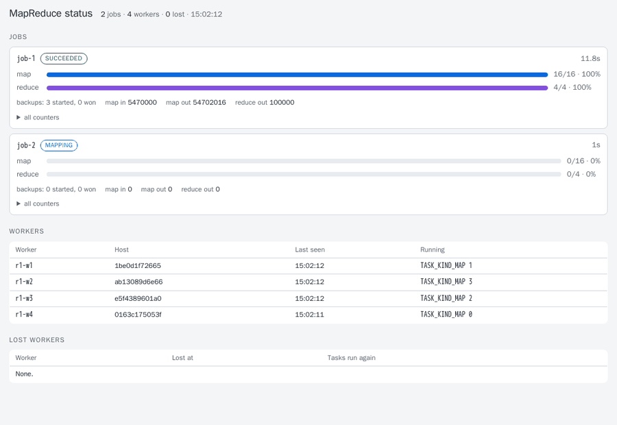

# MapReduce-Reloaded

[](https://dl.circleci.com/status-badge/redirect/gh/Exios66/MapReduce-Reloaded/tree/main)


A from-scratch re-implementation of Google's MapReduce, as described in
Dean & Ghemawat, [*MapReduce: Simplified Data Processing on Large Clusters*](https://research.google.com/archive/mapreduce-osdi04.pdf)
(OSDI 2004), extended for modern infrastructure: object storage, compression,
containers, gRPC, observability, and multi-language user code.

- **Go** is the primary implementation: the coordinator, the workers and the
  `mr` command, and the only one that runs on a cluster.
- **Python** is the reference implementation of the API, the file format and
  local mode, without compression. For the same uncompressed job, both
  languages produce the same bytes.

## Status

Phases 0 to 4 are done, with S3 storage and compression from Phase 6. The
Go coordinator and workers run jobs over gRPC with every paper feature
F1–F23 (see the [paper mapping](docs/paper-mapping.md)), and survive worker
crashes, coordinator restarts, slow machines and bad input records. The
chaos test passes 50 seeded runs.

The host client with uploads to a shared `/data` mount, user job files
submitted with each job, the benchmark harness and the evaluation of the
special features (E0–E5, [below](#results)) are done (see [the course deliverables](docs/roadmap.md#course-deliverables-honors-project-1)
and [design](design.md#key-decisions)). Python workers and Go↔Python interoperability (Phase 5) and the
rest of Phase 6 are stretch goals. The [roadmap](docs/roadmap.md) has the full
plan, and [the roadmap explained](docs/roadmap-explained.md) walks through it
in plain language.

## Quick start

From a fresh clone to a job's output, with host commands only. The cluster
runs in Docker Compose on one machine: one coordinator and four workers,
each limited to one CPU. The client, `bin/mr`, runs on the host, outside
every container. Run every command from the repository root.

### What to install

| What | Why | On the course VM |
|---|---|---|
| Docker Engine with the Compose plugin, and your user in the `docker` group | runs the cluster | already there |
| GNU `make` | the build and run targets | `sudo apt-get install -y make` |
| Python 3.11+ | `make upload-example` generates a web log with it | already there (3.12) |
| Go 1.26+ (optional) | builds `bin/mr`; without it, `make mr` builds it in Docker | `scripts/vm-setup.sh --install` |

The cluster needs 4 CPUs, about 3.3 GB of memory (3.7 GB with the S3 store) and a few GB of disk.
[Cluster VM](docs/cluster-vm.md) has the budgets and the setup for the
course VM, and the [runbook](docs/runbook.md) goes from SSH to a full demo.

### 1. Build and start

```sh
git clone https://github.com/Exios66/MapReduce-Reloaded.git
cd MapReduce-Reloaded
make cluster-up       # create data/, build the image, start the coordinator and 4 workers
make mr               # build the client into bin/mr
```

### 2. Upload the example data

Shared storage is the directory `data/`, which every container sees at
`/data` ([ADR 0016](docs/design/0016-shared-storage-and-host-client.md)).
`bin/mr upload` copies files into it; you name the destination by the path
the containers see, and the same path goes in the job.

```sh
make upload-example   # the corpus (4 books) to /data/input/corpus, a 10 MB web log to /data/input/weblog
bin/mr upload ~/my-logs /data/input/logs      # your own files, directories or quoted globs
```

### 3. Write a job

A job is one Go file, `package job`, with a `Map` and a `Reduce`
function ([ADR 0015](docs/design/0015-user-job-files.md)). The client reads
it and sends it with the job, and every worker interprets it, so there is
nothing to compile or upload. [`examples/wordcount.go`](examples/wordcount.go)
is a complete one that works with the example data:

```go
package job

import (
	"strconv"

	"mapreduce/api"
)

// Map is called once per input line: key is the line's byte offset, value the line.
func Map(ctx api.Context, key, value []byte, out api.Emitter) error {
	one := []byte("1")
	for _, w := range api.Words(value) {
		if err := out.Emit(w, one); err != nil {
			return err
		}
	}
	return nil
}

// Reduce is called once per key, with every value emitted for it.
func Reduce(ctx api.Context, key []byte, values func(yield func([]byte) bool), out api.Emitter) error {
	var n int64
	values(func(v []byte) bool {
		x, _ := strconv.ParseInt(string(v), 10, 64)
		n += x
		return true
	})
	return out.Emit(key, strconv.AppendInt(nil, n, 10))
}

// Combine is optional: it runs on each map task's output before the shuffle.
// api.Sum does what Reduce does, in compiled code.
var Combine = api.Sum
```

`Map` and `Reduce` emit keys and values as bytes. Only the standard library
and `mapreduce/api` can be imported. The job file is interpreted, so work done
for every byte or every value is best left to compiled code: the standard
library, `api.Words` (split a line on ASCII whitespace) and `api.Sum` (total
base-10 counts, as a `Reduce` or `Combine`). Splitting lines with a function
of your own instead makes word count's map 6× slower. `ctx.Param("name")` reads a
`-param name=value` given at submission.

### 4. Submit it

```sh
bin/mr submit -m 8 -r 4 -wait examples/wordcount.go /data/out/wc '/data/input/corpus/*.txt'
```

```
mr: 8 map tasks (-m 8)
job-1   SUCCEEDED
map     8/8
reduce  4/4
...
```

`mr submit [flags] <job file> <output dir> <inputs…>`:

| Argument or flag | Meaning |
|---|---|
| `<job file>` | A `.go` job file, or the name of a built-in program (`wordcount`, `grep`, `urlfreq`, …; see [Example programs](#example-programs)) |
| `<output dir>` | Where the output goes in shared storage, such as `/data/out/wc`. It must not already hold output |
| `<inputs…>` | Input files or globs in shared storage. Quote globs, so the coordinator expands them as the containers see them |
| `-m M` | The number of map tasks. The input is cut into M splits, shared among the non-empty files by size. Each such file gets at least one, so with more files than M there is one task per file; a file too small to cut that many ways, or a `kv` file, gets fewer. `mr submit` prints the M that resulted. Default: one per 64 MiB |
| `-r R` | The number of reduce tasks, and of output files. Default: 2 per worker |
| `-wait` | Wait for the job to end and print its status and counters. Without it, `mr submit` prints the job's id |
| `-combiner=false` | Do not run the job's `Combine` |
| `-param name=value` | A parameter for the job's code; may be repeated |

`bin/mr status job-1` prints a job's state, progress, backup tasks and
counters at any time. While a job runs, the status page is at
<http://127.0.0.1:18780/>.

<picture>
  <source srcset="docs/assets/status-chaos-dark.gif" media="(prefers-color-scheme: dark)">
  
</picture>

<sub>The status page during a seeded chaos run, in the reader's light or dark color scheme. It refreshes every two seconds and shows each job's map and reduce progress with a percentage, backup attempts, key counters, and every worker's running tasks.</sub>

### 5. Read the output

Reduce task r writes `part-r-0000r` in the output directory, one
`key<TAB>value` line per key, sorted by key within each file. `bin/mr cat`
prints them in order; they are also plain files under `data/out/`.

```sh
bin/mr cat /data/out/wc | sort -t$'\t' -k2 -nr | head -3      # the most frequent words
bin/mr submit -m 6 -wait urlfreq /data/out/urls /data/input/weblog/access.log
bin/mr cat /data/out/urls | sort -t$'\t' -k2 -nr | head -3    # the most requested pages
rm -r data/out/wc data/out/urls                               # output is yours to delete
make cluster-down                                             # remove the containers; data/ stays
```

`make e2e` checks the cluster end to end: it submits word count with
`bin/mr` and compares the output with the golden files byte for byte.
`make monitoring-up` adds Prometheus (`127.0.0.1:19090`) and a Grafana
dashboard (`127.0.0.1:13000`), and `make e2e-s3` runs the same job with its
input and output in an S3-compatible store.

[`examples/demo.ipynb`](examples/demo.ipynb) runs this whole sequence in
Jupyter: upload, submit, read, plot, a second program, the metrics, and a
local-mode check.

### Run a job on one machine, without Docker

Local mode runs every task in one process (§4.7). It is the oracle that
cluster runs are checked against, and it needs only Go.

```sh
cd go
go run ./cmd/mr run -local -m 3 -r 4 ../examples/wordcount.go /tmp/wc '../testdata/corpus/*.txt'
head -3 /tmp/wc/part-r-00000
```

The Python implementation gives the same files for built-in programs:

```sh
cd python
pip install -e .
python3 -m mapreduce_reloaded run --local -m 3 -r 4 wordcount /tmp/wc-py '../testdata/corpus/*.txt'
diff -r /tmp/wc /tmp/wc-py && echo identical
```

## How a job runs

```
                 mr submit
                     │  SubmitJob
                     ▼
              ┌─────────────┐   heartbeats, RequestTask, ReportTask
              │ coordinator │◄─────────────────────────────┐
              └─────────────┘                              │
      task table · worker registry · write-ahead log       │
      status page · /metrics                               │
                     │ tasks, handed out on request        │
        ┌────────────┼────────────┐                        │
        ▼            ▼            ▼                        │
    ┌────────┐   ┌────────┐   ┌────────┐                   │
    │ worker │   │ worker │   │ worker │ ──────────────────┘
    └────────┘   └────────┘   └────────┘
     map task: read a split, map, combine, sort, spill one
               sorted file for each reduce task
        ▲   FetchPartition: reduce tasks pull map output
        └────────────────────────────────────────────┐
     reduce task: fetch, merge, group, reduce, write part-r-NNNNN
```

The coordinator splits the input into map tasks and hands tasks to workers
that ask for them. Map output stays on the worker that made it, and reduce
tasks fetch it from there. The coordinator logs every decision before it
replies, so a restarted coordinator resumes the job. [Design](design.md)
follows one job from submission to completion, with sequence diagrams and a
list of where this system differs from the paper and why.

## Example programs

Every program the paper names is registered under a name that `mr` takes.

| Program | Paper | Input | Output |
|---|---|---|---|
| `wordcount` | §2 | Any text | Each word and its count |
| `grep` | §2.3 | Any text; `-param pattern=STRING` | Each line that contains the string |
| `invertedindex` | §2.3 | Any text | Each word and the files it occurs in |
| `urlfreq` | §2.3 | A web log in the Common Log Format | Each URL and its request count |
| `reverselinks` | §2.3 | `source<TAB>target` links | Each target and the pages that link to it |
| `termvector` | §2.3 | `url<TAB>text` documents; `-param min=N` | Each host and its term vector |
| `distsort` | §5.3 | Any text | All lines in byte order, across all output files |

Their code is in [`go/examples/`](go/examples/) and
[`python/mapreduce_reloaded/examples/`](python/mapreduce_reloaded/examples/).
Programs written in Go register themselves with the `api` package; see
[the programming API](docs/explainers/07-programming-api.md).

## The `mr` command

```
mr run -local [job flags] <program | job.go> <output-dir> <inputs>
mr submit [-coordinator addr] [-max-skipped N] [-wait] [job flags] <program | job.go> <output-dir> <inputs>
mr status [-coordinator addr] <job-id>
mr upload <local files, dirs or globs...> </data/dir>
mr cat </data/output-dir>

job flags:
  -m M (exact number of map tasks)  -r R  -param name=value (repeatable)
  -input-format text|kv  -output-format text|kv
  -intermediate-codec none|zstd|snappy  -output-codec none|zstd|snappy
  -combiner=false (run without the program's combiner)
```

Inputs are files or glob patterns, or `s3://` URIs on a cluster with an
object store. `mr status` and `mr submit -wait` print the job's state, its
progress, its backup attempts, its duration and its counters. `mr upload`
and `mr cat` resolve `/data/...` to `$MR_DATA_DIR` (default `./data`).

## Results

Measured on the course VM (4 vCPUs, 8 GB, four one-CPU workers) on 1 GiB
inputs with M = 32 and R = 4; each number is the median of three runs, and
every run's output matched the normal run's. The tables, the raw CSVs, the
logs and the commands are in [`bench/README.md`](bench/README.md#evaluation-e0e6)
and [`bench/evaluation/`](bench/evaluation/).

| Experiment | Result |
|---|---|
| E0: scaling over workers | Word count runs 3.8× faster on 4 workers than on 1, distributed sort 2.9×, grep 2.3× |
| E1: the combiner | Shuffles 15× to 78× fewer bytes and saves 18–44% of the job time, more as the keys get more skewed |
| E2: backup tasks | With one worker slowed to 0.2 CPU, backups bring the job from 17.6 s down to 11.2 s; with none slowed, they cost nothing measurable |
| E3: losing a worker | Every job finishes with the right output; the cost is the 10 s failure timeout plus the lost work (+9 s to +27 s) |
| E4: a coordinator restart | Recovery from the write-ahead log costs 1.6 s (13%) and keeps every finished task |
| E5: an interpreted job file | Word count as a job file takes 91 s against 38 s compiled (2.4×) with the compiled helpers `api.Words` and `api.Sum`, and 399 s (10.5×) without them |

<picture>
  <source media="(prefers-color-scheme: dark)" srcset="bench/evaluation/E0-dark.png">
  
</picture>

<picture>
  <source media="(prefers-color-scheme: dark)" srcset="bench/evaluation/E1-dark.png">
  
</picture>

<picture>
  <source media="(prefers-color-scheme: dark)" srcset="bench/evaluation/E2-dark.png">
  
</picture>

<picture>
  <source media="(prefers-color-scheme: dark)" srcset="bench/evaluation/E3-dark.png">
  
</picture>

<picture>
  <source media="(prefers-color-scheme: dark)" srcset="bench/evaluation/E4-dark.png">
  
</picture>

<picture>
  <source media="(prefers-color-scheme: dark)" srcset="bench/evaluation/E5-dark.png">
  
</picture>

## Benchmarks

`make bench SCENARIO=grep` (also `sort` and `zipf`) runs one of the paper's
benchmarks on the Compose cluster, and writes the input, shuffle and output
rates over time, the job's counters, and the machine it ran on to
`bench/results/`. `make bench-codecs` compares the compression codecs. See
[`bench/README.md`](bench/README.md).

## Repository layout

```
proto/     gRPC/protobuf contract shared by Go and Python
go/        Go implementation: coordinator, worker, mr, example programs
python/    Python reference implementation: API, file format, local mode
deploy/    Dockerfile, Compose cluster, Prometheus and Grafana
bench/     data generators and benchmark harness
scripts/   code generation, the end-to-end test, test-data generators
testdata/  test corpus, golden files and format vectors
docs/      design, roadmap, paper mapping, file format, ADRs, explainers
```

Each of these has its own README.

## Development

Requirements: Go 1.26+, Python 3.11+, `golangci-lint` v2 (built with Go 1.26+).
`shellcheck` is optional: `make lint` runs it on the shell scripts if it is
installed, and skips it with a message if not.

```sh
pip install -e "python[dev]"   # install the Python package + dev tools
make tools                     # install pinned code generators into .tools/bin
make hooks                     # once per clone: run `make check` before every push
make check                     # all linters and tests (the project's quality gate)
make fmt                       # auto-format both languages
make proto                     # regenerate code after editing proto/
```

`make` runs Python as `python3`. To use another interpreter, e.g. a
virtualenv's `python`, pass `PYTHON=...` (`make check PYTHON=python`).

`make check` is the gate: it checks the generated code, runs the linters,
and runs every test, including a short chaos run that kills workers and
restarts the coordinator during jobs. The pre-push hook runs it before every
push, and CI runs the same targets on every pull request in four jobs
(`proto`, `go`, `python-3.11`, `python-3.13`). Work reaches `main` only
through pull requests. CI runs on CircleCI's Free plan; the configuration is
in `.circleci/config.yml`, and the owner connects the service, so see
[CI](docs/ci.md) for the setup, the required checks and the Free-plan limits.
The GitHub Actions workflow is disabled and kept for a run by hand, and
`make ci-report` posts the result as a commit status when no hosted service
is available. See
[ADR 0002](docs/design/0002-local-quality-gate.md) and
[ADR 0014](docs/design/0014-ci-on-pull-requests.md).

## Documentation

[`docs/README.md`](docs/README.md) is the index. In short:

- [Final report](docs/report.md): what was built, how it compares with
  the paper, the demo, and what was learned.
- [Design](design.md): one job from submission to completion, and the
  differences from the paper.
- [Paper mapping](docs/paper-mapping.md): each feature of the paper, where it
  is, and how it is tested.
- [Design records](docs/design/): short ADRs for the key decisions.
- [Explainers](docs/explainers/): one page for each component, written to
  answer a reviewer's questions.
- [File format](docs/file-format.md): the MRKV intermediate and output file
  format, and the partition hash.
