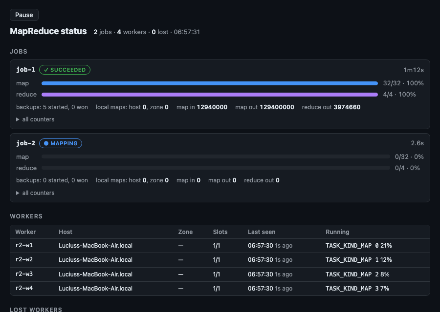
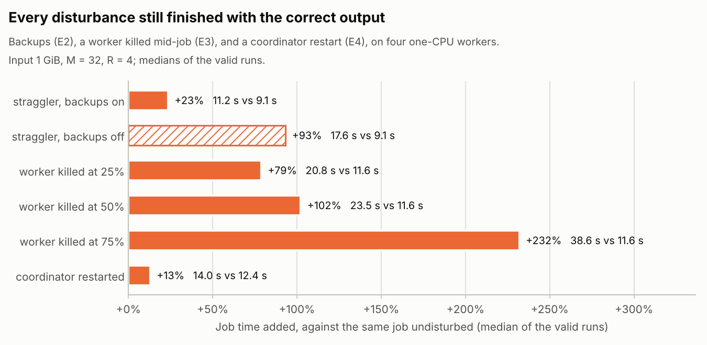
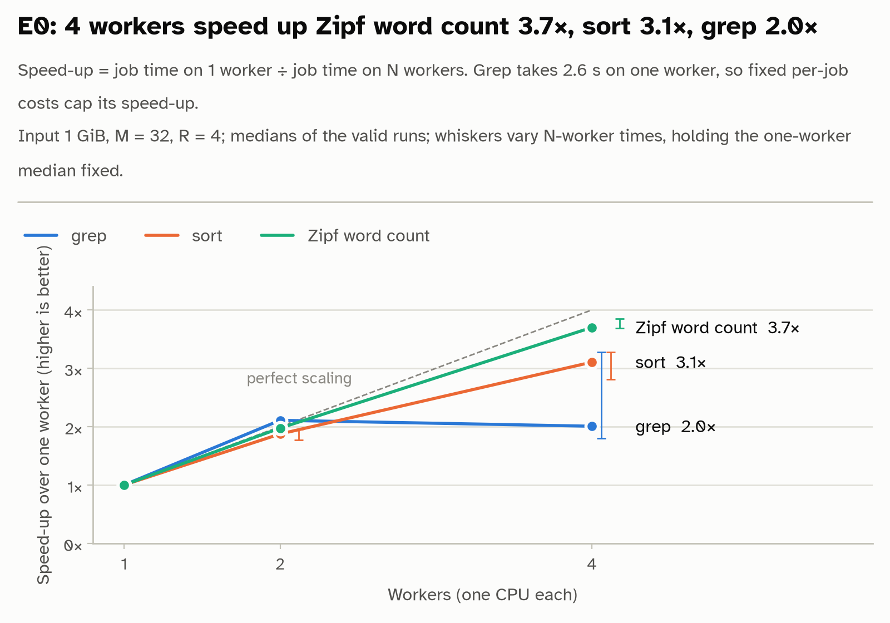
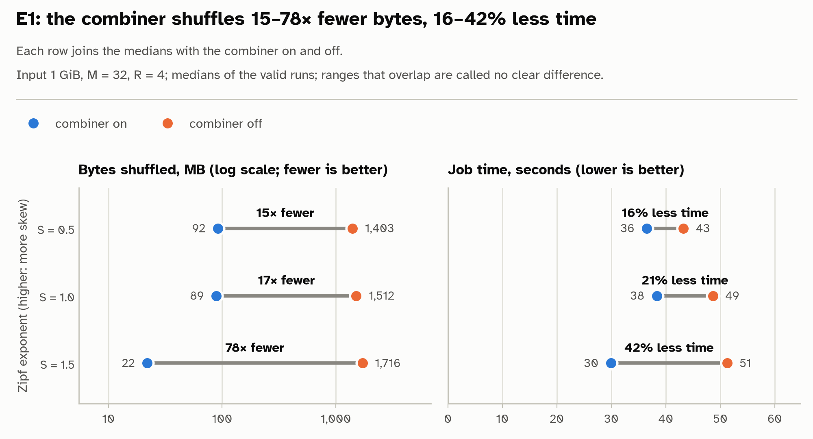
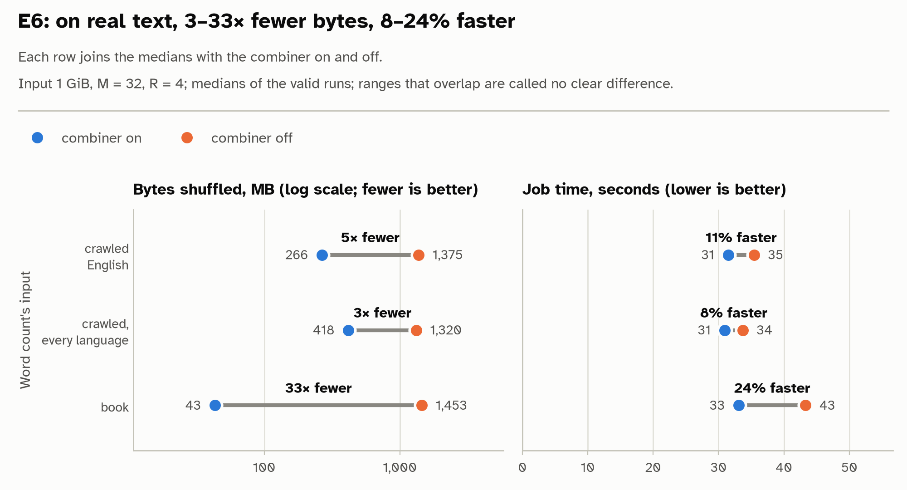
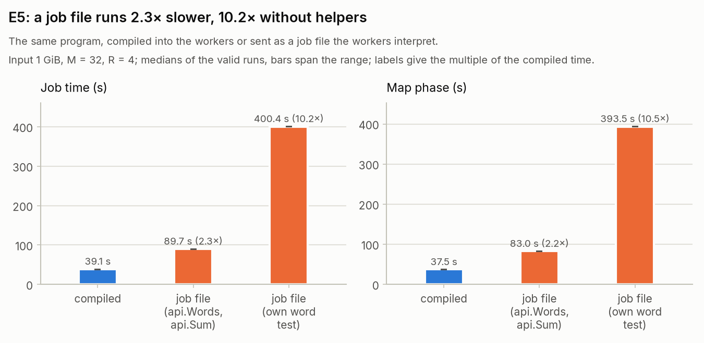
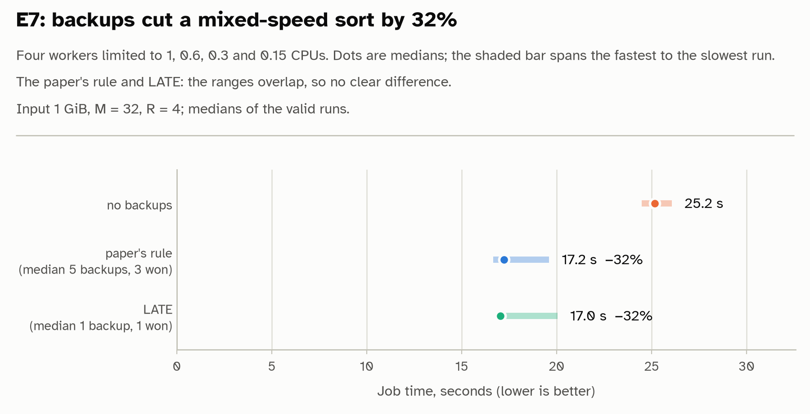

# MapReduce-Reloaded

[](https://dl.circleci.com/status-badge/redirect/circleci/G3QnJG4kdzGF2XeRsnRapm/SfxKxSQXX24QadG7WkAKAa/tree/main)


A from-scratch re-implementation of Google's MapReduce, as described in
Dean & Ghemawat, [*MapReduce: Simplified Data Processing on Large Clusters*](https://research.google.com/archive/mapreduce-osdi04.pdf)
(OSDI 2004), extended for modern infrastructure: object storage, compression,
containers, gRPC, observability and user job files. Go runs the cluster;
Python is the reference implementation of the API, the file format and local
mode and a coordinator server, and gives the same bytes for the same uncompressed job.

## Quick start

Needs Docker with Compose, GNU `make`, and Python 3.11+ (for the example
data). Go is optional: `make mr` builds the client in Docker without it.
The cluster needs 4 vCPUs, about 3.3 GB of memory and a few GB of disk;
[Cluster VM](docs/cluster-vm.md) has the budgets and the setup.

```sh
git clone https://github.com/Exios66/MapReduce-Reloaded.git
cd MapReduce-Reloaded
make cluster-up            # build the image; start the coordinator and 4 workers
make mr                    # build the host client into bin/mr
make upload-example        # the 4-book corpus and a 10 MB web log
bin/mr submit -m 8 -r 4 -wait examples/wordcount.go /data/out/wc '/data/input/corpus/*.txt'
bin/mr cat /data/out/wc | sort -t$'\t' -k2 -nr | head -5
```

With `-m` set, `mr submit` prints the map task count to stderr; `-wait` then prints the job's status and counters. The first lines are:

```text
mr: 8 map tasks (-m 8)
job-1   SUCCEEDED
map     8/8
reduce  4/4
```

While a job runs, <http://127.0.0.1:18780/> shows the same status, the
workers and their running tasks; `bin/mr status <id>` prints it again.
`make e2e` runs the whole job and compares the output with the golden files;
`make monitoring-up` adds Prometheus and Grafana; `make cluster-down`
removes the containers and keeps `data/`.

<picture>
  <source srcset="docs/assets/status-wordcount-1g-dark.gif" media="(prefers-color-scheme: dark)">
  
</picture>

<sub>The status page during one whole 1 GiB word count, M = 32, R = 4, in the reader's light or dark color scheme, from its first map task to the final state (job complete, counters, workers idle), which holds at the loop's end. The page refreshes every two seconds and the recording kept its own refresh frames. It shows each job's map and reduce progress with a percentage, backup attempts, key counters, and every worker's running tasks; consecutive frames are 9 seconds of real time apart, and the page's duration clock is the job's elapsed time. `docs/assets/status-wordcount-1g-provenance.json` records the commit, machine, job and capture settings.</sub>

## Capabilities

| Area | What is implemented |
|---|---|
| Paper model | Map, reduce, combiner, partitioning, ordering, counters, side outputs, local mode — F1–F23, each with its test in the [paper mapping](docs/paper-mapping.md) |
| Fault tolerance | Worker loss (tasks re-run elsewhere), coordinator crash (write-ahead log replay), backup tasks for stragglers, bad-record skipping, disk-full pause |
| Storage | The host's shared `data/` directory, or an S3-compatible store; commit-on-object-storage |
| Data | Text and key/value formats; zstd and Snappy for intermediate and output data |
| Jobs | A job is one Go file the workers interpret; nothing to compile or upload |
| Operations | Status page, Prometheus metrics, Grafana dashboard, chaos test with seeded worker kills and coordinator crashes |
| Languages | Go cluster; Python reference implementation and a coordinator tested with Go workers; the same bytes for the same uncompressed job |

Phases 0–4 and 7, and the first part of Phase 6 (#41, #42 and LATE speculation, #284), are done; Python workers and full Go↔Python
interoperability (Phase 5) are stretch goals — the Python-coordinator/Go-worker
combination is already tested (`make py-e2e`). See the [roadmap](docs/roadmap.md)
and the [final report](docs/report.md).

## Results

The paper's experiments, rerun on the course VM (4 vCPUs, four one-CPU
workers) on 1 GiB inputs with M = 32 and R = 4, at commit `8f0ddb9` (E0 at
`3a907de`, which adds only input isolation); each
number is the median of five runs, the settings taking turns within each
repeat, and every run's output matched the normal run's.

| Experiment | Result |
|---|---|
| E0: scaling over workers | Word count runs 3.7× faster on 4 workers than on 1, distributed sort 3.1×, grep 2.0× |
| E1: the combiner | 15× to 78× fewer bytes shuffled, 16–42% less job time, more as the keys get more skewed |
| E2: backup tasks | With one worker at 0.2 CPU, backups cut 17.9 s to 11.4 s; with no straggler they cost nothing measurable |
| E3: losing a worker | Every job finishes with the undisturbed run's output; the cost is the 10 s timeout, partly overlapped by the other workers, plus the lost work (+8 s to +26 s) |
| E4: a coordinator restart | Recovery from the log costs 1.2 s (15%) and keeps every finished task |
| E5: an interpreted job file | 2.3× slower than compiled with the helpers `api.Words`/`api.Sum`, 10.2× without them |
| E6: the combiner on real text | 5.2× fewer bytes and 11% faster on crawled English, 3.2×/8% in every language, 33×/24% on the book (a best case) |
| E7: the paper's backups against LATE | On four workers of mixed speeds, either rule cuts a sort by 32% (25.2 s to about 17 s); LATE needs fewer backups (1 against 5), and the two times overlap |

<picture>
  <source media="(prefers-color-scheme: dark)" srcset="bench/evaluation/faults-dark.png">
  
</picture>

<picture>
  <source media="(prefers-color-scheme: dark)" srcset="bench/evaluation/E0-dark.png">
  
</picture>

<picture>
  <source media="(prefers-color-scheme: dark)" srcset="bench/evaluation/E1-dark.png">
  
</picture>

<picture>
  <source media="(prefers-color-scheme: dark)" srcset="bench/evaluation/E6-dark.png">
  
</picture>

<picture>
  <source media="(prefers-color-scheme: dark)" srcset="bench/evaluation/E5-dark.png">
  
</picture>

<picture>
  <source media="(prefers-color-scheme: dark)" srcset="bench/evaluation/E7-dark.png">
  
</picture>

In every plot, blue is the system as it ships and orange the changed or
disturbed setting. E1 and E6 are dumbbells: each row joins the combiner-on
and combiner-off medians, and bytes use a log axis, so a row's length is
the factor the combiner saves. The other plots (E2–E4), the raw CSVs, the
machine and the commands are in
[`bench/README.md`](bench/README.md#evaluation-e0e7).

## How a job runs

```text
                 mr submit
                     │  SubmitJob
                     ▼
              ┌─────────────┐   heartbeats, RequestTask, ReportTask
              │ coordinator │◄─────────────────────────────┐
              └─────────────┘                              │
      task table · worker registry · write-ahead log       │
      status page · /metrics                               │
                     │ tasks, handed out on request        │
        ┌────────────┼────────────┐                        │
        ▼            ▼            ▼                        │
    ┌────────┐   ┌────────┐   ┌────────┐                   │
    │ worker │   │ worker │   │ worker │ ──────────────────┘
    └────────┘   └────────┘   └────────┘
     map task: read a split, map, combine, sort, spill one
               sorted file for each reduce task
        ▲   FetchPartition: reduce tasks pull map output
        └────────────────────────────────────────────┐
     reduce task: fetch, merge, group, reduce, write part-r-NNNNN
```

The coordinator splits the input and hands tasks to workers that ask for
them; map output stays on the worker that made it, and reducers fetch it
from there. With `-data-dir` (as the Compose cluster sets it) every decision
is logged before the reply, so a restarted coordinator resumes the job.
[Design](design.md) follows one job end to end.

## The `mr` command

```text
mr run -local [job flags] <program | job.go> <output-dir> <inputs>
mr submit [-coordinator addr] [-max-skipped N] [-wait] [job flags] <program | job.go> <output-dir> <inputs>
mr status [-coordinator addr] <job-id>
mr upload <local files, dirs or globs...> </data/dir>
mr cat </data/output-dir>
```

| Flag | Meaning |
|---|---|
| `-m M` | The number of map tasks to ask for. The input is cut into M splits by size, but each non-empty file gets at least one (more files than M means one task per file), and a file too small to split that finely gets fewer; `mr submit` prints the resulting count. Default: one per 64 MiB |
| `-r R` | Number of reduce tasks and output files. Default: 2 per worker |
| `-wait` | Wait for the job and print its status and counters |
| `-combiner=false` | Do not run the job's `Combine` |
| `-param name=value` | A parameter for the job's code; repeatable |

Inputs are files or quoted globs, or `s3://` URIs on a cluster with an
object store. `-input-format text|kv`, `-output-format text|kv` and
`-intermediate-codec`/`-output-codec none|zstd|snappy` choose formats and
compression. `mr upload` and `mr cat` resolve `/data/...` to `$MR_DATA_DIR`
(default `./data`). A job file is one Go file, `package job`, with `Map` and
`Reduce` functions; only the standard library and `mapreduce/api` can be
imported. [`examples/wordcount.go`](examples/wordcount.go) is a complete one.

## Example programs

| Program | Paper | Input | Output |
|---|---|---|---|
| `wordcount` | §2 | Any text | Each word and its count |
| `grep` | §2.3 | Any text; `-param pattern=STRING` | Each line that contains the string |
| `invertedindex` | §2.3 | Any text | Each word and the files it occurs in |
| `urlfreq` | §2.3 | A web log in the Common Log Format | Each URL and its request count |
| `reverselinks` | §2.3 | `source<TAB>target` links | Each target and the pages that link to it |
| `termvector` | §2.3 | `url<TAB>text` documents; `-param min=N` | Each host and its term vector |
| `distsort` | §5.3 | Any text | All lines in byte order, across all output files |

## Benchmarks

`make bench SCENARIO=grep` (also `sort`, `zipf` and `book`, which needs `scripts/fetch-data.sh warpeace` first) runs one of the paper's
benchmarks and writes the input, shuffle and output rates over time, the
counters and the machine to `bench/results/`. `make bench-codecs` compares
the compression codecs; `make soak` runs 1 GiB with the combiner off on two
workers limited to 256 MB, which must finish with no OOM kill; `make perf`
compares the Go benchmarks with the baseline. See
[`bench/README.md`](bench/README.md).

## Local mode

Local mode runs every task in one process (§4.7); it is the oracle that
cluster runs are checked against.

```sh
cd go
go run ./cmd/mr run -local -m 3 -r 4 ../examples/wordcount.go /tmp/wc '../testdata/corpus/*.txt'
head -3 /tmp/wc/part-r-00000

cd ../python
pip install -e .
python3 -m mapreduce_reloaded run --local -m 3 -r 4 wordcount /tmp/wc-py '../testdata/corpus/*.txt'
diff -r /tmp/wc /tmp/wc-py && echo identical
```

## Repository layout

```text
proto/     gRPC/protobuf contract shared by Go and Python
go/        Go implementation: coordinator, worker, mr, example programs
python/    Python reference implementation: API, file format, local mode, coordinator
deploy/    Dockerfile, Compose cluster, Prometheus and Grafana
bench/     data generators, benchmark harness and the evaluation
scripts/   code generation, the end-to-end test, test-data generators
testdata/  test corpus, golden files and format vectors
docs/      design, roadmap, paper mapping, file format, ADRs, explainers
```

## Development

```sh
make venv                      # python/.venv with the package and dev tools; make uses it automatically
make tools                     # pinned code generators into .tools/bin
make hooks                     # once per clone: run `make check` before every push
make check                     # all linters and tests (the quality gate)
make fmt                       # auto-format both languages
make proto                     # regenerate code after editing proto/
```

`make check` checks the generated code, runs the linters and every test,
including a short chaos run that kills workers and restarts the coordinator.
CI runs the same targets in six jobs (`proto`, `go`, `python-3.11`,
`python-3.13`, `lint`, `mapping-coverage`); work reaches `main` only through pull requests. See
[CI](docs/ci.md) and [ADR 0014](docs/design/0014-ci-on-pull-requests.md).
`make` runs Python from `python/.venv` when `make venv` has created it, and as
`python3` otherwise; pass `PYTHON=...` to use another interpreter.

## Documentation

[`docs/README.md`](docs/README.md) is the index. The short list:

- [Reviewing the code](docs/reviewing.md): where to start, where each part
  lives, and how to check each claim.
- [Final report](docs/report.md): what was built, the comparison with the
  paper, the demo and what was learned.
- [Design](design.md) and the [design records](docs/design/): how it works
  and why.
- [Paper mapping](docs/paper-mapping.md): every paper feature, where it is
  and how it is tested.
- [Evaluation](docs/evaluation.md) and [bench/README.md](bench/README.md#evaluation-e0e7):
  the results against the paper's §5.
- [Runbook](docs/runbook.md) and [demo](docs/demo.md): from SSH to a demo.
- [`examples/demo.ipynb`](examples/demo.ipynb): the demo in Jupyter.
- [Changelog](CHANGELOG.md): every release and what changed in it.
- [Security policy](SECURITY.md): the trust model and how to report a
  vulnerability.

## License

[MIT](LICENSE). The texts in [`testdata/corpus/`](testdata/corpus/README.md)
are public-domain works in the United States, and the datasets that `scripts/` fetches keep their
own terms ([data sources](docs/data.md#sources-and-terms)).
