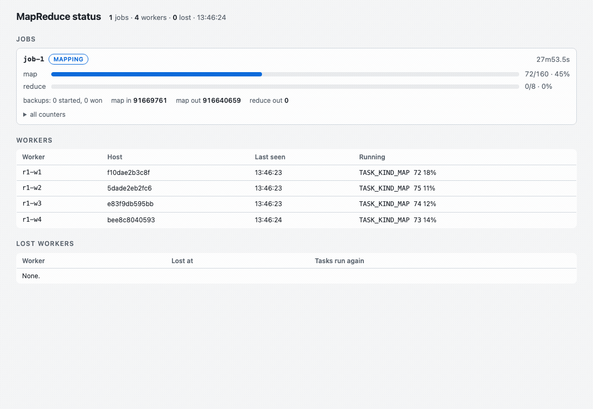
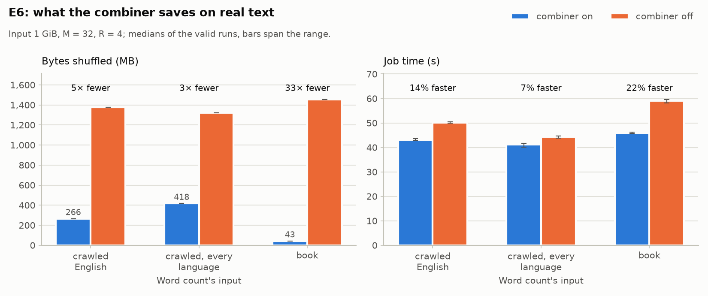
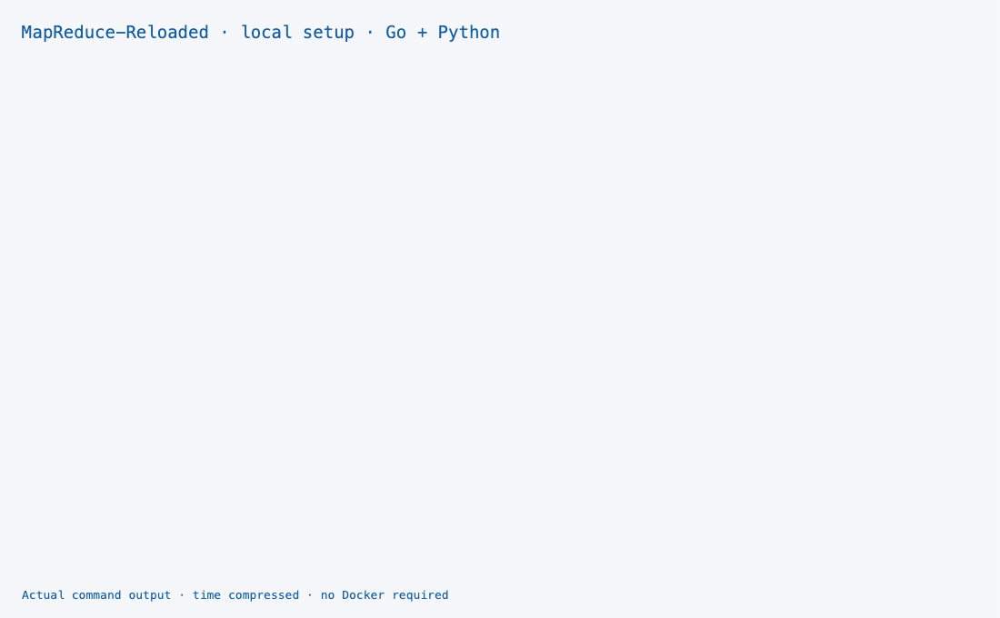

# MapReduce-Reloaded

[](https://dl.circleci.com/status-badge/redirect/circleci/G3QnJG4kdzGF2XeRsnRapm/SfxKxSQXX24QadG7WkAKAa/tree/main)


A from-scratch re-implementation of Google's MapReduce, as described in
Dean & Ghemawat, [*MapReduce: Simplified Data Processing on Large Clusters*](https://research.google.com/archive/mapreduce-osdi04.pdf)
(OSDI 2004), extended for modern infrastructure: object storage, compression,
containers, gRPC, observability and user job files. Go runs the cluster;
Python is the reference implementation of the API, the file format and local
mode and a coordinator server, and gives the same bytes for the same uncompressed job.

[VM quick start](#quick-start) · [Dashboard](#open-the-dashboard) ·
[Local setup + terminal GIF](#local-mode) · [Results](#results) ·
[Development](#development) · [Documentation](#documentation)

## Quick start

Needs a running Docker Engine with Compose v2 or later, GNU `make`, Git, and Python
3.11+ (for the example data). Go is optional: `make mr` builds the client
in Docker without it. **The Docker deployment target is the CS544 Linux VM,
not the laptop.** Connect to the VM first (`ssh cs544` with the course SSH
alias, or `ssh USER@VM`), then run this block there. For a laptop-only run
without Docker, use [Local mode](#local-mode).
The cluster needs 4 vCPUs, about 3.3 GB of memory and a few GB of disk;
[Cluster VM](docs/cluster-vm.md) has the budgets and the setup.

```sh
git clone https://github.com/Exios66/MapReduce-Reloaded.git
cd MapReduce-Reloaded
docker info               # confirm the Docker daemon is ready
docker compose version    # confirm Compose v2 is installed
make cluster-up            # build the image; start the coordinator and 4 workers
make mr                    # build the host client into bin/mr
make upload-example        # the 4-book corpus and a 10 MB web log
bin/mr submit -m 8 -r 4 -wait examples/wordcount.go /data/out/wc '/data/input/corpus/*.txt'
bin/mr cat /data/out/wc | sort -k2,2nr | head -n 5
```

`mr submit` prints the job's id and status:

```text
mr: 8 map tasks (-m 8)
job-1   SUCCEEDED
map     8/8
reduce  4/4
```

While a job runs, <http://127.0.0.1:18780/> shows the same status, the
workers and their running tasks; `bin/mr status <id>` prints it again.
`make e2e` runs the whole job and compares the output with the golden files;
`make monitoring-up` adds Prometheus and Grafana; `make cluster-down`
removes the containers and keeps `data/`.

The output directory must be new: submitting the same `/data/out/wc` again
is rejected rather than overwriting the previous result. Choose another
output name when repeating the example. Run the commands from the repository
root; `mr upload` and `mr cat` use its `data/` directory by default.

### Open the dashboard

Open <http://127.0.0.1:18780/> in a browser while a job runs. No dashboard
installation or external network connection is needed after the cluster is
installed. Current builds have Pause/Resume; an older VM deployment may use
full-page refresh instead. For the VM, run this on your laptop
and keep the SSH session open:

```sh
ssh -N -L 18780:127.0.0.1:18780 cs544
```

Use `USER@VM` instead of `cs544` if you have no course SSH alias, then open
the same localhost URL.
If that local port is occupied, use `-L 18782:127.0.0.1:18780` and open
<http://127.0.0.1:18782/> instead. The coordinator and dashboard are bound
to loopback by default; do not expose them to the public internet.

<picture>
  <source srcset="docs/assets/status-vm-dark.gif" media="(prefers-color-scheme: dark)">
  
</picture>

<sub>A read-only excerpt of the running CS544 campaign, not a complete job or
a performance benchmark. The page's clock shows actual elapsed job time;
the GIF compresses sampling time and holds the last captured frame.
Light and dark variants show the deployed viewer, not the upcoming showcase UI.</sub>

[Dashboard capture provenance](docs/assets/status-vm-provenance.json).

## Capabilities

| Area | What is implemented |
|---|---|
| Paper model | Map, reduce, combiner, partitioning, ordering, counters, side outputs, local mode — F1–F23, each with its test in the [paper mapping](docs/paper-mapping.md) |
| Fault tolerance | Worker loss (tasks re-run elsewhere), coordinator crash (write-ahead log replay), backup tasks for stragglers, bad-record skipping, disk-full pause |
| Storage | The host's shared `data/` directory, or an S3-compatible store; commit-on-object-storage |
| Data | Text and key/value formats; zstd and Snappy for intermediate and output data |
| Jobs | A job is one Go file the workers interpret; nothing to compile or upload |
| Operations | Status page, Prometheus metrics, Grafana dashboard, chaos test with seeded worker kills and coordinator crashes |
| Languages | Go cluster; Python reference implementation and a coordinator tested with Go workers; the same bytes for the same uncompressed job |

Phases 0–4 and the first part of Phase 6 (#41, #42 and LATE speculation, #284) are done; Python workers and full Go↔Python
interoperability (Phase 5) are stretch goals — the Python-coordinator/Go-worker
combination is already tested (`make py-e2e`). See the [roadmap](docs/roadmap.md)
and the [final report](docs/report.md).

## Results

The paper's experiments, rerun on the course VM (4 vCPUs, four one-CPU
workers) on 1 GiB inputs with M = 32 and R = 4; each number is the median of
three runs, and every run's output matched the normal run's.

| Experiment | Result |
|---|---|
| E0: scaling over workers | Word count runs 3.8× faster on 4 workers than on 1, distributed sort 2.9×, grep 2.3× |
| E1: the combiner | 15× to 78× fewer bytes shuffled, 18–44% less job time, more as the keys get more skewed |
| E2: backup tasks | With one worker at 0.2 CPU, backups cut 17.6 s to 11.2 s; with no straggler they cost nothing measurable |
| E3: losing a worker | Every job finishes with the right output; the cost is the 10 s timeout plus the lost work (+9 s to +27 s) |
| E4: a coordinator restart | Recovery from the log costs 1.6 s (13%) and keeps every finished task |
| E5: an interpreted job file | 2.4× slower than compiled with the helpers `api.Words`/`api.Sum`, 10.5× without them |
| E6: the combiner on real text | 5.2× fewer bytes and 14% faster on crawled English, 3.2×/7% in every language, 33×/22% on the book (a best case) |

<picture>
  <source media="(prefers-color-scheme: dark)" srcset="bench/evaluation/E0-dark.png">
  
</picture>

<picture>
  <source media="(prefers-color-scheme: dark)" srcset="bench/evaluation/E1-dark.png">
  
</picture>

<picture>
  <source media="(prefers-color-scheme: dark)" srcset="bench/evaluation/E6-dark.png">
  
</picture>

The other plots (E2–E5), the raw CSVs, the machine and the commands are in
[`bench/README.md`](bench/README.md#evaluation-e0e6).

## How a job runs

```text
                 mr submit
                     │  SubmitJob
                     ▼
              ┌─────────────┐   heartbeats, RequestTask, ReportTask
              │ coordinator │◄─────────────────────────────┐
              └─────────────┘                              │
      task table · worker registry · write-ahead log       │
      status page · /metrics                               │
                     │ tasks, handed out on request        │
        ┌────────────┼────────────┐                        │
        ▼            ▼            ▼                        │
    ┌────────┐   ┌────────┐   ┌────────┐                   │
    │ worker │   │ worker │   │ worker │ ──────────────────┘
    └────────┘   └────────┘   └────────┘
     map task: read a split, map, combine, sort, spill one
               sorted file for each reduce task
        ▲   FetchPartition: reduce tasks pull map output
        └────────────────────────────────────────────┐
     reduce task: fetch, merge, group, reduce, write part-r-NNNNN
```

The coordinator splits the input and hands tasks to workers that ask for
them; map output stays on the worker that made it, and reducers fetch it
from there. With `-data-dir` (as the Compose cluster sets it) every decision
is logged before the reply, so a restarted coordinator resumes the job.
[Design](design.md) follows one job end to end.

## The `mr` command

```text
mr run -local [job flags] <program | job.go> <output-dir> <inputs>
mr submit [-coordinator addr] [-max-skipped N] [-wait] [job flags] <program | job.go> <output-dir> <inputs>
mr status [-coordinator addr] <job-id>
mr upload <local files, dirs or globs...> </data/dir>
mr cat </data/output-dir>
```

| Flag | Meaning |
|---|---|
| `-m M` | The number of map tasks to ask for. The input is cut into M splits by size, but each non-empty file gets at least one (more files than M means one task per file), and a file too small to split that finely gets fewer; `mr submit` prints the resulting count. Default: one per 64 MiB |
| `-r R` | Number of reduce tasks and output files. Default: 2 per worker |
| `-wait` | Wait for the job and print its status and counters |
| `-combiner=false` | Do not run the job's `Combine` |
| `-param name=value` | A parameter for the job's code; repeatable |

Inputs are files or quoted globs, or `s3://` URIs on a cluster with an
object store. `-input-format text|kv`, `-output-format text|kv` and
`-intermediate-codec`/`-output-codec none|zstd|snappy` choose formats and
compression. `mr upload` and `mr cat` resolve `/data/...` to `$MR_DATA_DIR`
(default `./data`). A job file is one Go file, `package job`, with `Map` and
`Reduce` functions; only the standard library and `mapreduce/api` can be
imported. [`examples/wordcount.go`](examples/wordcount.go) is a complete one.

## Example programs

| Program | Paper | Input | Output |
|---|---|---|---|
| `wordcount` | §2 | Any text | Each word and its count |
| `grep` | §2.3 | Any text; `-param pattern=STRING` | Each line that contains the string |
| `invertedindex` | §2.3 | Any text | Each word and the files it occurs in |
| `urlfreq` | §2.3 | A web log in the Common Log Format | Each URL and its request count |
| `reverselinks` | §2.3 | `source<TAB>target` links | Each target and the pages that link to it |
| `termvector` | §2.3 | `url<TAB>text` documents; `-param min=N` | Each host and its term vector |
| `distsort` | §5.3 | Any text | All lines in byte order, across all output files |

## Benchmarks

`make bench SCENARIO=grep` (also `sort` and `zipf`) runs one of the paper's
benchmarks and writes the input, shuffle and output rates over time, the
counters and the machine to `bench/results/`. `make bench-codecs` compares
the compression codecs; `make soak` runs 1 GiB with the combiner off on two
workers limited to 256 MB, which must finish with no OOM kill; `make perf`
compares the Go benchmarks with the baseline. See
[`bench/README.md`](bench/README.md).

## Local mode

Local mode runs every task in one process (§4.7); it is the oracle that
cluster runs are checked against.

Needs Go 1.26+ and Python 3.11+, but no Docker. Run from the repository root.
A virtual environment avoids modifying your system Python; a fresh temporary
directory makes the example safe to repeat without deleting previous output.

```sh
python3 -m venv .venv
. .venv/bin/activate
python -m pip install -e python
make mr
demo_dir=$(mktemp -d)
bin/mr run -local -m 3 -r 4 examples/wordcount.go "$demo_dir/go" 'testdata/corpus/*.txt'
head -n 3 "$demo_dir/go/part-r-00000"
python -m mapreduce_reloaded run --local -m 3 -r 4 wordcount "$demo_dir/python" 'testdata/corpus/*.txt'
diff -r "$demo_dir/go" "$demo_dir/python" && echo identical
```

Both runs must print the same counters and the comparison must print
`identical`. Output stays in `$demo_dir` for inspection. The Go command
interprets the job file; Python runs its matching built-in `wordcount`.

<picture>
  <source srcset="docs/assets/setup-terminal-dark.gif" media="(prefers-color-scheme: dark)">
  
</picture>

<sub>The local-mode commands above, actually executed and rendered as a terminal
animation. Installation and execution time are compressed; the final comparison
is held for readability. This is not a recording of Docker deployment.</sub>

[Setup commands and captured output](docs/assets/setup-terminal-provenance.json).

## Repository layout

```text
proto/     gRPC/protobuf contract shared by Go and Python
go/        Go implementation: coordinator, worker, mr, example programs
python/    Python reference implementation: API, file format, local mode, coordinator
deploy/    Dockerfile, Compose cluster, Prometheus and Grafana
bench/     data generators, benchmark harness and the evaluation
scripts/   code generation, the end-to-end test, test-data generators
testdata/  test corpus, golden files and format vectors
docs/      design, roadmap, paper mapping, file format, ADRs, explainers
```

## Development

Needs Go 1.26+, Python 3.11+, GNU `make`, a C compiler for Go's race detector,
and `shellcheck` on `PATH`. The block below also installs `golangci-lint`
at the version used by the VM setup script.
Use a Linux environment for the full suite: some filesystem and shell tests
require Linux/GNU behavior. From the repository root:

```sh
python3 -m venv .venv
. .venv/bin/activate
python -m pip install -e "python[dev]"  # the Python package and dev tools
go install github.com/golangci/golangci-lint/v2/cmd/golangci-lint@v2.14.0
export PATH="$(go env GOPATH)/bin:$PATH"
make tools                     # pinned code generators into .tools/bin
make hooks                     # once per clone: run `make check` before every push
make check                     # all linters and tests (the quality gate)
make fmt                       # auto-format both languages
make proto                     # regenerate code after editing proto/
```

`make check` checks the generated code, runs the linters and every test,
including a short chaos run that kills workers and restarts the coordinator.
CI runs the same targets in six jobs (`proto`, `go`, `python-3.11`,
`python-3.13`, `lint`, `mapping-coverage`); work reaches `main` only through pull requests. See
[CI](docs/ci.md) and [ADR 0014](docs/design/0014-ci-on-pull-requests.md).
`make` runs Python as `python3`; pass `PYTHON=...` to use another interpreter.
Keep the virtual environment active for `git push`, because the pre-push
hook runs the same `make check`. If pushing from another terminal, use
`PYTHON="$PWD/.venv/bin/python" git push` after installing the dev dependencies
in that clone. Missing `grpc_tools.protoc` means that interpreter has not had
`python[dev]` installed; do not bypass the hook.

### Troubleshooting

| Symptom | What to check |
|---|---|
| Cannot connect to the Docker daemon | Run the cluster commands on the CS544 VM, not the laptop; check `docker info` there |
| `docker: 'compose' is not a docker command` | Install the Compose v2 plugin, then rerun `docker compose version` |
| Connection refused on submit or dashboard | Wait for `make cluster-up` to finish; inspect `docker compose -p mapreduce -f deploy/compose/compose.yaml logs coordinator` |
| Output directory already exists | Choose a new job output directory; do not delete another run's results |
| Python says externally managed environment | Activate `.venv` before installing; do not use `sudo pip` |
| `make check` cannot find `.tools/bin/buf` | Run `make tools` in this clone before the quality gate |

## Documentation

[`docs/README.md`](docs/README.md) is the index. The short list:

- [Final report](docs/report.md): what was built, the comparison with the
  paper, the demo and what was learned.
- [Design](design.md) and the [design records](docs/design/): how it works
  and why.
- [Paper mapping](docs/paper-mapping.md): every paper feature, where it is
  and how it is tested.
- [Evaluation](docs/evaluation.md) and [bench/README.md](bench/README.md#evaluation-e0e6):
  the results against the paper's §5.
- [Runbook](docs/runbook.md) and [demo](docs/demo.md): from SSH to a demo.
- [`examples/demo.ipynb`](examples/demo.ipynb): the demo in Jupyter.
- [Changelog](CHANGELOG.md): every release and what changed in it.
- [Security policy](SECURITY.md): the trust model and how to report a
  vulnerability.

## License

[MIT](LICENSE). The texts in [`testdata/corpus/`](testdata/corpus/README.md)
are public-domain works in the United States, and the datasets that `scripts/` fetches keep their
own terms ([data sources](docs/data.md#sources-and-terms)).
