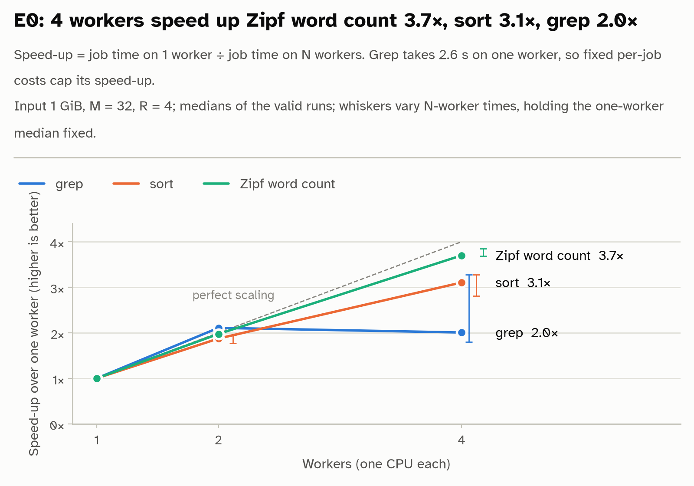
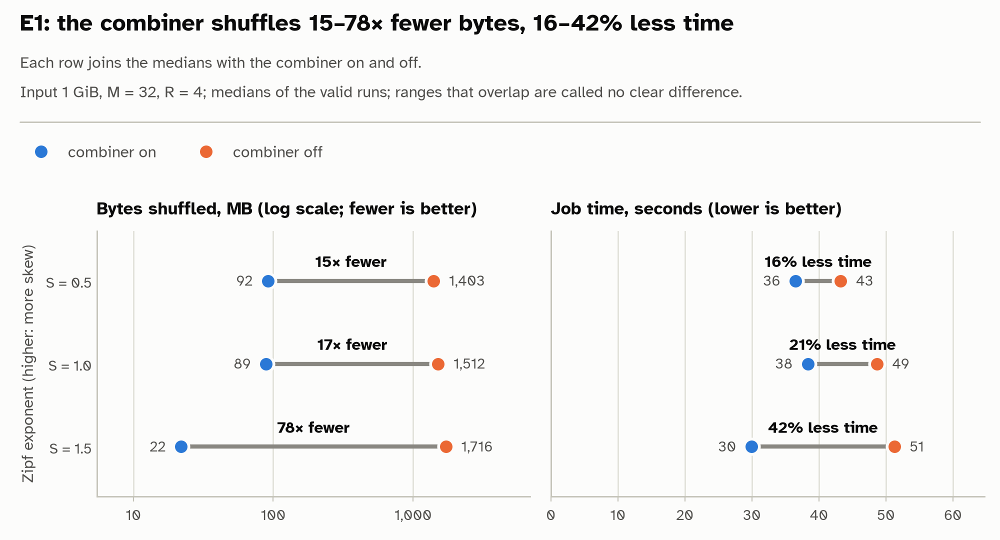
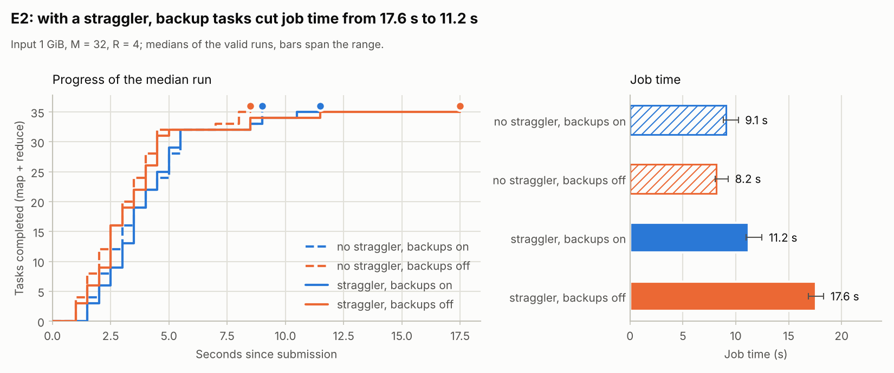
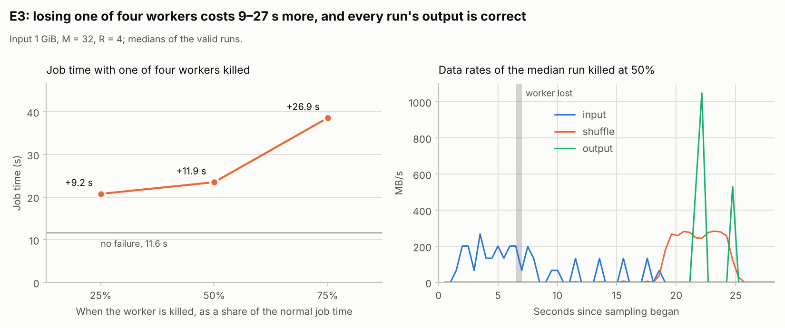
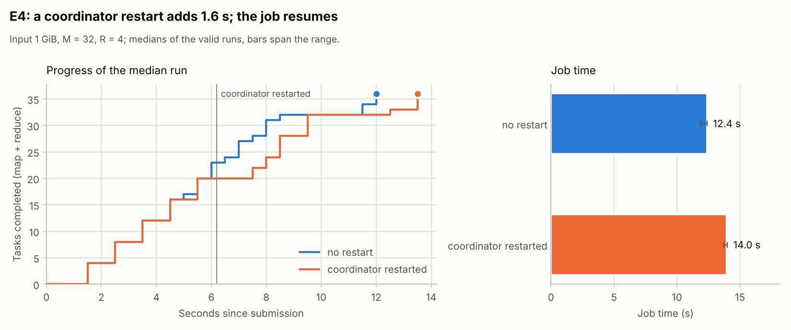
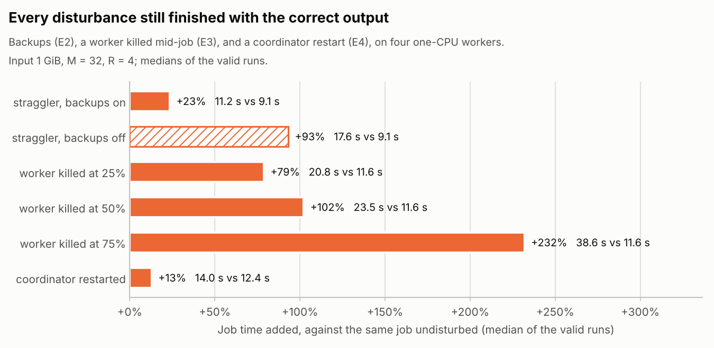
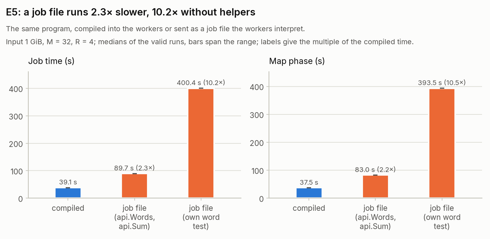
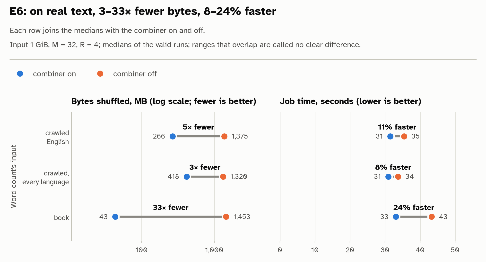
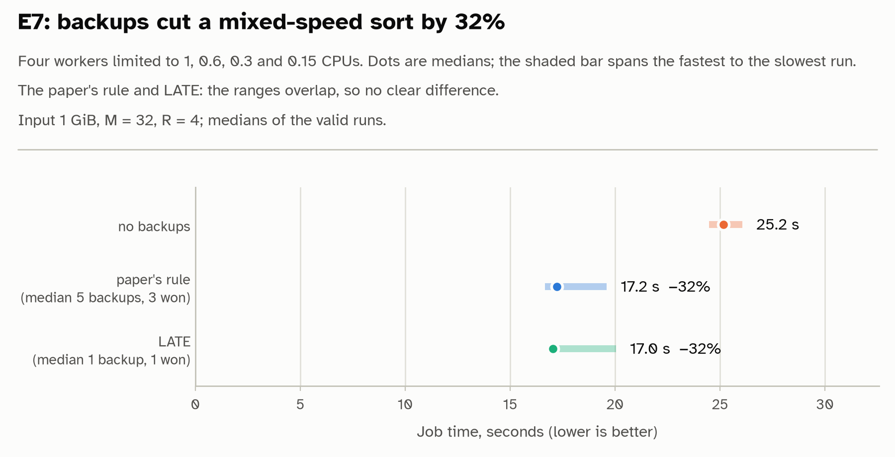

# Benchmarks

Scripts that measure the cluster. Each one runs on the Compose cluster and
writes its raw results to `bench/results/`, which git ignores. The numbers
below are copied from a run, with the machine it ran on. Rule: every results
table names its machine, in the text above it or in its caption.

## Data generators (#57)

Each generator writes reproducible input to stdout from a size in bytes and
an optional seed (42 by default); `gen-crawl.py` takes `SIZE LANG [DIR]`
instead, and no seed. Measured on the machine below, each
writes 64 MB in about a second, except `gen-zipf.py`, which takes about 6 s.

| Script | Records | For |
|---|---|---|
| [`gen-words.py`](gen-words.py) | Lines of 5 to 15 words from the test corpus | Word count, the codec benchmark |
| [`gen-grep.py`](gen-grep.py) | 100-byte records; the pattern `XYZ` is in 92,337 per 10^10 records, as in the paper's grep (§5.2) | `grep` with `-param pattern=XYZ` |
| [`gen-sort.py`](gen-sort.py) | TeraSort-style 100-byte records with random 10-byte keys, as in the paper's sort (§5.3) | `distsort` |
| [`gen-zipf.py`](gen-zipf.py) | Lines of words from a vocabulary of 100,000, with Zipf-distributed frequencies (exponent S, 1 by default) | Word count with a skewed key |
| [`gen-weblog.py`](gen-weblog.py) | Requests in the Common Log Format for 10,000 pages; the page is drawn with probability proportional to 1 / N | `urlfreq` |
| [`gen-book.py`](gen-book.py) | Whole lines of War and Peace, every line once a pass in a new order, to any size; [`scripts/fetch-data.sh`](../scripts/fetch-data.sh) fetches the book. The vocabulary stops at the book's 41,631 words and lines repeat, so it is word count's best case, not real text at scale | Word count, the combiner's best case (E6 `book`) |
| [`gen-crawl.py`](gen-crawl.py) | `gen-crawl.py SIZE LANG [DIR]`. The text of Common Crawl's pages, one page a line, no page repeated, from ten pinned WET files (`scripts/fetch-data.sh crawl`, about 2.9 GB of text); `eng` keeps the pages Common Crawl identifies as English, `all` keeps every language | Word count on real text (E6 `crawl-eng`, and `crawl` in every language) |
| [`gen-links.py`](gen-links.py) | A source page, a tab and a target page, over 100,000 pages; targets are drawn with probability proportional to 1 / N | `reverselinks` |

- `gen-grep.py`: the rest of each record is lowercase letters and digits,
  so the pattern never occurs by chance. grep's output has exactly
  round(records × 92,337 / 10^10) lines, at least one.
- `gen-sort.py`: keys are random bytes, any but newline and carriage
  return, so they spread evenly over the first byte that `distsort`
  partitions on.
- `python/tests/test_bench_gen.py` checks the record sizes, the number of
  matches, the spread of keys and the skew.

## Data rates over a job (#57)

The paper's Figures 2 and 3 plot, against seconds since the job started,
the rate at which map tasks read input, the rate at which data is shuffled
from map to reduce tasks, and the rate at which reduce tasks write output
(§5.3). Two scripts make the same plots from the workers' `/metrics`:

- [`scrape-metrics.py`](scrape-metrics.py) `INTERVAL DURATION URL...`
  fetches each worker's `/metrics` every INTERVAL seconds and writes its byte
  counters to stdout as CSV.
- [`plot-rates.py`](plot-rates.py) `SAMPLES.csv [OUT.png [TITLE]]` sums the counters
  over the workers and differentiates them between samples. It writes the
  input, shuffle and output rates in MB/s as CSV, or, given `OUT.png`, draws
  them in three panels as the paper does, with TITLE (program, size, M, R,
  commit) as an identification line. Drawing needs matplotlib.

Workers count input and output bytes as each task ends, so those two rates
rise in steps of whole tasks. The shuffle is counted as it is fetched.
`python/tests/test_bench_rates.py` tests both scripts against a fake
`/metrics`.

`make bench SCENARIO=grep|sort|zipf|book` runs one benchmark with them on the
Compose cluster, through [`run.sh`](run.sh):

| Scenario | Input | Program |
|---|---|---|
| `grep` | `gen-grep.py` | `grep` for `XYZ` (§5.2) |
| `sort` | `gen-sort.py` | `distsort` (§5.3) |
| `zipf` | `gen-zipf.py` | `wordcount` |
| `book` | `gen-book.py`; run `scripts/fetch-data.sh warpeace` first | `wordcount`, the combiner's best case |

- Settings come from the environment: `WORKERS` (default 4), `SIZE` in
  bytes (default 256 MiB), `M` (16), `R` (4), `SEED` (42) and `INTERVAL`,
  the seconds between samples (0.5).
- The cluster is started or scaled to `WORKERS` workers. The host samples
  each worker's `/metrics` at its container's address, so this needs Docker
  on Linux, where the host can reach the Compose network.
- Each run writes `bench/results/SCENARIO-STAMP/`: `samples.csv`,
  `rates.csv`, `rates.png` (with matplotlib), `status.txt` (from
  `mr submit -wait`) and `result.json`.
- `result.json` records the settings, the job's counters and duration, the
  git commit (and whether the tree had changes), and the machine: CPUs, CPU
  model, memory, kernel and Docker version.
- Seconds in the samples count from just before the job is submitted.

## Codecs (#42)

`make bench-codecs` starts the cluster and runs [`codecs.sh`](codecs.sh):

- Input: 64 MiB of lines of 5 to 15 random words from the test corpus,
  written by [`gen-words.py`](gen-words.py) with a fixed seed.
  - The lines are text-like but don't repeat.
  - Copies of the corpus would make sorted map output far more compressible
    than real data: a first attempt with 100 copies shrank 11 times with
    zstd.
- Jobs: word count, which combines, and `distsort`, which shuffles every
  line.
  - Each job runs with M = 16 and R = 4, three times per intermediate codec.
- Bytes shuffled: every map output file is fetched once by its reduce task,
  so the `map.output.bytes` counter is the bytes shuffled.
- Time: the job's duration as the coordinator measured it, from accepting
  the job to its last reduce task (`seconds` in `mr status`).
  - The CSV also has `wall_seconds`, the time of `mr submit -wait`, which
    adds about a second to start its container.

**Development-machine results — not the course VM.** Results on 2026-10-24: 4 vCPUs (Intel Xeon, 2.1 GHz), 16 GB of memory,
Docker 29.9.1, 4 workers. This was a development machine, not the course
VM, which has 4 vCPUs (Intel Xeon Silver 4516Y+) and 8 GB
([the VM](../docs/cluster-vm.md#the-vm)). Time is the median of three runs, with the range. Each results section in this file identifies its machine; do not compare development-machine numbers with course-VM numbers.

| Job | Codec | Bytes shuffled | vs none | Time (s) |
|---|---|---:|---:|---|
| wordcount | none | 2,071,855 | 1.00 | 2.81 (2.75–2.99) |
| wordcount | zstd | 1,225,752 | 0.59 | 2.93 (2.55–3.02) |
| wordcount | snappy | 1,930,867 | 0.93 | 3.00 (2.80–3.04) |
| distsort | none | 68,353,231 | 1.00 | 2.25 (1.98–2.37) |
| distsort | zstd | 31,892,233 | 0.47 | 2.40 (2.22–2.58) |
| distsort | snappy | 51,049,537 | 0.75 | 2.28 (2.23–2.34) |

<sub>Table: codec results on the development machine (4 vCPUs, Intel Xeon 2.1 GHz, 16 GB), 2026-10-24, not the course VM.</sub>

What the numbers show:

- **Bytes:** compression measurably reduces the bytes shuffled.
  - zstd roughly halves them, and Snappy saves a quarter on `distsort`.
  - Word count's combiner already leaves one record per word and map task,
    so there is less left to compress.
- **Time:** job time does not change beyond run-to-run noise.
  - Every container shares one machine, so the shuffle crosses loopback,
    not a network, and saving bytes saves almost no time.
  - The paper's cluster shuffled over a real network (§5.1), where bytes
    cost time. Measuring that across machines is Phase 7
    work (#56).

## Benchmarks and limits (#160)

The cluster runs above need Docker and a person to read them. These run in
`go test`, on one machine:

- Benchmarks of the external sort (in memory, spilling 10 runs, spilling
  with zstd), the MRKV writer and reader for each codec, the combiner, a
  64 MB shuffle fetch, a local-mode word count, the partition hash and the
  job-file helpers. `make perf` runs them 6 times (`COUNT`), compares the
  median time per op with `bench/baseline.txt`, and fails if one is more
  than 20% slower (`THRESHOLD`). The baseline is from the course VM; on
  another CPU the comparison is printed but cannot fail. After a change
  that is meant to be slower or faster, `PERF_UPDATE=1 make perf` on the VM
  writes a new baseline, to commit with the change. If `benchstat` is
  installed, its table is printed too. Two runs on the VM in a row
  differed by at most 3.6%.
- `TestSortMemoryBounded` (`internal/extsort`) sorts 80 MB with a 4 MB
  budget and checks that the live heap stays under 16 MB while adding and
  while merging the 25 runs; measured 4.2 and 6.0 MB uncompressed, 6.2 and
  9.8 MB with zstd. A sorter that never spills holds the whole input and
  fails it.
- `TestReduceMemoryBounded` (`internal/task`) merges 100 map outputs, 76 MB
  in all, through a reduce and checks the heap stays under 256 KB a source;
  measured 14.2 MB, about 140 KB a source (a 64 KB block decompressed and
  as stored, and the file buffer).
- `TestCompressionRatio` (`internal/formats/kv`) checks the corpus's
  intermediate data against the measured ratios plus 0.05: word-count
  records 0.368 with zstd and 0.532 with Snappy, line records 0.446 and
  0.673.

## Evaluation (E0–E7)

The performance evaluation in [design](../design.md#performance-evaluation),
run on the course VM: 4 vCPUs (Intel Xeon Silver 4516Y+), 8 GB of memory,
Docker 29.8.1, four workers of one CPU and 768 MiB each. Every experiment ran
the system at commit `8f0ddb9` (E0 at `3a907de`, below), from a clean tree, on 1 GiB inputs with
M = 32 and R = 4. Every number is the median of five runs, with the range;
the settings of an experiment took turns within each repeat, reversed on
even repeats (E5's three rotate instead), so drift on the VM falls on every
setting alike. Every run
succeeded, and every run's output matched the first undisturbed run's
checksum.

[`evaluation/`](evaluation/) holds only this rerun's data, which every
figure below is drawn from; its [README](evaluation/README.md) lists what
is where. Each experiment's directory, `evaluation/E0/` to `evaluation/E7/`
and `evaluation/E2-pairs/`, has its `runs.csv`, `cache.jsonl` and
`machine.json` (with the commit); `logs/` has the harness logs, and `raw/`
every run's samples and logs as archives, with their SHA-256. E0 was rerun
so each program runs with only its own input in the page cache (#347); its
harness commit, `3a907de`, adds that to `8f0ddb9` and changes nothing else.
Its archive is still named `E0-isolated.tar.gz`, as it was recorded. The
plots were drawn from the archives, which hold the rate samples the CSVs
do not:

```sh
a=bench/evaluation/raw
d=$(mktemp -d)  # a fresh directory, so no older results are drawn
mkdir "$d/iso"
for e in E1 E2 E2-pairs E3 E4 E5 E6 E7; do tar xzf "$a/$e.tar.gz" -C "$d"; done
tar xzf "$a/E0-isolated.tar.gz" -C "$d/iso" && mv "$d/iso/E0" "$d/E0-isolated"
python3 bench/plot-experiments.py "$d" bench/evaluation
```

In paired comparisons, blue is the system as it ships
(combiner on, backups on, no failure, compiled) and orange the changed or
disturbed setting; a third series, where there is one, is green and labeled
directly. E0 instead colors the three workloads. Each title states the finding,
computed from the CSVs. The chart
type follows the comparison:

- E0 is a line against the ideal diagonal, because workers are an ordered
  scale. A whisker right of each dot varies the N-worker runs while holding
  the one-worker median fixed; it does not include variation in the baseline.
  The one-worker baseline is 1× by definition and has no whisker, and a
  range narrower than a dot is not drawn.
- E1 and E6 compare two settings per group, so they are dumbbells: one row
  per group joining the combiner-on and combiner-off medians, labeled with
  the saving. Bytes use a log axis, where a row's length is the factor
  saved and 15× and 78× can share one axis; job time uses a linear axis
  from zero.
- E2, E3 and E4 compare each disturbance with the undisturbed run, so
  their job times are dumbbells too, labeled with the time added (or saved,
  for backups), or "no clear difference" when the run ranges overlap. Two
  medians too close for two dots are drawn a little above and below the
  row. Beside them is the reason: tasks finished over time for E2 and E4,
  and the cluster's data rate for E3, with the lost worker shaded. Each
  curve is one valid run selected by median duration, not an aggregate.
- E5 and `faults.png` compare magnitudes, so they are bars from zero. E5's
  runs all fall within a few percent of their medians, too close for a
  whisker to show, so its subtitle gives that spread instead. E7 compares
  three settings, so each is a median dot on a pale bar spanning its runs.

Text is set in Atkinson Hyperlegible, shipped in `bench/fonts/` with its
license, so the figures look the same whichever machine draws them.

Every run is checked for validity. Valid means the output's checksum matches the
first run on that input, an undisturbed one; the harness compares the
checksums and deletes the output, so `runs.csv`'s `valid` column is the
record, not the checksums. `make e2e` checks word count against the
committed golden output independently.

`plot-experiments.py` also draws `E2-comparison.png` (and `-dark`) from two directories: the
no-straggler rows from `E2-pairs/` and the straggler rows from `E2/`; the
image's subtitle says so.

E2 and E5 are timed by the coordinator, from the job's submission to its
end. E3 and E4 are timed from when `mr submit` returned, which a killed
worker or a restarted coordinator does not reset.

Older data is kept, labeled, in [`evaluation/archive/`](evaluation/archive/),
and none of it is drawn in the figures below: the results published before
this rerun, at several commits with three runs each; the rerun's first E0,
which the isolated E0 replaced; and the single grep and sort runs of
28 October, at commit `2707160`, whose two rates plots in
[the evaluation against the paper](../docs/evaluation.md) were drawn from
their `samples.csv` with `plot-rates.py`.

Sort runs faster in this rerun than in the results published before it.
The undisturbed sort took 12.37 s in E4 at `4b5a235` (three runs), and
7.95 s in this rerun's E4. [`evaluation/ab/`](evaluation/ab/) shows that
the code between those two commits does not explain it: on the same VM
and day, ten sorts each with the system at `4b5a235` and at `8f0ddb9`,
taking turns, took 7.78 s and 8.02 s, with overlapping ranges, so the
`4b5a235` system itself now sorts in under 8 s. The A/B compares only
those two commits; its `NOTE.md` gives the setup.

### E0: scaling over workers

<picture>
  <source media="(prefers-color-scheme: dark)" srcset="evaluation/E0-dark.png">
  
</picture>

| Program | 1 worker (s) | 2 workers (s) | 4 workers (s) | Speed-up at 4 |
|---|---|---|---|---:|
| grep | 2.58 (2.04–2.61) | 1.22 (1.18–1.23) | 1.28 (0.79–1.43) | 2.0× |
| distsort | 25.04 (23.98–25.66) | 13.37 (12.86–14.12) | 8.06 (7.63–8.91) | 3.1× |
| wordcount | 148.35 (148.01–150.24) | 75.16 (74.95–76.37) | 40.10 (38.52–40.27) | 3.7× |

- Every job got faster from one worker to two, and sort and word count
  again at four; grep's two- and four-worker ranges overlap, so it shows
  no clear gain past two. Word count, the most CPU-bound, scales almost
  linearly (3.7× on 4).
- grep scales least, not most as design.md predicted: it finds few matches,
  so its job takes about a second and the fixed costs (task assignment,
  heartbeats, one reduce wave) dominate. Its 2- and 4-worker ranges overlap:
  past two workers it gains nothing.
- distsort (3.1×) moves its whole input through the shuffle. Its 4-worker
  time agrees with the undisturbed sorts of E2–E4 (7.83, 7.79 and 8.00 s,
  job time as here; E3 and E4 report wall time).
- Each run started with only its own input in the page cache
  (`E0_ISOLATE=1`, the default). Sort still reads from disk, more on fewer
  workers: a median of 142 MiB per run on 4, 687 MiB on 2 and 952 MiB on 1,
  its own intermediate files evicted under each worker's 768 MiB limit. So
  fewer workers also means less page cache. With the 1-worker limit raised
  to 2 GiB, the reads fell to 81 MiB but the job only from 25.5 s to 24.8 s:
  memory accounts for about 3% of sort's 1-worker time at most (#347).

### E1: what the combiner saves

<picture>
  <source media="(prefers-color-scheme: dark)" srcset="evaluation/E1-dark.png">
  
</picture>

| Zipf exponent | Bytes shuffled, on | Bytes shuffled, off | On / off | Time on (s) | Time off (s) | Time saved |
|---|---:|---:|---:|---|---|---:|
| 0.5 | 91,561,690 | 1,402,591,670 | 6.5% | 36.49 (36.31–38.32) | 43.23 (42.97–44.15) | 16% |
| 1.0 | 88,755,466 | 1,512,014,251 | 5.9% | 38.37 (37.99–39.22) | 48.64 (47.83–49.57) | 21% |
| 1.5 | 21,885,547 | 1,715,904,960 | 1.3% | 29.93 (28.79–29.95) | 51.25 (50.64–51.74) | 42% |

- The combiner cuts the bytes shuffled by 15× to 78×, and the saving grows
  with skew, as §4.3 says: the more often a word repeats within a map task,
  the more records it folds into one.
- Unlike compression (see Codecs above), this saves time too, because it
  also saves the reduce tasks' sorting and reducing.
- Some runs read from disk, up to 1.4 GB machine-wide, with the combiner on
  and off, more often off; the time saved is far larger than the spread this
  adds.

### E2: backup tasks and a straggler

<picture>
  <source media="(prefers-color-scheme: dark)" srcset="evaluation/E2-dark.png">
  
</picture>

Color marks backups, blue on and orange off. On the left, the upper row
joins the two medians without a straggler and the lower row those with
one; on the right are the straggler runs' tasks finished over time.

| Setting | Job time (s) | Backups run | Backups won |
|---|---|---:|---:|
| no straggler, backups on | 7.83 (7.27–8.42) | 4–6 | 0 |
| no straggler, backups off | 8.08 (7.99–8.33) | 0 | 0 |
| straggler, backups on | 11.36 (10.82–11.84) | 4 | 1–2 |
| straggler, backups off | 17.90 (17.05–18.20) | 0 | 0 |

- With one worker at 0.2 CPU, backups make the job 37% faster (11.4 s
  against 17.9 s), as in the paper's Figure 3(b).
- It is still slower than with no straggler: the slow worker holds some
  tasks for the whole map phase, and a backup only starts when the phase
  is nearly done (§3.6).
- With no straggler, backups run and never win, and cost nothing
  measurable. Ten pairs taken in turn
  (`REPEAT=10 E2_SETTINGS="normal normal-no-backups"`,
  [`E2-pairs/`](evaluation/E2-pairs/)) took 7.67 s with
  backups and 7.90 s without, backups faster in 6 of 10 pairs; the mean
  difference is −0.14 s, 95% interval −0.36 to +0.08 s (paired t,
  p = 0.19; Wilcoxon signed-rank, p = 0.23). The interval allows a mean
  cost of up to 0.08 s.

### E3: losing a worker

<picture>
  <source media="(prefers-color-scheme: dark)" srcset="evaluation/E3-dark.png">
  
</picture>

Three calibration runs come first; the kill times are 25, 50 and 75% of
their median, 7.1 s. The rate panel uses seconds since sampling began, and
its shaded band marks the observed worker loss on that clock. The table's
kill times are measured from submission; the saved data does not record
the offset between those two clocks.

| Worker killed at | Job time (s) | Cost |
|---|---|---:|
| no failure | 7.86 (7.03–7.88) | |
| 1.8 s (25%) | 15.78 (13.88–16.11) | +7.9 s |
| 3.6 s (50%) | 20.70 (19.71–23.22) | +12.8 s |
| 5.4 s (75%) | 34.05 (32.49–34.37) | +26.2 s |

- Every job finished on three workers, with its output checksum matching
  the first normal run's; this checks agreement, not independent correctness.
- A worker timeout is 10 s (three missed heartbeats), but a reduce can
  report missing map output earlier. At 25%, in every run, the reduces
  reported the killed worker's map output missing about 7 s before the
  timeout declared it lost, and those map tasks ran again at once on the
  other three workers; the job still ended 0.5–2.4 s after the timeout
  (the coordinator's log, in the E3 archive).
- Killed at 75%, near the end of the map phase, the worker's finished map
  tasks are lost too: their output lived on its disk, so they run again
  (§3.3), and the reduce phase waits for them.

### E4: a coordinator restart

<picture>
  <source media="(prefers-color-scheme: dark)" srcset="evaluation/E4-dark.png">
  
</picture>

| Setting | Job time (s) |
|---|---|
| no restart | 7.95 (7.58–8.13) |
| coordinator killed and restarted at 3.8 s (50%) | 9.18 (8.90–9.74) |

- A restart with the write-ahead log costs 1.2 s (15%). The restarted
  coordinator replays its log and keeps every task that had finished; the
  plot shows a flat step in the selected run. The historical task samples
  and restart time use different clocks, so the plot does not place a restart
  marker or measure its duration.
- Every run started on a fresh log, so a restart replays its own job only,
  and the restart time is 50% of three calibration runs' median.

### E2 to E4 together: what each fault costs

<picture>
  <source media="(prefers-color-scheme: dark)" srcset="evaluation/faults-dark.png">
  
</picture>

`faults.png` (and `-dark`) recaps E2, E3 and E4: one bar per disturbance,
each the job time it added against the same experiment's undisturbed
median, from the tables above. Its title claims the undisturbed output only
if every disturbed run was valid.

### E5: what an interpreted job file costs

<picture>
  <source media="(prefers-color-scheme: dark)" srcset="evaluation/E5-dark.png">
  
</picture>

| Setting | Job time (s) | Map phase (s) |
|---|---|---|
| compiled `wordcount` | 39.11 (37.75–39.19) | 37.5 |
| job file, `examples/wordcount.go` (`api.Words`, `api.Sum`) | 89.67 (88.50–90.36) | 83.0 |
| job file, `bench/jobs/wordcount-naive.go` (its own word test) | 400.43 (399.88–401.09) | 393.5 |

- A job file costs 2.3× the compiled job when it uses the compiled helpers,
  and 10.2× when it splits words itself. Nearly all of the difference is in
  the map phase (map and combine), where the interpreted code runs once per
  line or per word; the reduce phase takes about 7 s instead of 1.6 s. All
  three give the same output, and the map output is the same 88.8 MB.
- The job time is the coordinator's; the map phase runs from the first map
  task's start until every map task is done, from the coordinator's task
  counts.
- A profile of the map function (ADR 0015) found the cost was mostly the job
  file's own word test, which `bytes.FieldsFunc` called back into the
  interpreter for every byte, not the call into the job file. The compiled
  helpers for that work (`api.Words`, `api.Sum`) cut the job from 400 s to
  90 s.

### E6: what the combiner saves on real text

<picture>
  <source media="(prefers-color-scheme: dark)" srcset="evaluation/E6-dark.png">
  
</picture>

| Input | Bytes shuffled, on | Bytes shuffled, off | On / off | Time on (s) | Time off (s) | Time saved |
|---|---:|---:|---:|---|---|---:|
| Crawled English | 265,983,823 | 1,374,954,686 | 19.3% | 31.48 (30.52–32.78) | 35.41 (35.19–36.05) | 11% |
| Crawled, every language | 417,952,270 | 1,320,092,762 | 31.7% | 30.94 (30.68–31.47) | 33.68 (31.92–34.05) | 8% |
| Book (War and Peace lines) | 43,372,796 | 1,452,704,780 | 3.0% | 33.09 (32.96–34.27) | 43.30 (42.71–45.30) | 24% |

- E1 varies the skew of a generated vocabulary; E6 uses real text. The
  combiner cuts the bytes shuffled by 3.2× to 33×, and the job time by 8%
  to 24%, as §4.3 predicts: the more often a key repeats within one map
  task, the more records the combiner folds into one.
- The book is the best case: 33× fewer bytes and 24% faster, because its
  41,631-word vocabulary repeats. Crawled English is the real-text answer:
  5.2× fewer bytes and 11% faster.
- Crawl in every language saves the least, 3.2× and 8%, because Chinese,
  Japanese and Thai text has no spaces, so word count reads a whole run of
  it as one word, and a mix of languages has more distinct words. There is
  less for the combiner to fold per map task. It is also the fastest job in
  both settings (30.9 s on), for the same reason: fewer words.
- `scripts/fetch-data.sh crawl` downloads the ten pinned Common Crawl WET
  files; `bench/gen-crawl.py` writes their English pages or every page. The
  book is War and Peace's lines repeated (`bench/gen-book.py`).

### E7: the paper's backups against LATE on mixed-speed workers (#59)

<picture>
  <source media="(prefers-color-scheme: dark)" srcset="evaluation/E7-dark.png">
  
</picture>

E2 slows one worker. E7 slows all four, each to a different speed, which is
what LATE ([ADR 0019](../docs/design/0019-late-speculation.md)) is for.

| Setting | Job time (s) | Backups run | Backups won |
|---|---|---:|---:|
| no backups (`mixed-off`) | 25.16 (24.48–26.07) | 0 | 0 |
| the paper's rule (`mixed-paper`) | 17.23 (16.65–19.60) | 4–5 | 1–3 |
| LATE (`mixed-late`) | 17.04 (16.98–20.04) | 1–2 | 1 |

- Either backup rule cuts the job by 32%, from 25.2 s to about 17 s.
- The two rules' ranges overlap, so this does not show either one faster.
  LATE reaches the same time with fewer backups: a median of 1, against 5
  for the paper's rule, which backs up the oldest attempts once nothing is
  idle, whatever their progress.

| Setting | Coordinator | Compose files |
|---|---|---|
| `mixed-paper` | `-speculation=paper` (the default): the oldest attempt, once nothing is idle (§3.6) | `compose.yaml` |
| `mixed-late` | `-speculation=late` | `compose.yaml`, [`speculation-late.yaml`](../deploy/compose/speculation-late.yaml) |
| `mixed-off` | `-backups=false` | `compose.yaml`, [`backups-off.yaml`](../deploy/compose/backups-off.yaml) |

- **Workload.** `distsort` on 1 GiB with M = 32 and R = 4, as E2, on four
  workers. After each setting's cluster starts, `docker update --cpus`
  gives the workers `E7_CPUS`, one value for each in the order `docker
  compose ps` lists them: `1 0.6 0.3 0.15` by default, 2.05 CPUs in all.
  The limits go back to 1 after each run, and on any exit.
- **Order.** The three settings take turns within each repeat, reversed on
  even repeats, as in E2.
- **Output.** `bench/results/E7/runs.csv`, in the format of the other
  experiments, with `backups` and `backups_won` from the job's status;
  `tasks-SETTING-N.csv` (the coordinator's task counts over time, as E2's);
  and `machine.json`. Output is checksummed against the first run, and a
  run that differs has `valid` 0.
- **Not in `all`;** run it with `bench/experiments.sh E7`.
- **Knobs.** `E7_SETTINGS="mixed-late mixed-off"` runs some settings; an
  unknown one stops the script before it starts the cluster. `E7_CPUS`
  must hold four positive numbers. `SIZE`, `M`, `R` and `REPEAT` work as in
  the other experiments.
