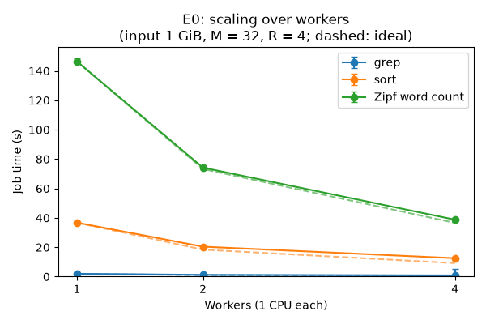
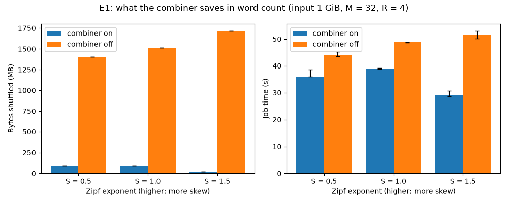
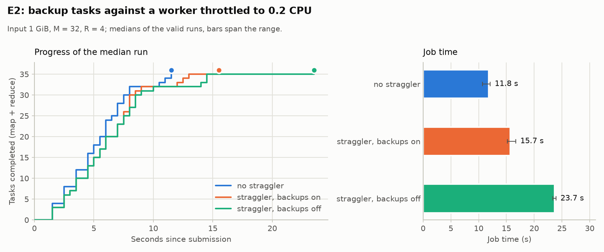
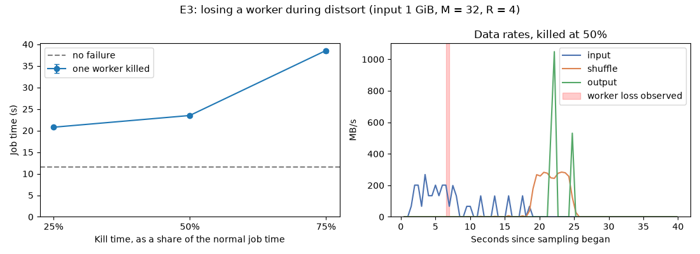
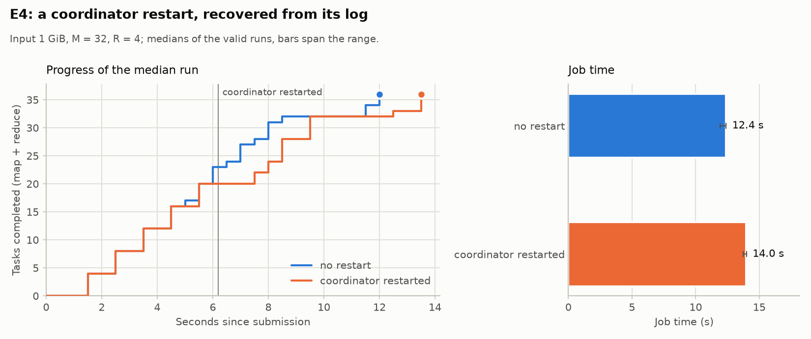
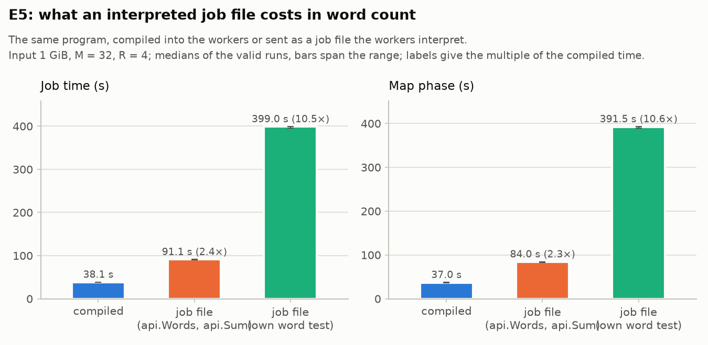

# Benchmarks

Scripts that measure the cluster. Each one runs on the Compose cluster and
writes its raw results to `bench/results/`, which git ignores. The numbers
below are copied from a run, with the machine it ran on.

## Data generators (#57)

Each generator writes reproducible input to stdout from a size in bytes and
an optional seed (42 by default). Measured on the machine below, each
writes 64 MB in about a second, except `gen-zipf.py`, which takes about 6 s.

| Script | Records | For |
|---|---|---|
| [`gen-words.py`](gen-words.py) | Lines of 5 to 15 words from the test corpus | Word count, the codec benchmark |
| [`gen-grep.py`](gen-grep.py) | 100-byte records; the pattern `XYZ` is in 92,337 per 10^10 records, as in the paper's grep (§5.2) | `grep` with `-param pattern=XYZ` |
| [`gen-sort.py`](gen-sort.py) | TeraSort-style 100-byte records with random 10-byte keys, as in the paper's sort (§5.3) | `distsort` |
| [`gen-zipf.py`](gen-zipf.py) | Lines of words from a vocabulary of 100,000, with Zipf-distributed frequencies (exponent S, 1 by default) | Word count with a skewed key |
| [`gen-weblog.py`](gen-weblog.py) | Requests in the Common Log Format for 10,000 pages; the page is drawn with probability proportional to 1 / N | `urlfreq` |
| [`gen-links.py`](gen-links.py) | A source page, a tab and a target page, over 100,000 pages; targets are drawn with probability proportional to 1 / N | `reverselinks` |

- `gen-grep.py`: the rest of each record is lowercase letters and digits,
  so the pattern never occurs by chance. grep's output has exactly
  round(records × 92,337 / 10^10) lines, at least one.
- `gen-sort.py`: keys are random bytes, any but newline and carriage
  return, so they spread evenly over the first byte that `distsort`
  partitions on.
- `python/tests/test_bench_gen.py` checks the record sizes, the number of
  matches, the spread of keys and the skew.

## Data rates over a job (#57)

The paper's Figures 2 and 3 plot, against seconds since the job started,
the rate at which map tasks read input, the rate at which data is shuffled
from map to reduce tasks, and the rate at which reduce tasks write output
(§5.3). Two scripts make the same plots from the workers' `/metrics`:

- [`scrape-metrics.py`](scrape-metrics.py) `INTERVAL DURATION URL...`
  fetches each worker's `/metrics` every INTERVAL seconds and writes its byte
  counters to stdout as CSV.
- [`plot-rates.py`](plot-rates.py) `SAMPLES.csv [OUT.png]` sums the counters
  over the workers and differentiates them between samples. It writes the
  input, shuffle and output rates in MB/s as CSV, or, given `OUT.png`, draws
  them in three panels as the paper does. Drawing needs matplotlib.

Workers count input and output bytes as each task ends, so those two rates
rise in steps of whole tasks. The shuffle is counted as it is fetched.
`python/tests/test_bench_rates.py` tests both scripts against a fake
`/metrics`.

`make bench SCENARIO=grep|sort|zipf` runs one benchmark with them on the
Compose cluster, through [`run.sh`](run.sh):

| Scenario | Input | Program |
|---|---|---|
| `grep` | `gen-grep.py` | `grep` for `XYZ` (§5.2) |
| `sort` | `gen-sort.py` | `distsort` (§5.3) |
| `zipf` | `gen-zipf.py` | `wordcount` |

- Settings come from the environment: `WORKERS` (default 4), `SIZE` in
  bytes (default 256 MiB), `M` (16), `R` (4), `SEED` (42) and `INTERVAL`,
  the seconds between samples (0.5).
- The cluster is started or scaled to `WORKERS` workers. The host samples
  each worker's `/metrics` at its container's address, so this needs Docker
  on Linux, where the host can reach the Compose network.
- Each run writes `bench/results/SCENARIO-STAMP/`: `samples.csv`,
  `rates.csv`, `rates.png` (with matplotlib), `status.txt` (from
  `mr submit -wait`) and `result.json`.
- `result.json` records the settings, the job's counters and duration, the
  git commit (and whether the tree had changes), and the machine: CPUs, CPU
  model, memory, kernel and Docker version.
- Seconds in the samples count from just before the job is submitted.

## Codecs (#42)

`make bench-codecs` starts the cluster and runs [`codecs.sh`](codecs.sh):

- Input: 64 MiB of lines of 5 to 15 random words from the test corpus,
  written by [`gen-words.py`](gen-words.py) with a fixed seed.
  - The lines are text-like but don't repeat.
  - Copies of the corpus would make sorted map output far more compressible
    than real data: a first attempt with 100 copies shrank 11 times with
    zstd.
- Jobs: word count, which combines, and `distsort`, which shuffles every
  line.
  - Each job runs with M = 16 and R = 4, three times per intermediate codec.
- Bytes shuffled: every map output file is fetched once by its reduce task,
  so the `map.output.bytes` counter is the bytes shuffled.
- Time: the job's duration as the coordinator measured it, from accepting
  the job to its last reduce task (`seconds` in `mr status`).
  - The CSV also has `wall_seconds`, the time of `mr submit -wait`, which
    adds about a second to start its container.

Results on 2026-10-24: 4 vCPUs (Intel Xeon, 2.1 GHz), 16 GB of memory,
Docker 29.9.1, 4 workers. This was a development machine, not the course
VM, which has 4 vCPUs (Intel Xeon Silver 4516Y+) and 8 GB
([the VM](../docs/cluster-vm.md#the-vm)). Time is the median of three runs, with the range.

| Job | Codec | Bytes shuffled | vs none | Time (s) |
|---|---|---:|---:|---|
| wordcount | none | 2,071,855 | 1.00 | 2.81 (2.75–2.99) |
| wordcount | zstd | 1,225,752 | 0.59 | 2.93 (2.55–3.02) |
| wordcount | snappy | 1,930,867 | 0.93 | 3.00 (2.80–3.04) |
| distsort | none | 68,353,231 | 1.00 | 2.25 (1.98–2.37) |
| distsort | zstd | 31,892,233 | 0.47 | 2.40 (2.22–2.58) |
| distsort | snappy | 51,049,537 | 0.75 | 2.28 (2.23–2.34) |

What the numbers show:

- **Bytes:** compression measurably reduces the bytes shuffled.
  - zstd roughly halves them, and Snappy saves a quarter on `distsort`.
  - Word count's combiner already leaves one record per word and map task,
    so there is less left to compress.
- **Time:** job time does not change beyond run-to-run noise.
  - Every container shares one machine, so the shuffle crosses loopback,
    not a network, and saving bytes saves almost no time.
  - The paper's cluster shuffled over a real network (§5.1), where bytes
    cost time. Measuring that across machines is Phase 7
    work (#56).

## Benchmarks and limits (#160)

The cluster runs above need Docker and a person to read them. These run in
`go test`, on one machine:

- Benchmarks of the external sort (in memory, spilling 10 runs, spilling
  with zstd), the MRKV writer and reader for each codec, the combiner, a
  64 MB shuffle fetch, a local-mode word count, the partition hash and the
  job-file helpers. `make perf` runs them 6 times (`COUNT`), compares the
  median time per op with `bench/baseline.txt`, and fails if one is more
  than 20% slower (`THRESHOLD`). The baseline is from the course VM; on
  another CPU the comparison is printed but cannot fail. After a change
  that is meant to be slower or faster, `PERF_UPDATE=1 make perf` on the VM
  writes a new baseline, to commit with the change. If `benchstat` is
  installed, its table is printed too. Two runs on the VM in a row
  differed by at most 3.6%.
- `TestSortMemoryBounded` (`internal/extsort`) sorts 80 MB with a 4 MB
  budget and checks that the live heap stays under 16 MB while adding and
  while merging the 25 runs; measured 4.2 and 6.0 MB uncompressed, 6.2 and
  9.8 MB with zstd. A sorter that never spills holds the whole input and
  fails it.
- `TestReduceMemoryBounded` (`internal/task`) merges 100 map outputs, 76 MB
  in all, through a reduce and checks the heap stays under 256 KB a source;
  measured 14.2 MB, about 140 KB a source (a 64 KB block decompressed and
  as stored, and the file buffer).
- `TestCompressionRatio` (`internal/formats/kv`) checks the corpus's
  intermediate data against the measured ratios plus 0.05: word-count
  records 0.368 with zstd and 0.532 with Snappy, line records 0.446 and
  0.673.

## Evaluation (E0–E5)

The performance evaluation in [design](../design.md#performance-evaluation),
run on the course VM: 4 vCPUs (Intel Xeon Silver 4516Y+), 8 GB of memory,
Docker 29.8.1, four workers of one CPU each. Each experiment ran as its own
`bench/experiments.sh EN` invocation, on 1 GiB inputs with M = 32 and R = 4.
Every number is the median of three runs, with the range; every run
succeeded, and every run's output matched the normal run's checksum.
[`evaluation/`](evaluation/) has the raw CSVs, each experiment's
`machine.json` (with the commit) and the log; the plots were drawn with

```sh
python3 bench/plot-experiments.py bench/evaluation bench/evaluation
```

Runs that were replaced are kept in [`evaluation/superseded/`](evaluation/superseded/). E0, E1 and E4 ran at commit `4b5a235`, and E2 again at `ca082a3` and `162be31` (below); E3 ran again at `9a3cd42`, after
its rate plot was found to mark the kill about 8 s too early (the workers
were restarted after the sampler started). The `dirty` flag in their
`machine.json` was set by an untracked backup directory, not a code change.
E5 ran at `6b6c7be`; its harness log is
[`evaluation/experiments-E5.log`](evaluation/experiments-E5.log).

### E0: scaling over workers

<picture>
  <source media="(prefers-color-scheme: dark)" srcset="evaluation/E0-dark.png">
  
</picture>

| Program | 1 worker (s) | 2 workers (s) | 4 workers (s) | Speed-up at 4 |
|---|---|---|---|---:|
| grep | 1.96 (1.89–1.96) | 1.21 (1.21–1.67) | 0.84 (0.82–5.51) | 2.3× |
| distsort | 36.74 (36.52–37.03) | 20.40 (19.79–20.62) | 12.54 (12.24–12.59) | 2.9× |
| wordcount | 146.48 (145.53–148.70) | 74.18 (73.80–74.95) | 38.78 (38.37–39.16) | 3.8× |

- Every job got faster with more workers. Word count, the most
  CPU-bound, scales almost linearly (3.8× on 4).
- grep scales least, not most as design.md predicted: it finds few matches,
  so its job takes about a second and the fixed costs (task assignment,
  heartbeats, one reduce wave) dominate. One 4-worker run took 5.5 s.
- distsort (2.9×) moves its whole input through the shuffle, and the four
  workers share one disk, which likely limits it more than CPU does.

### E1: what the combiner saves

<picture>
  <source media="(prefers-color-scheme: dark)" srcset="evaluation/E1-dark.png">
  
</picture>

| Zipf exponent | Bytes shuffled, on | Bytes shuffled, off | On / off | Time on (s) | Time off (s) | Time saved |
|---|---:|---:|---:|---|---|---:|
| 0.5 | 91,561,690 | 1,402,591,670 | 6.5% | 35.95 (35.88–38.60) | 43.85 (43.55–45.14) | 18% |
| 1.0 | 88,755,466 | 1,512,014,251 | 5.9% | 39.03 (38.80–39.16) | 48.76 (48.56–48.90) | 20% |
| 1.5 | 21,885,547 | 1,715,904,960 | 1.3% | 28.93 (28.61–30.64) | 51.64 (50.22–52.96) | 44% |

- The combiner cuts the bytes shuffled by 15× to 78×, and the saving grows
  with skew, as §4.3 says: the more often a word repeats within a map task,
  the more records it folds into one.
- Unlike compression (see Codecs above), this saves time too, because it
  also saves the reduce tasks' sorting and reducing.

### E2: backup tasks and a straggler

<picture>
  <source media="(prefers-color-scheme: dark)" srcset="evaluation/E2-dark.png">
  
</picture>

Run again at `ca082a3` with a fourth setting, no straggler and backups off,
which the first run lacked. Color marks the straggler; a dashed line and a
hatched bar, backups off.

| Setting | Job time (s) | Backups run | Backups won |
|---|---|---:|---:|
| no straggler, backups on | 9.10 (8.83–10.24) | 5–6 | 0 |
| no straggler, backups off | 8.16 (8.06–9.29) | 0 | 0 |
| straggler, backups on | 11.24 (10.98–12.48) | 4 | 1 |
| straggler, backups off | 17.58 (16.89–18.31) | 0 | 0 |

- With one worker at 0.2 CPU, backups make the job 36% faster (11.2 s
  against 17.6 s), as in the paper's Figure 3(b).
- It is still slower than with no straggler: the slow worker holds some
  tasks for the whole map phase, and a backup only starts when the phase
  is nearly done (§3.6).
- With no straggler, backups run and never win. The table above suggests
  they cost about a second, but that run took each setting's three runs in
  a block, so drift on the VM fell on one setting. Ten pairs taken in turn
  (`REPEAT=10 E2_SETTINGS="normal normal-no-backups"`, at `162be31`,
  [`evaluation/E2-pairs/`](evaluation/E2-pairs/)) found no statistically
  significant cost: 8.03 s
  with backups and 8.20 s without, backups faster in 8 of 10 pairs; the
  mean difference is -0.11 s, 95% interval -0.38 to +0.16 s (paired t,
  p = 0.38; Wilcoxon signed-rank, p = 0.13). The interval allows a mean
  cost of up to 0.16 s.

### E3: losing a worker

<picture>
  <source media="(prefers-color-scheme: dark)" srcset="evaluation/E3-dark.png">
  
</picture>

The rate panel uses seconds since sampling began. Its shaded band marks
the observed worker loss between 6.5 and 7.0 seconds on that clock. The
table's kill times are measured from submission; the saved data does not
record the offset between those two clocks.

| Worker killed at | Job time (s) | Cost |
|---|---|---:|
| no failure | 11.62 (11.59–12.65) | |
| 2.9 s (25%) | 20.78 (20.52–20.80) | +9.2 s |
| 5.8 s (50%) | 23.50 (23.17–23.68) | +11.9 s |
| 8.7 s (75%) | 38.56 (38.04–38.85) | +26.9 s |

- Every job finished on three workers, with its output checksum matching
  the first normal run's; this checks agreement, not independent correctness.
- The cost is the 10 s it takes the coordinator to declare the worker dead
  (three missed heartbeats), plus the work that is lost. Killed early, the
  worker has finished little, so the cost is about the timeout.
- Killed at 75%, near the end of the map phase, the worker's finished map
  tasks are lost too: their output lived on its disk, so they run again
  (§3.3), and the reduce phase waits for them.

### E4: a coordinator restart

<picture>
  <source media="(prefers-color-scheme: dark)" srcset="evaluation/E4-dark.png">
  
</picture>

| Setting | Job time (s) |
|---|---|
| no restart | 12.37 (11.91–12.39) |
| coordinator killed and restarted at 50% | 13.97 (13.72–13.99) |

- A restart with the write-ahead log costs 1.6 s (13%). The restarted
  coordinator replays its log and keeps every task that had finished; the
  plot's flat step at the restart is the time the coordinator was down and
  the workers' reconnects.

### E5: what an interpreted job file costs

<picture>
  <source media="(prefers-color-scheme: dark)" srcset="evaluation/E5-dark.png">
  
</picture>

| Setting | Job time (s) | Map phase (s) |
|---|---|---|
| compiled `wordcount` | 38.12 (38.09–38.77) | 37.0 |
| job file, `examples/wordcount.go` (`api.Words`, `api.Sum`) | 91.08 (90.69–91.28) | 84.0 |
| job file, `bench/jobs/wordcount-naive.go` (its own word test) | 398.97 (395.71–399.10) | 391.5 |

- A job file costs 2.4× the compiled job when it uses the compiled helpers,
  and 10.5× when it splits words itself. Nearly all of the difference is in
  the map phase (map and combine), where the interpreted code runs once per
  line or per word; the reduce phase takes about 7 s instead of 1 s. All
  three give the same output, and the map output is the same 88.8 MB.
- The job time is the coordinator's; the map phase runs from the first map
  task's start until every map task is done, from the coordinator's task
  counts.
- A profile of the map function (ADR 0015) found the cost was mostly the job
  file's own word test, which `bytes.FieldsFunc` called back into the
  interpreter for every byte, not the call into the job file. The compiled
  helpers for that work (`api.Words`, `api.Sum`) cut the job from 399 s to
  91 s.
