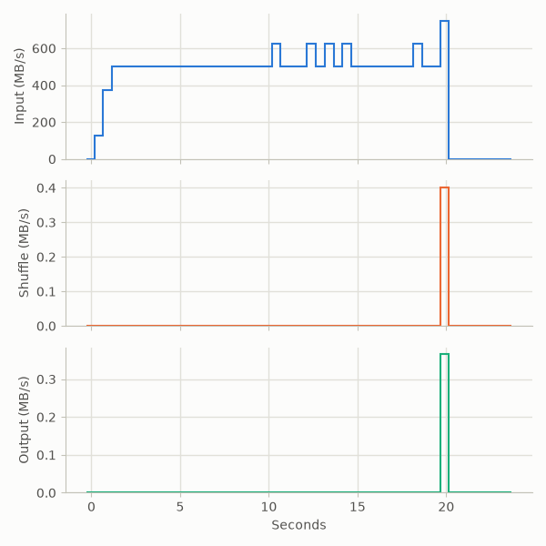

# Decimal-10-GB campaign evidence

Raw results of the expanded campaign at approximately ten times the previous
1 GiB evaluation. The primary E0–E5 controls keep their original generated
formats, seeds, skew and paired settings. Real datasets are separate
extensions and do not replace these runs. Every complete matrix here comes
from one frozen source revision; the revision and immutable image are in each
run's `build.json`.

Every accepted trial was independently validated on the stopped cluster.
Grep and sort use input-derived count and multiset fingerprints (explicitly
probabilistic) plus their framing/order checks; word count uses
input-derived expected output-part hashes. A checksum against an earlier
distributed run alone is not accepted as correctness.

Cache state is uncontrolled: the host page cache was not dropped, so these
are neither cold-cache nor warm-cache claims. Docker resource extrema are
sampled, not guaranteed instantaneous peaks. `disk.csv` gives host-wide
root-device sectors, not per-container physical I/O.

## E0: grep scaling

Source `70fcbd424672ec4405e6c0325ddf326ff509ef6a`, image
`sha256:41d5bacf3835fce4479ed95fa06048b65defedd103129b435439e5a4b28b9bad`.
Each job scans exactly 100,000,000 records and 10,000,000,000 bytes for `XYZ`,
which 923 records contain. M = 160, R = 1, three trials per worker count.
Worker counts rotate by round (4/2/1, 2/1/4, 1/4/2), so a drift in the VM does
not fall entirely on one setting.

| Workers | Job seconds, trials | Median | Wall seconds, median |
|---:|---|---:|---:|
| 1 | 51.625, 50.366, 48.742 | 50.366 | 50.703 |
| 2 | 23.260, 26.247, 23.537 | 23.537 | 23.780 |
| 4 | 19.942, 15.390, 16.016 | 16.016 | 16.528 |

Scaling from one to four workers is **3.15×** by median job time (2.14× from
one to two, then 1.47× from two to four). Four workers share one disk, so this
is not CPU-only scaling. The shape is the paper's
Figure 2: input rises as maps start, holds, then falls; shuffle and output are
tiny. The historical same-size run in `docs/evaluation.md` was 18.3 s on four
workers; this current-runtime median is 16.0 s, but cache state and revisions
differ, so the 12.5% difference is not a controlled speedup claim. This is a
rerun, not the first 10 GB grep.

Each `wN-rM/` directory holds the sanitized `status.txt`, `events.csv`,
`clock.json`, `submission-clock.json`, `samples.csv`, `tasks.csv`,
`rates.csv`, `resources.jsonl`, `disk.csv`, host snapshots, provenance and
validation. Worker URLs and IPs are replaced with stable labels; sample times
are relative to submission, so baseline samples are negative. `trials.json`,
`trials.csv` and `audit.json` summarize all nine, and `SHA256SUMS` names every
published file. Private raw copies, including absolute host paths, remain
outside the repository.

## Sort representation and admission

The paper's sort uses a 10-byte key plus the original 100-byte record.
`papersort` implements that representation. The historical `distsort` uses
the whole line as its key, so its E0/E2/E3/E4 trials are a separately labeled
control, never the paper-format result.

The extra reduce wave and shared disk make native uncompressed sort
infeasible on this VM. The admitted sort runs therefore use the named
`zstdkv` variant: **compressed input, intermediate and output**. The input
holds the same 100,000,000 records and 10,000,000,000 logical bytes; its
physical size is 5,612,159,103 bytes. This is a storage variant, not a
10 GB-native result.

The first, 768 MiB pilot included a full-size normal calibration that
completed and was independently verified:

| Quantity | Value |
|---|---:|
| Input records / logical bytes | 100,000,000 / 10,000,000,000 |
| Map / reduce tasks | 160 / 8 |
| Job seconds | 262.453 |
| Wall seconds | 262.937 |
| Output records | 100,000,000 |
| Physical output bytes | 5,424,640,027 |
| Observed free-space growth | 11,758,465,024 bytes |
| Sampled free-space floor | 8,845,246,464 bytes |

[`sort-calibration-768pilot.json`](sort-calibration-768pilot.json) records the
exact pilot fields without private host paths. **This is not the final
admission calibration.**

The calibration is not counted as one of the three matrix repeats. The
compressed sort's observed growth describes the 768 MiB pilot; the final
1,024 MiB cohort is separately calibrated. The native variant's larger
simultaneous input/intermediate/output requirement does not fit the same free
space and is reported as capacity-blocked, without shrinking the workload.

The first sort attempt used the historical 768 MiB worker cap. Three E0
trials and the calibration passed, but the next trial lost a worker to a
container OOM at 765 MiB (Docker `OOMKilled=true`, exit 137). Its completed
output still revalidated against the input manifest, showing the job logic
was correct and the memory cap was not. That trial is retained as **invalid
telemetry**, and the earlier 768 MiB sort runs are a labeled pilot, not part
of the final matrix. The final sort cohort uses **1,024 MiB per worker**
(1,000,000,000 NanoCPUs, four workers), verified by container inspection
before every run. The grep cohort ran under 768 MiB but used about 10 MiB per
worker, so its cap did not constrain that workload; its nine trials remain a
consistent cohort.

Tests, lint, builds and `make check` ran on the course VM. No test was run on
the Mac.
