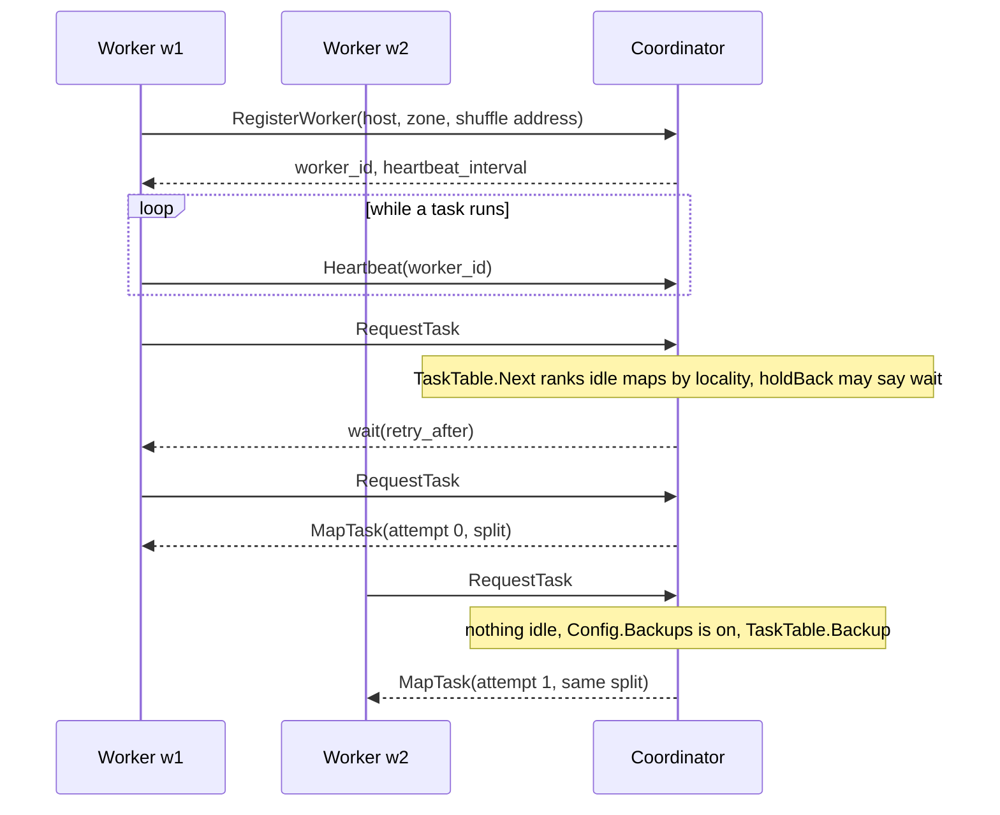
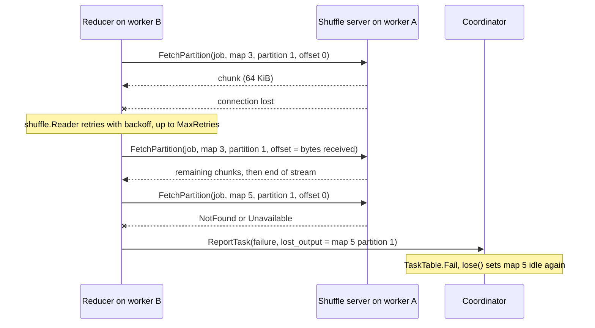
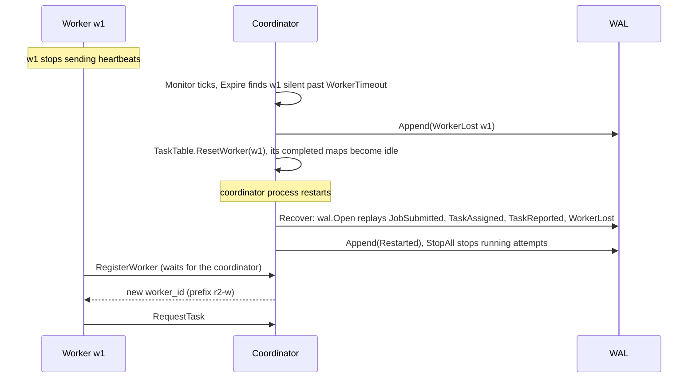
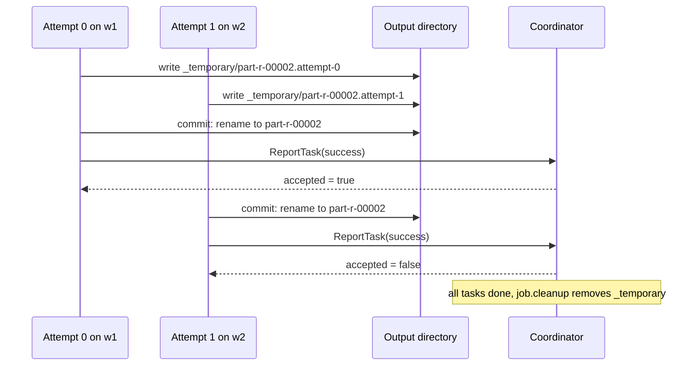

# Design

This repository recreates the system in Dean and Ghemawat,
[*MapReduce: Simplified Data Processing on Large Clusters*](https://research.google.com/archive/mapreduce-osdi04.pdf)
(OSDI 2004), for Honors Project 1: a MapReduce that runs with Docker Compose
on one VM with 4 vCPUs and 8 GB, as four worker containers limited to one
CPU each.
It is a solo project.

The first section answers the assignment's design questions, with the
evaluation plan for the special features. The rest follows one job from
submission to completion, so a reviewer can go from the paper to the code,
and lists where we differ from the paper and why.

Items marked **(planned)** are decided here and due before the code
deadline (Nov 16, 2026); everything else is built and tested.

## Assignment requirements

Each requirement of the assignment, and where this repository meets it.

| Requirement | Where | State |
|---|---|---|
| Docker Compose on one VM with 4 CPUs | [`deploy/compose/compose.yaml`](deploy/compose/compose.yaml), [cluster VM](docs/cluster-vm.md) | built |
| Four worker containers, each limited to 1 CPU | `cpus: 1` on the worker service | built |
| Client outside every container | `bin/mr` on the VM ([Client interface](#client-interface)) | built |
| Client gives input location, output location, a file with map and reduce functions, M and R | `mr submit -m M -r R job.go <output> <inputs…>` | built |
| README: what to build, what to install, how to upload the example data, how to write a job (a complete example for that data), how to submit it | [README](README.md#quick-start), rewritten for the host client | done |
| Design doc: client interface, language, communication, shared storage, formats, tests, performance evaluation | The sections below | done |
| At least one special feature, with measurements and plots showing it works | [Special features](#special-features), [Performance evaluation](#performance-evaluation), [`bench/experiments.sh`](bench/experiments.sh) | features built; E0–E5 run, [results](bench/README.md#evaluation-e0e6) |
| Never push to `main`; small pull requests; Actions run tests on PRs; feedback sought and given on PRs (an AI agent when solo) | [Process](#process), [ADR 0014](docs/design/0014-ci-on-pull-requests.md) | in place |
| Timeline: team email (Nov 1), design.md (Nov 6), code on `main` (Nov 16), demo (Nov 17–20) | [Course deliverables](docs/roadmap.md#course-deliverables-honors-project-1) | see the roadmap |

## Key decisions

### Client interface

The client is the `mr` command, built for the VM itself with `make mr` and
run outside every container. It talks to the coordinator at
`127.0.0.1:18770`, which Compose publishes on loopback only
([ADR 0016](docs/design/0016-shared-storage-and-host-client.md)). This is the
default address for `mr submit` and `mr status`; `-coordinator` overrides it.

```sh
make cluster-up                                   # build the image; start 1 coordinator + 4 workers
make mr                                           # build the client into bin/mr
make upload-example                               # bundled corpus and web log into /data/input
bin/mr upload ~/my-logs /data/input/logs          # upload your own data
bin/mr submit -m 8 -r 4 -wait \
    examples/wordcount.go /data/out/wc '/data/input/corpus/*.txt'   # a job file
bin/mr status job-1                               # state, progress, backups, counters
bin/mr cat /data/out/wc | head                    # read the output
```

`mr submit` takes the five things the assignment lists:

| Assignment | `mr submit` |
|---|---|
| where inputs are in shared storage | trailing arguments: paths or globs under `/data` (or `s3://…`) |
| where outputs go in shared storage | the output directory, e.g. `/data/out/wc` |
| a file with map and reduce functions | a `.go` job file, read on the client and sent with the job ([ADR 0015](docs/design/0015-user-job-files.md)) |
| the number of map tasks | `-m M`, exact: the input is cut into M splits, shared among the files by size, at least one each |
| the number of reduce tasks | `-r R` |

Optional flags choose input and output formats, compression and the
bad-record limit, and turn the combiner off (`-combiner=false`; it is on
by default). A built-in program name (`wordcount`, `grep`, …)
can stand in for the job file; the benchmarks use them.

A job file's `Reduce` takes `values func(yield func([]byte) bool)`, not the
compiled API's `iter.Seq[[]byte]`, because Yaegi cannot range over a
function ([ADR 0015](docs/design/0015-user-job-files.md)). During submission,
`wire.JobSpec` calls `jobfile.Load` in the coordinator: job-file code,
including package-level initializers and `init` functions, executes there
before any worker execution. Each worker then interprets the source once
per job. The accepted risk is a single-user VM with submission exposed on
loopback only; the interpreter is not a sandbox. `Combine` must be pure and associative: a bad
combiner silently changes the output, and so the E1 results.

The README's [quick start](README.md#quick-start) runs these commands, and
`make e2e` submits through `bin/mr` and deletes the output as the host user.

### Language

Go 1.26 for the coordinator, the workers and the client: goroutines suit a
server that holds many streams open, gRPC support is first-class, and a
static binary makes a small distroless image. Job files are Go too, so users
write the same API the built-in programs use.

Python 3.11+ is a second, reference implementation of the API, the file
format, the partition hash and local mode. It checks the shared contract
byte for byte; it does not run on the cluster
([ADR 0001](docs/design/0001-languages-and-shared-contract.md)).

### Communication

gRPC with protobuf messages, defined once in [`proto/`](proto/) and
generated for Go and Python ([ADR 0003](docs/design/0003-rpc-contract.md)). The
assignment's "boss" is our coordinator. Boss → workers runs in the replies:
a worker asks with `RequestTask` and the coordinator answers with a task, so
only workers open connections to the coordinator. The RPCs are not encrypted
or authenticated: the cluster trusts its network, and Compose publishes the
coordinator on the VM's loopback only ([ADR 0018](docs/design/0018-trust-model.md)).

| From → to | RPCs | Notes |
|---|---|---|
| client → coordinator | `SubmitJob`, `GetJobStatus` | `-wait` polls status until the job ends |
| worker → coordinator | `RegisterWorker`, `Heartbeat`, `RequestTask`, `ReportTask` | Workers pull tasks. The coordinator never opens a connection to a worker, so a worker behind a restart just registers again |
| worker → worker | `ShuffleService.FetchPartition` | Server-streaming, 64 KiB chunks, resumable from a byte offset ([ADR 0008](docs/design/0008-shuffle.md)) |

### Shared storage

A host directory, `data/` in the repository, bind-mounted at `/data` in the
coordinator and every worker. Directories the containers create
there are writable by everyone, so the host user can delete output the
containers wrote. The experiments keep their 1 GiB inputs and outputs in
a named volume at `/out` instead, out of the way of user data. The assignment
allows a shared volume mount on a single VM; it lets the host client upload
input with a plain copy and read output without a container
([ADR 0016](docs/design/0016-shared-storage-and-host-client.md)).

- Inputs and outputs live in shared storage. A path in a job is the path
  every container sees, such as `/data/out/wc`.
- Intermediate data does not. Each map task's output stays on its worker's
  disk and reducers fetch it over gRPC, as in the paper (§3.1).
- Output is committed by writing a temporary file and renaming it, so a
  reader never sees a partial file.
- S3-compatible object storage (VersityGW, Compose profile `s3`) is built as
  an alternative for `s3://` paths
  ([ADR 0013](docs/design/0013-commit-on-object-storage.md)).

### Data formats

| Data | Format |
|---|---|
| Input | Text, one record per line (key = byte offset, value = line), or MRKV records (`-input-format kv`) |
| Intermediate | MRKV: our block format of length-prefixed key/value records, with a CRC-32C per block and a footer; blocks optionally compressed with zstd or Snappy ([spec](docs/file-format.md), [ADR 0004](docs/design/0004-intermediate-file-format.md)). One sorted file per map task and reduce partition |
| Output | Text, `key<TAB>value` per line, one `part-r-NNNNN` per reduce task (default), or MRKV (`-output-format kv`) |
| Job file | Go source, package `job`, at most 1 MiB ([ADR 0015](docs/design/0015-user-job-files.md)) |
| RPC messages | Protobuf |

MRKV was chosen over Arrow or Parquet because keys and values are opaque
bytes, records are read in order rather than by column, and a reducer must
resume a broken fetch at a byte offset and detect corruption.

### Tests

Every check is a make target. `make check` runs them before every push, and
CircleCI runs them on every pull request and on pushes to `main`
([ADR 0014](docs/design/0014-ci-on-pull-requests.md), [CI](docs/ci.md)).

| Kind | What it checks | Where |
|---|---|---|
| Unit | Each package: splits, task table, WAL replay, external sort, combiner, formats, partitioner, shuffle resume, storage | `go test ./...`, `pytest` |
| Cross-language | Go and Python agree on the partition hash and on MRKV, byte for byte, from shared test vectors | `testdata/hash`, `testdata/format` |
| Golden | Local mode and the cluster give identical output for every example program | `go/internal/worker/examples_test.go` |
| In-process cluster | A coordinator and workers in one test: word count, retries, bad records, worker loss, backups, locality, counters | `go/internal/worker/cluster_test.go` |
| Chaos | Random worker kills and freezes and coordinator restarts during a job; output must equal the golden files. 3 seeded runs in `make check`, 50 as a soak | `go/internal/worker/chaos_test.go` |
| End to end | Word count submitted by the host client over uploaded input, compared with the golden output and deleted by the host user, and no container over its memory limit | `make e2e`, `make e2e-s3` |
| Client | Upload of files, directories and globs, `/data` path resolution and its errors, `cat` order, an exact M through a real coordinator, the M allocation (proportional, at least one per file, more files than M) | `go/cmd/mr`, `go/internal/split` |
| Docs | Every code path and test named in the paper mapping exists | `go/internal/papermap` |
| Job files | `examples/wordcount.go` gives the golden output with and without its combiner; a file that does not parse, lacks Map or Reduce, or has the wrong types is rejected with a reason, and the coordinator refuses its submit (`InvalidArgument`); a panic in `Map` is an error, not a crash | `go/internal/jobfile`, `go/internal/wire`, `go/cmd/mr` |
| Task failures | A worker that cannot load a job file reports a fatal failure, which ends the job at once (`TaskFailure.fatal`); a task whose attempts fail `-max-task-failures` times ends its job, while a crashing record is still skipped first and a lost map output does not count | `go/internal/worker`, `go/internal/coordinator` |

### Special features

The assignment asks for at least one feature beyond basic MapReduce, and
names four examples: combiners, extra tasks for stragglers, handling worker
failures, and scheduling tasks where their data is. We do the first three,
plus a fourth of our own, coordinator recovery. All four are built in code.
Compose runs the coordinator with `-data-dir` by default, and with backups
off through the override [`backups-off.yaml`](deploy/compose/backups-off.yaml); the
combiner's switch is `mr submit -combiner=false`. Each feature has an
experiment and a plot below.

Locality is a scheduler hook only. On one VM every container reads the same
disk, so there is no locality to exploit or measure
([ADR 0016](docs/design/0016-shared-storage-and-host-client.md)). User job files
are not a special feature: the assignment requires them.

1. **Combiners** (§4.3). A map task runs the job's combiner on each sorted
   spill, so fewer bytes cross the shuffle.
2. **Backup tasks for stragglers** (§3.6). When no task of the current phase
   is idle, an idle worker gets a second attempt of the oldest running task;
   the first to finish wins ([ADR 0010](docs/design/0010-backup-tasks.md)).
3. **Worker failure handling** (§3.3). Heartbeats detect a dead worker; its
   running tasks and its completed map tasks (whose output was on its disk)
   run again elsewhere ([ADR 0009](docs/design/0009-failure-detection.md)).
4. **Coordinator recovery**, beyond the paper. With `-data-dir` the
   coordinator logs every decision before replying, and a restarted
   coordinator replays the log and finishes the job
   ([ADR 0007](docs/design/0007-write-ahead-log.md)). Compose keeps the log
   at `/out/wal` in the output volume, and `make e2e` checks that a job
   survives a coordinator crash.

Bad-record skipping, counters, side outputs, compression, a status page with
Prometheus and Grafana, and a locality-aware scheduler hook are also built.

### Failure semantics

- A task whose attempts fail `-max-task-failures` times (default 8; 0 for
  no limit) ends its job with the last error, and a worker that cannot load
  a job file ends the job at once with a fatal failure (ADR 0015, #198).
  Only failures reported by the running attempt count, and not a reduce
  failure that names a lost map output, which is the map task's fault.
- A record is skipped only after `SkipAfter = 2` attempts crash on the same
  record, so skipping needs at least three attempts.
- After a coordinator restart, running attempts are stopped and workers
  register again under new IDs. Completed tasks stay completed.

### Resource management

The cluster shares one VM with other coursework, so nothing it keeps grows
without bound ([ADR 0017](docs/design/0017-disk-and-memory-bounds.md)):

| What | Bound |
|---|---|
| Map output on each worker | Deleted once the job ends: each heartbeat reply lists the active jobs, and the worker deletes the rest (§3.1 step 7) |
| Map output of a killed worker | Without `-work-dir`, each worker locks its temporary directory while it runs; a starting worker deletes the directories whose lock it can take, those of dead workers |
| Experiment results and inputs | `bench/experiments.sh` keeps a rerun's earlier results in `bench/results/previous/` (last three per experiment) and deletes interrupted runs' outputs and inputs of other sizes from the volume; results kept for good are in `bench/evaluation/` |
| Worker disk | Under `-min-free-mib` free (default 1024), a worker takes no task until there is space; the margin must hold one task's output |
| Jobs in the coordinator's memory | The `-keep-jobs` most recent ended jobs (default 100) |
| Job-file programs | An LRU of 16 per process |
| Container logs | 10 MB × 3 files per container |
| Prometheus samples | 512 MB |
| Job output | Kept until deleted: `make clean-output` |

The write-ahead log is not compacted; it is small next to job data.

### Performance evaluation

All runs use the Compose cluster on the course VM: four workers at one CPU
each, on 4 vCPUs (Intel Xeon Silver 4516Y+), 8 GB of memory and a 35 GB
disk ([the VM](docs/cluster-vm.md#the-vm)). `make bench` already generates the inputs, samples every worker's
`/metrics` every 0.5 s, and records the job's counters, the git commit and
the machine in `result.json`. Every point is the median of three runs, with
the range shown as an error bar. Each plot's caption states the input size,
M, R and the commit.

| # | Question | Experiment | Plot |
|---|---|---|---|
| E0 | Is the job faster when its tasks are spread over all four 1-CPU workers, as the assignment's deployment intends? | grep, sort and Zipf word count (1 GiB) on 1, 2 and 4 workers | Job time against workers, one line per program, with ideal linear speed-up dashed |
| E1 | How much does the combiner save? | Zipf word count, 1 GiB, Zipf exponent 0.5, 1.0 and 1.5, combiner on and off (`-combiner=false`), alternating which runs first | Two panels: bytes shuffled and job time, grouped bars per exponent |
| E2 | Do backup tasks hide a straggler? | sort, 1 GiB, M = 32; one worker throttled to 0.2 CPU (`docker update --cpus 0.2`) at the start; coordinator `-backups` on and off; also no straggler | Tasks completed against time, one line per setting, as the paper's Figure 3; job-time bars beside it |
| E3 | What does losing a worker cost? | sort, 1 GiB; `docker kill` one worker at 25%, 50% and 75% of the normal job time | Input, shuffle and output rates against time with the kill marked, as Figure 3(c); job time against kill time, with the no-failure time as a line |
| E4 | What does a coordinator restart cost? | sort, 1 GiB; kill the coordinator (`docker kill`, so it cannot tell its workers to exit) and start it again at 50% of the normal job time, with the log | Tasks completed against time with the restart marked; job time with and without the restart |
| E5 | What do interpreted job files cost? | Zipf word count, compiled `wordcount` against `examples/wordcount.go` and `bench/jobs/wordcount-naive.go` | Job time and map-phase time, bars |
| E6 | How much does the combiner save on real text? | Word count, 1 GiB each, combiner on and off, on three inputs: `crawl-eng`, Common Crawl's English pages (the real-text result); `crawl`, its pages in every language, where scripts without spaces make runs of text one word; `book`, War and Peace's lines repeated, a fixed vocabulary and so a best case | Bytes shuffled and job time, grouped bars per input |

What each plot should show if the feature works: E0, job time falling as
workers are added, close to linear for grep; E1, far fewer bytes shuffled
with the combiner, the saving growing with skew; E2, the throttled run
close to the unthrottled one with backups on, and much slower with them
off; E3 and E4, the job finishing with correct output and a delay of about
the lost work plus the detection timeout (10 s for a worker). Every run's
output is checksummed and compared with a normal run on the
same input,
whose output `make e2e` and the golden tests tie to local mode; a run that
differs, fails, or ends before its kill or restart is marked invalid and
reported, not plotted.

How it runs. [`bench/experiments.sh`](bench/experiments.sh) `E0|E1|E2|E3|E4|E5|E6|all`
runs the experiments and writes one CSV row per run, plus the
coordinator's task counts (E2, E4) or the workers' byte counters (E3) over
time, to `bench/results/`; [`bench/plot-experiments.py`](bench/plot-experiments.py)
draws the plots and prints the tables. The [runbook](docs/runbook.md#56-the-evaluation-experiments-and-plots)
has the commands. E0, E1, E2 and E5 report the coordinator's job time; E3 and E4
report the time from submission until `mr status` sees the job finish,
because a restarted coordinator times a job from its replay.

Budget. Each run deletes its output first; the 1 GiB inputs are generated
once and kept in the output volume. A run holds the input, the
intermediate files in the workers' containers and the output on the same
disk, about 3 GiB, within the disk budget in
[cluster VM](docs/cluster-vm.md#disk-budget). E0 runs on 1 and 2 workers with
`docker compose up --scale worker=N`, which keeps the one-CPU limit. E2
changes a coordinator flag, so it uses the Compose override
`backups-off.yaml` (`-backups=false`); E4 starts from an empty log. E1's "bytes shuffled" is the map output bytes after the
combiner, an existing counter. The Zipf generator takes its exponent as a
parameter and a seed, and samples from a finite vocabulary of 100,000
words, so any exponent works, 0.5 included.

The plots and their tables are in
[`bench/README.md`](bench/README.md#evaluation-e0e6), with the commands that
made them; the data is in `bench/evaluation/`. What they showed (course VM,
2026-10-26): every run succeeded with the right output. E0 scaled 3.8× on four
workers for word count but only 2.3× for grep, whose one-second job is mostly
fixed cost, so grep is not the most linear, as predicted above. E1 shuffled
15× to 78× fewer bytes with the combiner, more with more skew, and ran 18%
to 44% faster. E2, run again on 2026-10-28 with the settings alternating, took 11.2 s with the straggler and backups, 17.6 s with the straggler and no backups, and 8.0 s with no straggler. E3 cost
about the 10 s detection timeout when the kill came early and 27 s at 75%,
when finished map output was lost. E4's restart cost 1.6 s. E5's job file
made word count 10.5× slower (399 s against 38 s), nearly all in the map
phase; a profile traced most of it to the job file's per-byte word test, and
with the compiled helpers `api.Words` and `api.Sum` the job file takes 91 s
(2.4×).

### Process

Solo, so an AI agent plays the teammate, as the assignment allows. The
four engineering practices:

- **Never push to `main`.** Work goes to a branch, and `main` changes only by
  merging a pull request.
- **CI runs tests on pull requests.** CircleCI (`.circleci/config.yml`) runs
  the `make check` targets on every PR. GitHub's hosted runners fail on the
  account's billing lock, so the Actions workflow runs only by hand; `make
  ci-report` can still record a local run on the PR's commit
  ([ADR 0014](docs/design/0014-ci-on-pull-requests.md), #165, #212).
- **Many small pull requests.** One concern each, as the roadmap's
  course-deliverable items are listed.
  Issues and pull requests start from the forms and templates in
  [`.github/`](.github/), which ask for the checks, the docs and the review
  that each one needs.
- **Feedback sought and given.** An AI agent reviews my pull requests with
  inline comments, and I answer each thread with a fix or a reason (sought).
  I review at least one pull request written by an AI agent and leave
  comments on it before it merges (given).

## Components


- **Coordinator** (`go/cmd/coordinator`, `go/internal/coordinator`). The
  paper's master (§3.2). It holds the task table, the worker registry and the
  job. One mutex guards all state ([ADR 0006](docs/design/0006-coordinator-concurrency.md)).
  With `-data-dir`, it logs every decision to a write-ahead log
  (`go/internal/wal`, [ADR 0007](docs/design/0007-write-ahead-log.md)).
- **Worker** (`go/cmd/worker`, `go/internal/worker`). It registers, sends
  heartbeats, asks for tasks, runs them with `go/internal/task` and reports
  the result. Workers pull work; the coordinator never calls them
  ([ADR 0003](docs/design/0003-rpc-contract.md)).
- **Shuffle server** (`go/internal/shuffle`). Each worker serves its own map
  output over `ShuffleService.FetchPartition`. Reducers fetch from it
  directly, so no data passes through the coordinator. A worker started with
  `-listen ""` serves nothing: it writes to a work directory all workers
  share, and reports a `file://` location instead.
- **Local mode** (`go/cmd/mr`, `go/internal/local`). The whole pipeline in
  one process, using the same `split`, `task` and `extsort` code as the
  cluster (§4.7).
- **Python reference** (`python/mapreduce_reloaded`). A second implementation
  of the API, splitting, partition hash, sort, combiner, file format and
  local mode. It shares the proto contract and the MRKV format with Go
  ([ADR 0001](docs/design/0001-languages-and-shared-contract.md)).

## A job's lifecycle

The steps follow §3.1 of the paper. Function names are in Go. RPCs belong to
`CoordinatorService` unless noted.

### 1. Split the input

`mr submit` calls `SubmitJob` (`-m` asks for M map tasks, sent as `NumMapTasks` as [ADR 0016](docs/design/0016-shared-storage-and-host-client.md) describes: `split.PlanM` gives each non-empty file at least one, so more files than M means more tasks, and a file that cannot be cut that finely gets fewer; and `-r` sets R; `-intermediate-codec` and `-output-codec` choose compression, as in [the file format](docs/file-format.md#codecs)). The coordinator fills in R if it is zero:
`split.DefaultR` returns twice the number of registered workers (§3.5). It
then calls `split.Plan`, which expands the input patterns and cuts each file
into splits of `split.DefaultSize` (64 MiB) unless the job sets another
size. M is the number of splits.

If `Config.Locate` is set, it labels each split with the hosts or zones
that hold it. The shipped binaries do not set it.

`SubmitJob` rejects a second job while one runs. It checks that the output
directory holds no `part-r-*` files, and `task.Setup` creates
`<output>/_temporary`. It appends a `JobSubmitted` record to the log, with
the splits, and only then calls `submit`. That builds the `TaskTable`:
M idle map tasks and R idle reduce tasks.

### 2. Assign tasks

A worker calls `RegisterWorker`, then loops on `RequestTask`. The
coordinator answers with a map task, a reduce task, a wait or a shutdown.
`TaskTable.Next` returns map tasks first. It returns reduce tasks only after
every map task has completed (§3.1 step 5). If map tasks are idle, it picks
the one whose split is nearest the worker (`locality`). Each assignment is an
attempt of a task, logged as `TaskAssigned` before the reply.

### 3. Run the map

The worker calls `runMap`, which calls `task.Map`. The map function reads
records from the split through `formats.InputFormat`. Each emitted pair goes
to one of R `extsort.Sorter`s, chosen by the partitioner (FNV-1a 64 mod R by
default, `api.HashPartitioner`).

A sorter buffers pairs up to its share of `extsort.DefaultBudget`. It then
sorts the buffer and spills a run file to disk. If the job has a combiner,
it runs on each run as it is spilled (§4.3).

### 4. Write the partition files

When the split is read, `Sorter.Sorted` merges the runs. `writeKV` writes
one MRKV file per partition, `map-<m>-r-<r>.kv`, in the worker's work
directory. It writes to `<name>.attempt-<n>` and renames the file once it
is complete. The worker reports one `PartitionLocation` per partition, with
its shuffle address (or a `file://` URI if it has no shuffle server).

### 5. Report the map

The worker calls `ReportTask` with `TaskSuccess{outputs, counters}`. In
`Server.report`, `TaskTable.Complete` accepts the first completion of a task
and rejects others. The coordinator keeps the accepted attempt's counters
only. It logs the report as `TaskReported`. Map output stays on the worker.
The coordinator stores locations only.

### 6. Run the reduce

When all M map tasks are complete, `TaskTable.Sources` lists where partition
p of every map task lives, and `RequestTask` hands out reduce tasks with that
list. The worker's `runReduce` opens one source per map task. For a
remote source, it opens a `shuffle.Reader`, which streams
`ShuffleService.FetchPartition`. `task.Reduce` then calls `extsort.Merge`
over the sources, in map task order, and `extsort.Groups` to present each key
with its values. The reducer sees keys in sorted order (§4.2). Each partition
is sorted already, so the reducer merges rather than sorts again.

### 7. Commit and finish

`task.Reduce` writes `<output>/_temporary/part-r-<r>.attempt-<n>`. When the
reducer returns, `commit` closes the file and renames it to
`<output>/part-r-<r>`. The worker then calls `ReportTask`. The first
reduce completion is accepted. When `TaskTable.Done` is true, `Server.end`
calls `job.cleanup`, which removes `_temporary` under the lock, and clears
the active job. `GetJobStatus` then reports `JOB_STATE_SUCCEEDED` with the
summed counters. With `mr submit -wait`, the client polls `GetJobStatus` until then.

## Diagrams

### Scheduling



A worker registers and learns its heartbeat interval. A goroutine then
sends `Heartbeat` on that interval, naming the attempt the worker is
running. A `RequestTask` also counts as a heartbeat. An unknown worker gets
`NotFound` from `RequestTask`, or `reregister` from `Heartbeat`, and
registers again. The reply's `cancel` lists any attempt the coordinator no
longer expects from that worker: a backup's loser, an attempt of a reset
worker, or one from a job that has ended. The worker stops it at the next
record or group and does not report it.

`RequestTask` ranks idle map tasks by locality: host, then zone, then the
rest. If the best task is on other hosts, `holdBack` tells the worker to
wait, for at most `LocalityWait` since the job first held a task back. The
hold ends sooner if a worker on a host that holds a split asks first. A
reply of `wait` carries `retry_after`.

When no task of the current phase is idle and backups are on, the
coordinator calls `TaskTable.Backup`. It offers the in-progress task whose
attempt started first, of those with one running attempt on another worker.
The backup is an ordinary attempt with the next number, and the log records
it as an ordinary assignment. The job's status counts the backups started
and the tasks a backup won.

### Shuffle



`FetchPartition` is a server-streaming RPC
([ADR 0008](docs/design/0008-shuffle.md)). The server reads the MRKV file
from `offset` and sends chunks of at most `shuffle.ChunkSize` (64 KiB), so
memory per fetch is bounded.

`shuffle.Reader` presents the fetch as one stream. If the stream breaks, or
nothing arrives for `shuffle.IdleTimeout` (30 s), the reader treats it as a
transient error. It reconnects after an exponential backoff, with the
`offset` set to the bytes it already holds. It gives up after
`shuffle.MaxRetries` failures in a row.

If the fetch still fails with `Unavailable`, `NotFound` or
`DeadlineExceeded`, the worker wraps the error as `lostOutput`. The reduce
attempt fails, and `Worker.report` sends `TaskFailure.lost_output` naming
the `PartitionLocation`. `TaskTable.lose` makes that map task idle again,
unless it has already re-run elsewhere with a different address. The reduce
task becomes idle too, unless another attempt of it is still running, and a
worker picks it up once the map is complete.

### Failure recovery



*Worker failure.* `Server.Monitor` calls `Expire` every heartbeat interval.
A worker unheard for `WorkerTimeout` is removed from the registry (the
shipped binary uses 3 s and 10 s). If a job is active, the coordinator
appends `WorkerLost` to the log, and `TaskTable.ResetWorker` stops the worker's running attempts and
makes its completed map tasks idle, because their output was on its disk.
Its completed reduce tasks stay done, since their output is in the output
directory (§3.3). If the worker returns, it is told to register again, under
a new ID.

*Coordinator failure.* With `-data-dir`, `coordinator.Recover` opens the
log and replays each record through `Server.replay`, which calls the same
code as the live handlers. It then appends a `Restarted` record, and
`TaskTable.StopAll` stops every running attempt. Completed tasks stay
completed. The registry is not logged, so it starts with a new ID prefix.
Workers see `Unavailable` or `NotFound`, call `RegisterWorker` again and
carry on. A map output that was lost meanwhile is found by the reduce task
that cannot fetch it. Without `-data-dir`, a restart loses the job.

*A bug in one request.* gRPC does not recover a panicking handler, so a
bug that one request triggers would stop the whole process. The
coordinator's and the worker's gRPC servers recover it
([`internal/rpcguard`](go/internal/rpcguard/rpcguard.go)): the call fails
with `Internal`, the panic and its stack are logged, and every other job
and worker carries on. Handlers release their locks with `defer`, so a
recovered panic leaves none held. A panic in user code is already an
ordinary task failure (§3.7).

### Commit



Each reduce attempt writes to its own file under `_temporary`. When the
reducer finishes, `commit` renames the file to its final name. A failed
attempt removes its temporary file and renames nothing.

The coordinator accepts only the first successful `ReportTask` for a task.
It rejects the second, because `TaskTable.Complete` finds the task already
completed. A rejected attempt changes nothing in the task table and its
counters are dropped. Both attempts rename to the same `part-r-*`, and a
rename is atomic, so readers see a whole file either way. A deterministic
reducer writes the same bytes in both; a nondeterministic one can leave the
rejected attempt's bytes in the final file. The loser's temporary name no longer
exists after its rename, and `job.cleanup` removes anything left in
`_temporary` when the job ends (see
[the backup tasks explainer](docs/explainers/20-backup-tasks.md)).

A losing map attempt is different. Its files stay on its worker's disk, and
no reducer is told about them.

## Differences from the 2004 paper

| Paper (§) | This system | Why | Record |
|---|---|---|---|
| Google's internal RPC (§3.1) | gRPC and protobuf, with Go and Python generated from `proto/` | Both languages must speak one wire contract, and the shuffle needs streaming. | [ADR 0003](docs/design/0003-rpc-contract.md), [explainer](docs/explainers/03-rpc-contract.md) |
| GFS holds input and output (§3.1) | A host directory bind-mounted at `/data` in every container , read and written through `internal/storage`, or S3-compatible object storage (`s3://bucket/key`, configured by the standard AWS environment variables). Without a rename, an S3 commit is a server-side copy, then a delete. | GFS is not available, the cluster runs on one VM, and the client on the host must reach the same files. | [ADR 0016](docs/design/0016-shared-storage-and-host-client.md), [cluster VM](docs/cluster-vm.md), [ADR 0013](docs/design/0013-commit-on-object-storage.md) |
| Intermediate records in files of undescribed format (§3.1) | MRKV: checksummed blocks of records with a footer, each block optionally compressed with zstd or Snappy (#42). | Go and Python must agree byte for byte (uncompressed) or record for record (compressed), corruption must be detected, and fetches must resume. | [ADR 0004](docs/design/0004-intermediate-file-format.md), [file format](docs/file-format.md), [explainer](docs/explainers/04-file-format.md) |
| Master writes periodic checkpoints, and the job aborts if the master dies (§3.3) | With `-data-dir`, a write-ahead log of decisions. A restarted coordinator replays it, and the job survives. | Logging each decision needs no snapshot, and replay reuses the live handlers. | [ADR 0007](docs/design/0007-write-ahead-log.md), [explainer](docs/explainers/18-coordinator-recovery.md) |
| Master pings workers (§3.3) | Workers send heartbeats, and `RequestTask` counts as one. | The coordinator never opens a connection to a worker. | [ADR 0003](docs/design/0003-rpc-contract.md), [explainer](docs/explainers/16-worker-failure.md), [ADR 0009](docs/design/0009-failure-detection.md) |
| Backups start "when a MapReduce operation is close to completion" (§3.6) | Backups start when no task of the current phase is idle, oldest attempt first. One backup at a time, never on the same worker. | The paper gives no threshold, and this never delays a task that has not started. | [explainer](docs/explainers/20-backup-tasks.md), [ADR 0010](docs/design/0010-backup-tasks.md) |
| A signal handler sends the bad record's number by UDP (§4.6) | The worker recovers the panic and reports the record in `ReportTask`. The coordinator skips it after two crashes. | Go can recover a panic, and the report already reaches the coordinator. | [explainer](docs/explainers/19-bad-records.md), [ADR 0011](docs/design/0011-bad-records.md) |
| Master sums counters from task reports and ignores duplicates (§4.9) | Only the accepted attempt's counters are kept. A re-run map replaces its earlier counts. | A task may run more than once, and adding every attempt would over-count. | [explainer](docs/explainers/21-counters.md) |
| Master serves HTTP status pages (§4.8) | A status page and Prometheus `/metrics` on the coordinator, `/metrics` on workers, JSON logs, and a Grafana dashboard in the Compose monitoring profile. | These are standard tools, and per-attempt logs stay on each worker. | [explainer](docs/explainers/24-status.md), [ADR 0012](docs/design/0012-observability.md) |
| Master places map tasks near GFS replicas (§3.4) | A scheduler hook: `Config.Locate` labels splits, and `LocalityWait` holds tasks back. Nothing sets `Locate` in Compose, so there is no location source. | All Compose workers share one volume, so there is nothing to exploit until a store knows where data lives (#41). | [explainer](docs/explainers/23-locality.md), [paper mapping](docs/paper-mapping.md) (F11) |
| Keys and values are strings (§2) | `[]byte` in Go and `bytes` in Python. User code encodes its own data. | Both languages then sort and hash identically, with no extra rules. | [ADR 0005](docs/design/0005-programming-api.md), [explainer](docs/explainers/07-programming-api.md) |
| Keys are processed in sorted order within a partition (§4.2). The paper does not say how equal keys' values are ordered. | Equal keys keep map-task order, and within a map task, emit order. | Stable sorts and a merge in map task order make output reproducible, and Go and Python match. | [file format](docs/file-format.md), [explainer](docs/explainers/09-external-sort.md) |
| M and R are chosen by the user, with splits of 16 to 64 MB and R a small multiple of the workers (§3.1, §3.5) | Default split size is 64 MiB (`split.DefaultSize`). Default R is 2 per registered worker (`split.DefaultR`). `-m` and `-r` override them in `mr`; `-m` is an exact M (ADR 0016). | These follow the paper's guidance, and the assignment's client names M and R. Small inputs give few splits, so M can be smaller than the number of workers. | [explainer](docs/explainers/12-splits.md) |
| User code is linked into the user's program (§2) | A job is a Go source file sent with the job and interpreted by each worker; built-in programs are compiled in. | The assignment's client submits a file, and the workers are static binaries with no compiler. | [ADR 0015](docs/design/0015-user-job-files.md) |
| One implementation, in C++ | Go is primary. Python is a reference implementation for the API and local mode only, and it has no coordinator or worker. | A second implementation checks the contract, and only the Go cluster needs the distributed code. | [ADR 0001](docs/design/0001-languages-and-shared-contract.md), [explainer](docs/explainers/11-local-mode.md) |
| Clusters of about 1,800 machines (§5.1) | Docker Compose on one VM with 4 vCPUs and 8 GB of RAM: one coordinator and four workers, each limited to one CPU. | It is the hardware available, it still exercises every protocol path, and the CPU limits make spreading tasks over workers pay off. | [cluster VM](docs/cluster-vm.md), [explainer](docs/explainers/14-cluster.md) |

## Where to look next

- [Paper mapping](docs/paper-mapping.md): each paper feature, its code and the
  test that proves it.
- [Design records](docs/design/): ADRs 0001 to 0018, one per decision that
  shaped the code.
- [Explainers](docs/explainers/): one plain-language page per feature, from the
  RPC contract (03) to the status page (24).
- [File format](docs/file-format.md): the MRKV specification.
- [Cluster VM](docs/cluster-vm.md): how the Compose cluster is set up.
