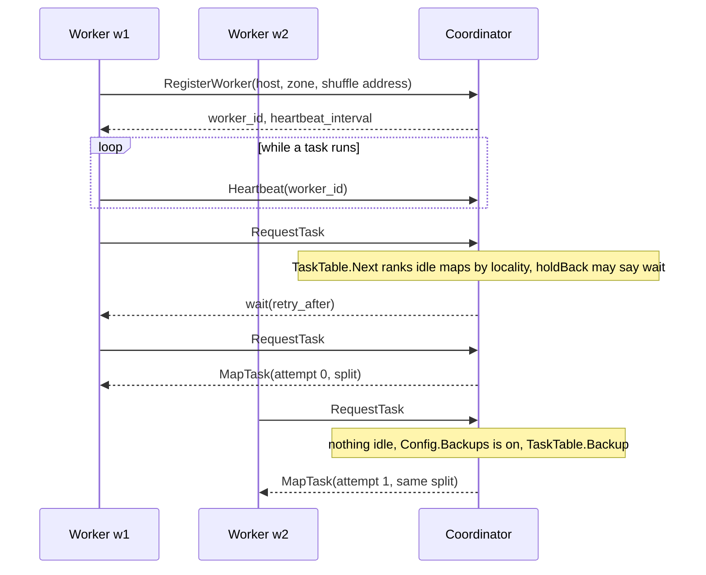
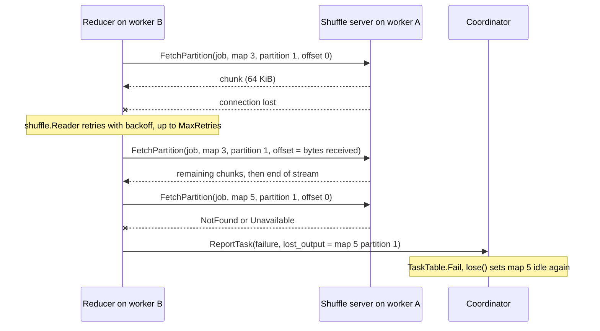
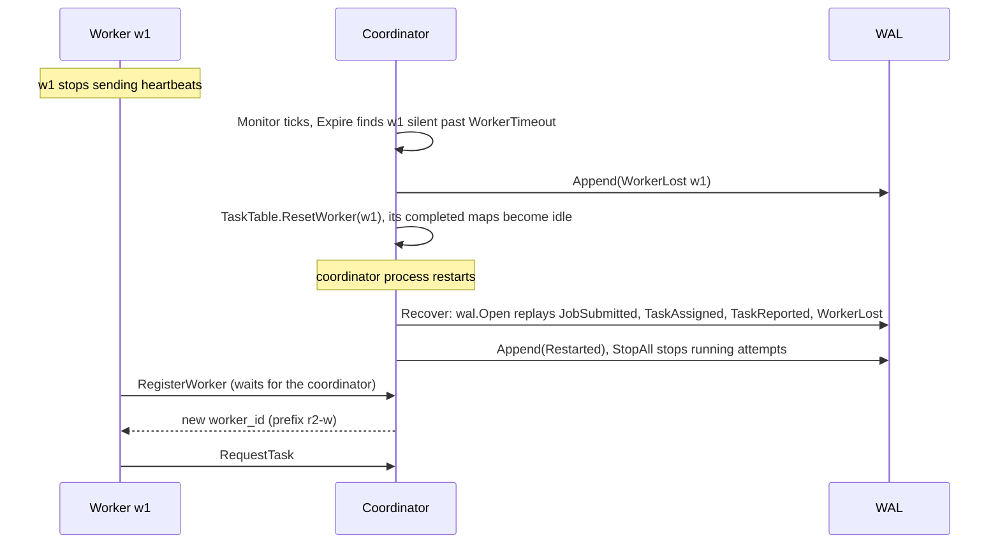
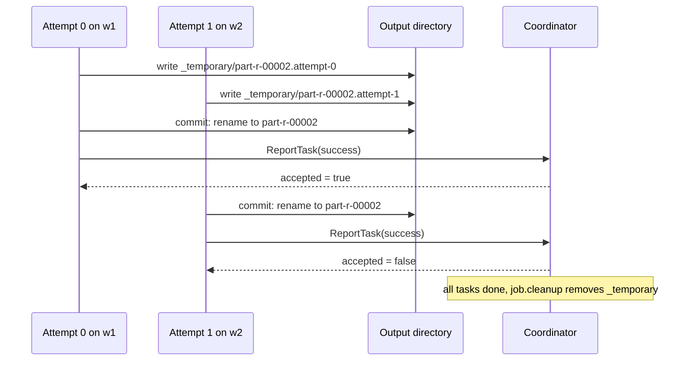

# Design

This repository recreates the system in Dean and Ghemawat,
[*MapReduce: Simplified Data Processing on Large Clusters*](https://research.google.com/archive/mapreduce-osdi04.pdf)
(OSDI 2004). This page follows one job from submission to completion, so a
reviewer can go from the paper to the code. It then lists where we differ
from the paper and why.

Components:

- **Coordinator** (`go/cmd/coordinator`, `go/internal/coordinator`). The
  paper's master (§3.2). It holds the task table, the worker registry and the
  job. One mutex guards all state ([ADR 0006](design/0006-coordinator-concurrency.md)).
  With `-data-dir`, it logs every decision to a write-ahead log
  (`go/internal/wal`, [ADR 0007](design/0007-write-ahead-log.md)).
- **Worker** (`go/cmd/worker`, `go/internal/worker`). It registers, sends
  heartbeats, asks for tasks, runs them with `go/internal/task` and reports
  the result. Workers pull work; the coordinator never calls them
  ([ADR 0003](design/0003-rpc-contract.md)).
- **Shuffle server** (`go/internal/shuffle`). Each worker serves its own map
  output over `ShuffleService.FetchPartition`. Reducers fetch from it
  directly, so no data passes through the coordinator. A worker started with
  `-listen ""` serves nothing: it writes to a work directory all workers
  share, and reports a `file://` location instead.
- **Local mode** (`go/cmd/mr`, `go/internal/local`). The whole pipeline in
  one process, using the same `split`, `task` and `extsort` code as the
  cluster (§4.7).
- **Python reference** (`python/mapreduce_reloaded`). A second implementation
  of the API, splitting, partition hash, sort, combiner, file format and
  local mode. It shares the proto contract and the MRKV format with Go
  ([ADR 0001](design/0001-languages-and-shared-contract.md)).

## A job's lifecycle

The steps follow §3.1 of the paper. Function names are in Go. RPCs belong to
`CoordinatorService` unless noted.

### 1. Split the input

`mr submit` calls `SubmitJob` (`-m` sets an approximate M through `split.SizeFor`, and `-r` sets R). The coordinator fills in R if it is zero:
`split.DefaultR` returns twice the number of registered workers (§3.5). It
then calls `split.Plan`, which expands the input patterns and cuts each file
into splits of `split.DefaultSize` (64 MiB) unless the job sets another
size. M is the number of splits.

If `Config.Locate` is set, it labels each split with the hosts or zones
that hold it. The shipped binaries do not set it.

`SubmitJob` rejects a second job while one runs. It checks that the output
directory holds no `part-r-*` files, and `task.Setup` creates
`<output>/_temporary`. It appends a `JobSubmitted` record to the log, with
the splits, and only then calls `submit`. That builds the `TaskTable`:
M idle map tasks and R idle reduce tasks.

### 2. Assign tasks

A worker calls `RegisterWorker`, then loops on `RequestTask`. The
coordinator answers with a map task, a reduce task, a wait or a shutdown.
`TaskTable.Next` returns map tasks first. It returns reduce tasks only after
every map task has completed (§3.1 step 5). If map tasks are idle, it picks
the one whose split is nearest the worker (`locality`). Each assignment is an
attempt of a task, logged as `TaskAssigned` before the reply.

### 3. Run the map

The worker calls `runMap`, which calls `task.Map`. The map function reads
records from the split through `formats.InputFormat`. Each emitted pair goes
to one of R `extsort.Sorter`s, chosen by the partitioner (FNV-1a 64 mod R by
default, `api.HashPartitioner`).

A sorter buffers pairs up to its share of `extsort.DefaultBudget`. It then
sorts the buffer and spills a run file to disk. If the job has a combiner,
it runs on each run as it is spilled (§4.3).

### 4. Write the partition files

When the split is read, `Sorter.Sorted` merges the runs. `writeKV` writes
one MRKV file per partition, `map-<m>-r-<r>.kv`, in the worker's work
directory. It writes to `<name>.attempt-<n>` and renames the file once it
is complete. The worker reports one `PartitionLocation` per partition, with
its shuffle address (or a `file://` URI if it has no shuffle server).

### 5. Report the map

The worker calls `ReportTask` with `TaskSuccess{outputs, counters}`. In
`Server.report`, `TaskTable.Complete` accepts the first completion of a task
and rejects others. The coordinator keeps the accepted attempt's counters
only. It logs the report as `TaskReported`. Map output stays on the worker.
The coordinator stores locations only.

### 6. Run the reduce

When all M map tasks are complete, `TaskTable.Sources` lists where partition
p of every map task lives, and `RequestTask` hands out reduce tasks with that
list. The worker's `runReduce` opens one source per map task. For a
remote source, it opens a `shuffle.Reader`, which streams
`ShuffleService.FetchPartition`. `task.Reduce` then calls `extsort.Merge`
over the sources, in map task order, and `extsort.Groups` to present each key
with its values. The reducer sees keys in sorted order (§4.2). Each partition
is sorted already, so the reducer merges rather than sorts again.

### 7. Commit and finish

`task.Reduce` writes `<output>/_temporary/part-r-<r>.attempt-<n>`. When the
reducer returns, `commit` closes the file and renames it to
`<output>/part-r-<r>`. The worker then calls `ReportTask`. The first
reduce completion is accepted. When `TaskTable.Done` is true, `Server.end`
calls `job.cleanup`, which removes `_temporary` under the lock, and clears
the active job. `GetJobStatus` then reports `JOB_STATE_SUCCEEDED` with the
summed counters. With `mr submit -wait`, the client polls `GetJobStatus` until then.

## Diagrams

### Scheduling

A worker registers and learns its heartbeat interval. A goroutine then
sends `Heartbeat` on that interval, naming the attempt the worker is
running. A `RequestTask` also counts as a heartbeat. An unknown worker gets
`NotFound` from `RequestTask`, or `reregister` from `Heartbeat`, and
registers again. The reply's `cancel` lists any attempt the coordinator no
longer expects from that worker: a backup's loser, an attempt of a reset
worker, or one from a job that has ended. The worker stops it at the next
record or group and does not report it.

`RequestTask` ranks idle map tasks by locality: host, then zone, then the
rest. If the best task is on other hosts, `holdBack` tells the worker to
wait, for at most `LocalityWait` since the job first held a task back. The
hold ends sooner if a worker on a host that holds a split asks first. A
reply of `wait` carries `retry_after`.

When no task of the current phase is idle and backups are on, the
coordinator calls `TaskTable.Backup`. It offers an in-progress task that has
one running attempt, on another worker. The backup is an ordinary attempt
with the next number, and the log records it as an ordinary assignment.

### Shuffle

`FetchPartition` is a server-streaming RPC
([ADR 0008](design/0008-shuffle.md)). The server reads the MRKV file
from `offset` and sends chunks of at most `shuffle.ChunkSize` (64 KiB), so
memory per fetch is bounded.

`shuffle.Reader` presents the fetch as one stream. If the stream breaks, or
nothing arrives for `shuffle.IdleTimeout` (30 s), the reader treats it as a
transient error. It reconnects after an exponential backoff, with the
`offset` set to the bytes it already holds. It gives up after
`shuffle.MaxRetries` failures in a row.

If the fetch still fails with `Unavailable`, `NotFound` or
`DeadlineExceeded`, the worker wraps the error as `lostOutput`. The reduce
attempt fails, and `Worker.report` sends `TaskFailure.lost_output` naming
the `PartitionLocation`. `TaskTable.lose` makes that map task idle again,
unless it has already re-run elsewhere with a different address. The reduce
task becomes idle too, unless another attempt of it is still running, and a
worker picks it up once the map is complete.

### Failure recovery

*Worker failure.* `Server.Monitor` calls `Expire` every heartbeat interval.
A worker unheard for `WorkerTimeout` is removed from the registry (the
shipped binary uses 3 s and 10 s). If a job is active, the coordinator
appends `WorkerLost` to the log, and `TaskTable.ResetWorker` stops the worker's running attempts and
makes its completed map tasks idle, because their output was on its disk.
Its completed reduce tasks stay done, since their output is in the output
directory (§3.3). If the worker returns, it is told to register again, under
a new ID.

*Coordinator failure.* With `-data-dir`, `coordinator.Recover` opens the
log and replays each record through `Server.replay`, which calls the same
code as the live handlers. It then appends a `Restarted` record, and
`TaskTable.StopAll` stops every running attempt. Completed tasks stay
completed. The registry is not logged, so it starts with a new ID prefix.
Workers see `Unavailable` or `NotFound`, call `RegisterWorker` again and
carry on. A map output that was lost meanwhile is found by the reduce task
that cannot fetch it. Without `-data-dir`, a restart loses the job.

### Commit

Each reduce attempt writes to its own file under `_temporary`. When the
reducer finishes, `commit` renames the file to its final name. A failed
attempt removes its temporary file and renames nothing.

The coordinator accepts only the first successful `ReportTask` for a task.
It rejects the second, because `TaskTable.Complete` finds the task already
completed. A rejected attempt changes nothing in the task table and its
counters are dropped. Both attempts rename to the same `part-r-*`, and a
rename is atomic, so readers see a whole file either way. A deterministic
reducer writes the same bytes in both; a nondeterministic one can leave the
rejected attempt's bytes in the final file. The loser's temporary name no longer
exists after its rename, and `job.cleanup` removes anything left in
`_temporary` when the job ends (see
[the backup tasks explainer](explainers/20-backup-tasks.md)).

A losing map attempt is different. Its files stay on its worker's disk, and
no reducer is told about them.

## Differences from the 2004 paper

| Paper (§) | This system | Why | Record |
|---|---|---|---|
| Google's internal RPC (§3.1) | gRPC and protobuf, with Go and Python generated from `proto/` | Both languages must speak one wire contract, and the shuffle needs streaming. | [ADR 0003](design/0003-rpc-contract.md), [explainer](explainers/03-rpc-contract.md) |
| GFS holds input and output (§3.1) | A local or shared volume, mounted at the same path in every container, read and written through `internal/storage`, or S3-compatible object storage (`s3://bucket/key`, configured by the standard AWS environment variables). Without a rename, an S3 commit is a server-side copy, then a delete. | GFS is not available, and the cluster runs on one VM. | [cluster VM](cluster-vm.md), [ADR 0013](design/0013-commit-on-object-storage.md) |
| Intermediate records in files of undescribed format (§3.1) | MRKV: checksummed blocks of records with a footer. Compression is planned in #42. | Go and Python must agree byte for byte, corruption must be detected, and fetches must resume. | [ADR 0004](design/0004-intermediate-file-format.md), [file format](file-format.md), [explainer](explainers/04-file-format.md) |
| Master writes periodic checkpoints, and the job aborts if the master dies (§3.3) | With `-data-dir`, a write-ahead log of decisions. A restarted coordinator replays it, and the job survives. | Logging each decision needs no snapshot, and replay reuses the live handlers. | [ADR 0007](design/0007-write-ahead-log.md), [explainer](explainers/18-coordinator-recovery.md) |
| Master pings workers (§3.3) | Workers send heartbeats, and `RequestTask` counts as one. | The coordinator never opens a connection to a worker. | [ADR 0003](design/0003-rpc-contract.md), [explainer](explainers/16-worker-failure.md), [ADR 0009](design/0009-failure-detection.md) |
| Backups start "when a MapReduce operation is close to completion" (§3.6) | Backups start when no task of the current phase is idle. One backup at a time, never on the same worker. | The paper gives no threshold, and this never delays a task that has not started. | [explainer](explainers/20-backup-tasks.md), [ADR 0010](design/0010-backup-tasks.md) |
| A signal handler sends the bad record's number by UDP (§4.6) | The worker recovers the panic and reports the record in `ReportTask`. The coordinator skips it after two crashes. | Go can recover a panic, and the report already reaches the coordinator. | [explainer](explainers/19-bad-records.md), [ADR 0011](design/0011-bad-records.md) |
| Master sums counters from task reports and ignores duplicates (§4.9) | Only the accepted attempt's counters are kept. A re-run map replaces its earlier counts. | A task may run more than once, and adding every attempt would over-count. | [explainer](explainers/21-counters.md) |
| Master serves HTTP status pages (§4.8) | A status page and Prometheus `/metrics` on the coordinator, `/metrics` on workers, JSON logs, and a Grafana dashboard in the Compose monitoring profile. | These are standard tools, and per-attempt logs stay on each worker. | [explainer](explainers/24-status.md), [ADR 0012](design/0012-observability.md) |
| Master places map tasks near GFS replicas (§3.4) | A scheduler hook: `Config.Locate` labels splits, and `LocalityWait` holds tasks back. Nothing sets `Locate` in Compose, so there is no location source. | All Compose workers share one volume, so there is nothing to exploit until a store knows where data lives (#41). | [explainer](explainers/23-locality.md), [paper mapping](paper-mapping.md) (F11) |
| Keys and values are strings (§2) | `[]byte` in Go and `bytes` in Python. User code encodes its own data. | Both languages then sort and hash identically, with no extra rules. | [ADR 0005](design/0005-programming-api.md), [explainer](explainers/07-programming-api.md) |
| Keys are processed in sorted order within a partition (§4.2). The paper does not say how equal keys' values are ordered. | Equal keys keep map-task order, and within a map task, emit order. | Stable sorts and a merge in map task order make output reproducible, and Go and Python match. | [file format](file-format.md), [explainer](explainers/09-external-sort.md) |
| M and R are chosen by the user, with splits of 16 to 64 MB and R a small multiple of the workers (§3.1, §3.5) | Default split size is 64 MiB (`split.DefaultSize`). Default R is 2 per registered worker (`split.DefaultR`). `-m` and `-r` override them in `mr`. | These follow the paper's guidance. Small inputs give few splits, so M can be smaller than the number of workers. | [explainer](explainers/12-splits.md) |
| One implementation, in C++ | Go is primary. Python is a reference implementation for the API and local mode only, and it has no coordinator or worker. | A second implementation checks the contract, and only the Go cluster needs the distributed code. | [ADR 0001](design/0001-languages-and-shared-contract.md), [explainer](explainers/11-local-mode.md) |
| Clusters of about 1,800 machines (§5.1) | Docker Compose on one 8 GB VM: one coordinator and four workers. | It is the hardware available, and it still exercises every protocol path. | [cluster VM](cluster-vm.md), [explainer](explainers/14-cluster.md) |

## Where to look next

- [Paper mapping](paper-mapping.md): each paper feature, its code and the
  test that proves it.
- [Design records](design/): ADRs 0001 to 0013, one per decision that
  shaped the code.
- [Explainers](explainers/): one plain-language page per feature, from the
  RPC contract (03) to the status page (24).
- [File format](file-format.md): the MRKV specification.
- [Cluster VM](cluster-vm.md): how the Compose cluster is set up.
