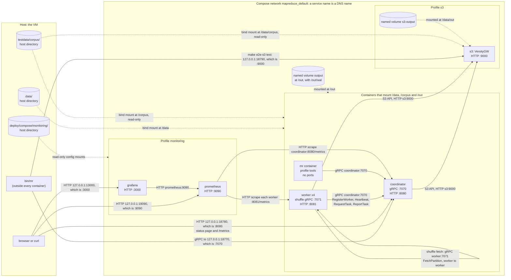

# Docker topology: what runs where, and why

For a reader who knows Go and MapReduce but is new to Docker. It explains
what `make cluster-up` starts, how the pieces reach each other, where the
data lives, and why each choice was made. The exact configuration is in
[`deploy/compose/compose.yaml`](../deploy/compose/compose.yaml) and
[`deploy/docker/Dockerfile`](../deploy/docker/Dockerfile); when this page
and those files disagree, the files are right. [Cluster VM](cluster-vm.md)
has the machine and its budgets, and [`deploy/`](../deploy/README.md) has
the file layout.

## Terms

Each term is defined here, where it is first used. A Go analogy follows
where one helps; none is exact.

- **Container.** A running process, or a few, that sees its own file
  system, its own network and its own process list, and that has limits on
  memory and CPU. It shares the host's kernel, so it is not a virtual
  machine. A Go analogy is a process started from a binary, with a private
  view of the machine.
- **Image.** The read-only file system a container starts from, plus
  defaults such as the user. The build produces it once and every container
  of that image starts from the same bytes, as many processes can run one
  compiled binary. Here the image is named `mapreduce-reloaded`.
- **Dockerfile.** The recipe for an image.
- **Volume.** Storage that outlives a container, so a container's own files
  do not have to. There are two kinds, and this project uses both:
  - a **bind mount** shows a directory of the host at a path inside the
    container. Both sides see the same files;
  - a **named volume** is a directory that Docker creates and manages. The
    host can reach it, but a program on the host does not normally look
    there.
- **Network.** A virtual network that Docker creates for the containers
  that share it. Each container gets an address, and Docker's built-in DNS
  resolves a service's name to it.
- **Published port.** A port a container listens on, made reachable from
  the host. A port that is not published is reachable only from containers
  on the same network.
- **Compose.** A tool that reads one YAML file and starts a set of
  containers, a network and volumes together. The set is a **project**; ours
  is named `mapreduce`.
- **Service.** One entry in the Compose file. It may run as several
  containers (the `worker` service runs four).
- **Profile.** A label on a service. A service with a profile does not
  start unless that profile is switched on, or the service is named
  directly. Ours are `tools`, `s3` and `monitoring`.
- **Override file.** A second YAML file, passed with another `-f`, that is
  merged over the first.

## 1. Diagram

Solid arrows are network traffic. Dotted arrows are mounts. Every port is
written as the container's port, with the host's port where one is
published. All published ports are bound to `127.0.0.1`, the host's loopback
address.



Four things to read from it:

- `bin/mr` runs on the host and reaches the coordinator through a published
  port. It never enters the network.
- Workers open every connection to the coordinator. The coordinator never
  calls a worker ([design](../design.md#communication)), so no worker port
  needs publishing for scheduling.
- A map task's output stays on the worker that made it, and a reduce task
  fetches it from that worker on port 7071 over the network. No data goes
  through the coordinator ([ADR 0008](design/0008-shuffle.md)).
- Everything under a profile is absent from a plain `make cluster-up`.

## 2. Services

All six services (four of them optional) are in one project, `mapreduce`.
The same settings apply to all: each container's log rotates at 10 MB with
three files kept. The three Go containers (`coordinator`, `worker`, `mr`)
share one image and the three mounts in the table below, and `worker`
waits for `coordinator` to start (`depends_on`, which orders start-up only
and does not wait for readiness; workers also wait for it themselves).

### What each service is

| Service | Profile | Image | Command | Memory, CPU | Container port, host port | Mounts |
|---|---|---|---|---|---|---|
| `coordinator` | none | `mapreduce-reloaded`, built from `go/` | `coordinator -addr :7070 -http :8080 -data-dir /out/wal` | `mem_limit: 256m`, no CPU limit | 7070 gRPC, host 18770; 8080 status page and `/metrics`, host 18780 | `data/` at `/data`, `testdata/corpus` at `/corpus` (read-only), volume `output` at `/out` |
| `worker` | none | `mapreduce-reloaded` | `worker -coordinator coordinator:7070 -http :8081 -min-free-mib 2048` | `mem_limit: 768m`, `cpus: 1`, 4 replicas | 8081 `/metrics`, not published; 7071 shuffle, the worker's default `-listen`, not published | the same three mounts |
| `mr` | `tools` | `mapreduce-reloaded` | entrypoint `mr`, arguments from `run` | `mem_limit: 128m`, no CPU limit | none | the same three mounts |
| `s3` | `s3` | `versity/versitygw:v1.9.0` | `--port :9000 posix /data` | `mem_limit: 256m`, no CPU limit | 9000, host 18790 | `testdata/corpus` at `/data/corpus` (read-only), volume `s3-output` at `/data/out` |
| `prometheus` | `monitoring` | `prom/prometheus:v3.5.0` | the image's defaults plus `--storage.tsdb.retention.size=512MB` | `mem_limit: 256m`, no CPU limit | 9090, host 19090 | `monitoring/prometheus.yml` at `/etc/prometheus/prometheus.yml` (read-only) |
| `grafana` | `monitoring` | `grafana/grafana:12.1.0` | the image's default | `mem_limit: 256m`, no CPU limit | 3000, host 13000 | the provisioning and dashboard directories of `monitoring/grafana`, read-only |

Notes on the table:

- Docker reads `256m` as 256 MiB. The other pages write MB.
- `grafana` allows anonymous read-only access (role Viewer), which is safe
  here because the port is published on loopback only.
- The Go containers carry `AWS_ENDPOINT_URL`, `AWS_REGION` and two
  credential variables, used only for `s3://` names. The values are the
  store's local test credentials, fixed in the Compose file.
- `worker` runs four replicas by `deploy.replicas`. The DNS name `worker`
  resolves to all four, which is how Prometheus finds them
  ([`prometheus.yml`](../deploy/compose/monitoring/prometheus.yml)).
- The coordinator's `-data-dir /out/wal` turns the write-ahead log on
  ([ADR 0007](design/0007-write-ahead-log.md)).

### What breaks when one dies

| Service | Effect | How it comes back |
|---|---|---|
| `coordinator` | No new tasks and no status page. Workers keep trying and register again. Without `-data-dir` the job would be lost; with it, a restarted coordinator replays `/out/wal`, keeps finished tasks and resumes the job (`make e2e` kills and restarts it to check this). A clean `docker compose stop` also tells the workers to exit; a crash or `docker kill` does not | `docker restart`, or `docker start` after a kill |
| `worker` | After 10 s without a heartbeat the coordinator declares it dead. Its running tasks, and its finished map tasks, whose output was on its disk, run again on the others. E3 measured the cost ([bench/README.md](../bench/README.md#e3-losing-a-worker)). The job finishes on three workers | Compose has no restart policy here, so it stays down until `make cluster-up` or `docker start` |
| `mr` | Nothing: it is a short-lived command | `run --rm` starts a new one |
| `s3` | Jobs that use `s3://` paths fail. Jobs on `/data` paths are not affected | `docker start`, or `make e2e-s3` |
| `prometheus` | The coordinator, the workers and jobs are not affected. Metric history stops, and Grafana shows nothing | `make monitoring-up` |
| `grafana` | The dashboard goes. Nothing else is affected | `make monitoring-up` |

### Override files

Three small files in `deploy/compose/` change one setting and are merged
over `compose.yaml` with another `-f`:

- [`backups-off.yaml`](../deploy/compose/backups-off.yaml) starts the
  coordinator with `-backups=false`, for experiments E2 and E7.
- [`speculation-late.yaml`](../deploy/compose/speculation-late.yaml) starts
  it with `-speculation=late` (LATE, [ADR 0019](design/0019-late-speculation.md)),
  for experiment E7.
- [`soak.yaml`](../deploy/compose/soak.yaml) lowers each worker to
  `mem_limit: 256m`, for `make soak`.

A merge replaces a key's value, so the first two repeat the coordinator's
whole `command`. `make check` and `make e2e` use none of them.

## 3. Network and ports

Compose creates one network for the project, `mapreduce_default`. Every
service joins it. Docker's DNS resolves each service name on that network:
workers call `coordinator:7070`, Prometheus calls `coordinator:8080` and
`worker:8081`, and the Go containers call `s3:9000`.

| Port | Where | Protocol | Published on the host? |
|---|---|---|---|
| 7070 | coordinator | gRPC: `SubmitJob`, `GetJobStatus`, and the workers' four calls | `127.0.0.1:18770` |
| 8080 | coordinator | HTTP: status page, `/metrics` | `127.0.0.1:18780` |
| 7071 | each worker | gRPC: `ShuffleService.FetchPartition` | no |
| 8081 | each worker | HTTP: `/metrics` | no |
| 9000 | s3 | S3 API over HTTP | `127.0.0.1:18790` |
| 9090 | prometheus | HTTP | `127.0.0.1:19090` |
| 3000 | grafana | HTTP | `127.0.0.1:13000` |

Rules behind the table:

- **Only the host's needs are published.** The host client needs the
  coordinator, a person needs the status page and the dashboards, and the
  storage test needs the store. Workers' ports stay on the network.
- **Published ports bind to `127.0.0.1`.** The RPCs are neither encrypted
  nor authenticated, and anyone who can reach the coordinator can run a job
  file on the workers. The project trusts its network and keeps the
  coordinator off every other interface
  ([ADR 0018](design/0018-trust-model.md)). To use them from a laptop, forward
  a port through SSH ([cluster VM](cluster-vm.md#daily-use)).
- **Host ports are in the 18xxx range**, away from the 8080 and 9000 that
  other coursework tends to use ([cluster VM](cluster-vm.md#living-alongside-other-coursework)).
- **Inside the network, use the service name and the container port.** From
  a container, `127.0.0.1` is that container itself. This is why
  `docker compose run --rm mr submit` needs `-coordinator coordinator:7070`,
  while `bin/mr` on the host uses the default `127.0.0.1:18770`.
- **A worker tells others where to fetch from.** It reports its host name and
  its `-listen` port (7071 by default) with each map output, and reducers
  connect to that address.

## 4. Volumes

| Mount | Kind | Where it is mounted | Holds | Survives `make cluster-down`? |
|---|---|---|---|---|
| `../../data` | bind mount of the repository's `data/` | `/data` in the coordinator, workers and `mr` | Job input and output: the shared storage | yes |
| `../../testdata/corpus` | bind mount, read-only | `/corpus` in the same three; `/data/corpus` in `s3` | The four-book test corpus | yes: it is in the repository |
| `output` | named volume, `mapreduce_output` | `/out` in the same three | The write-ahead log at `/out/wal`; the experiments' inputs and outputs | no |
| `s3-output` | named volume, `mapreduce_s3-output` | `/data/out` in `s3` | Job output written as `s3://out/...` | no |

### Why each mount

- **`/data`, a bind mount.** Shared storage has to be reachable from the
  host. `bin/mr upload` copies input into `data/` with a plain file copy,
  and `bin/mr cat` reads output from it, with no container involved. A
  named volume would force every upload and read through a container
  ([ADR 0016](design/0016-shared-storage-and-host-client.md)). The
  assignment allows a shared volume mount on a single VM. A path in a job is
  the path every container sees, such as `/data/out/wc`.
- **`/corpus`, a read-only bind mount.** The test corpus is in the
  repository already. Read-only means a job cannot change the golden input.
- **`/out`, a named volume.** The write-ahead log and the experiments' 1 GiB
  inputs and outputs stay out of the way of user data. The reason it is
  *named* is ownership. The containers run as a non-root user, and a
  bind-mounted directory keeps its host owner. A new named volume mounted at
  a path that the image already has copies that path's owner, and the
  Dockerfile creates `/out` owned by `nonroot` for that purpose.
- **`s3-output`, a named volume.** The store's output belongs to the store
  and needs no host access. Each directory in the store's `/data` is a
  bucket: `corpus` and `out` ([ADR 0013](design/0013-commit-on-object-storage.md)).

### The write-ahead log and `cluster-down`

The coordinator logs every decision to `/out/wal` before it replies. A
restart replays the log and resumes the job. The log lives in the `output`
volume, and `make cluster-down` runs `docker compose ... down -v`, which
deletes named volumes. So `cluster-down` deletes the log, and the next
`cluster-up` starts with no memory of old jobs. `data/` is kept: its job
output and input are yours to delete ([runbook](runbook.md#6-shut-down)).
Prometheus's samples have no volume named in the Compose file, so they go
with the container.

### Intermediate data is on no shared volume

Map output is not written to `/data`, `/out` or any other volume. Each
worker keeps it in a temporary directory in its own container, and reducers
fetch it through `ShuffleService.FetchPartition` on port 7071. That follows
the paper (§3.1): the coordinator stores locations and never data, and
reducers read from the machine that did the map. Three consequences:

- It fills the container's writable layer, on the host's disk under Docker's
  data directory. That is why workers delete an ended job's map output and
  stop taking tasks when less than `-min-free-mib` is free
  ([ADR 0017](design/0017-disk-and-memory-bounds.md)).
- Removing a worker container removes its map output. The coordinator reruns
  those map tasks elsewhere ([ADR 0009](design/0009-failure-detection.md)).
- A shared `-work-dir` with `-listen ""` can skip the network, but Compose
  does not use it, because it would put intermediate data on shared storage
  and hide the shuffle that the project reproduces.

## 5. Decision log

| Decision | Chosen | Rejected | Why | Record |
|---|---|---|---|---|
| Orchestrator | Docker Compose on one VM | Kubernetes | The assignment asks for Compose on one VM with 4 vCPUs. Kubernetes is a stretch item, in the report's list of modern extensions (#43–#55) | [Design](../design.md#assignment-requirements), [report](report.md#future-work) |
| Shared storage | A bind-mounted host directory, `data/` | HDFS; S3 as the default; a named volume only | HDFS needs a NameNode, DataNodes and Java in an 8 GB VM for locality that one VM cannot show. S3 adds a service to every run. A named volume cannot be reached by the host client | [ADR 0016](design/0016-shared-storage-and-host-client.md) |
| Images | One image with `coordinator`, `worker` and `mr` | One image for each | One Dockerfile and one build, and the three binaries cannot differ in version (this reasoning is not in an ADR). The cost is that each container holds binaries it does not run; image size was not measured. Only `coordinator` has a `build:`, and the others use the same tag | Dockerfile comment; no ADR |
| Build | Multi-stage: `golang:1.26-alpine` builds, `distroless/static-debian12:nonroot` runs | A single `golang` image; a base with a shell | The final image holds the binaries and what a static program needs, not a compiler or a shell. This is also why job files are interpreted: there is no compiler in the image to build them | [ADR 0015](design/0015-user-job-files.md) |
| Static binaries | `CGO_ENABLED=0` | The default, which may link C libraries | A static binary needs nothing from the base image's C library, and the `static` distroless image has none | Dockerfile |
| Smaller binaries | `-trimpath -ldflags=-s` | Default flags | `-trimpath` removes build paths from the binary, and `-s` omits the symbol table and debug information | Dockerfile |
| User | Run as the base image's `nonroot`; `/out` owned by it | Root; running as the host user | Files the containers write are created by UID 65532. Running as the host user would not fit the `output` volume and the log in it, which belong to 65532. Directories the containers create are mode 0777 so that the host user can delete output | [ADR 0016](design/0016-shared-storage-and-host-client.md); `make e2e` checks the user is not root |
| CPU | Four workers at `cpus: 1`; none on the others | A CPU limit on every service; one big worker | One worker per vCPU, so a job that spreads over all four is fastest. The coordinator is idle most of the time | [Cluster VM](cluster-vm.md#cpu-budget) |
| Memory | `mem_limit` on every service. Core cluster 3,328 MB; with `mr` and `s3` 3,712 MB; everything 4,224 MB | No limit; a soft limit | A container over its limit is killed, not allowed to slow the whole VM. `make e2e` fails if any was. 768 MB per worker is a 256 MB sort buffer plus the Go runtime, gRPC and file buffers | [Cluster VM](cluster-vm.md#memory-budget) |
| Disk gate | `-min-free-mib 2048` on workers | The default, 1024 | The four workers share one disk and each checks it alone, so all four could start a large task together. 2048 MiB holds four of the largest task measured | [ADR 0017](design/0017-disk-and-memory-bounds.md) |
| Logs | `json-file` driver, 10 MB, three files | Docker's default, which keeps every log | One cluster must not fill a shared VM's disk | [ADR 0017](design/0017-disk-and-memory-bounds.md) |
| Metrics storage | Prometheus `--storage.tsdb.retention.size=512MB` | The default retention | It is a target, not a hard limit: the write-ahead log and head chunks can exceed it, so leave extra space | [ADR 0017](design/0017-disk-and-memory-bounds.md); Compose comment |
| Optional services | Profiles `tools`, `s3` and `monitoring`, all off by default | Always on | The core cluster is 3.3 GB of the VM's 8 GB. Everything together is 4.2 GB, leaving about 3.8 GB | [Cluster VM](cluster-vm.md#memory-budget) |
| Ports | Published on `127.0.0.1` in the 18xxx range | All interfaces; common ports | The RPCs are unauthenticated, and the VM is shared | [ADR 0018](design/0018-trust-model.md) |
| Project name | `mapreduce` | The directory name | `make cluster-down` removes only this project's containers, networks and volumes | [Cluster VM](cluster-vm.md#living-alongside-other-coursework) |
| Intermediate data | On each worker, fetched over gRPC | A shared volume | It is the paper's design, and the coordinator stays free of data | [ADR 0008](design/0008-shuffle.md) |

## 6. Build and lifecycle

### What the build does

`docker compose ... up --build` builds the coordinator's image with
`go/` as the build context and `deploy/docker/Dockerfile` as the recipe. The
other Go services use the same tag, `mapreduce-reloaded`.

1. **Stage `build`**, from `golang:1.26-alpine`: copy `go.mod` and `go.sum`,
   run `go mod download`, then copy the rest of the module and run
   `CGO_ENABLED=0 go build -trimpath -ldflags=-s -o /dist/ ./cmd/...`. That
   builds the three programs in `go/cmd` (`coordinator`, `worker` and `mr`).
   It also makes an empty `/dist/out`.
2. **The final stage**, from `gcr.io/distroless/static-debian12:nonroot`:
   copy the three binaries to `/usr/local/bin`, and `/dist/out` to `/out`
   owned by `nonroot`.

Docker caches each step as a layer. The dependency download comes before
the source copy, so a source-only change reuses the download. Only the
final stage's layers end up in the image: the compiler stays in `build`.

### The make targets

| Target | What it runs |
|---|---|
| `make cluster-up` | `make data` (creates `data/input` and `data/out`, and makes `data/out` writable by all), then `docker compose -p mapreduce -f deploy/compose/compose.yaml up -d --build`. That builds the image, creates the network and the `output` volume, and starts the coordinator and four workers in the background |
| `make e2e` | `cluster-up`, then `make mr` (builds the host client `bin/mr`), then `scripts/e2e.sh`. The script checks that the image runs as a non-root user and that `coordinator`, `worker` and `mr status` print usage; uploads the corpus; submits word count with `bin/mr` (M = 7, R = 4); checks that no container was OOM-killed; compares the output with the golden files and deletes it; checks the coordinator's `/metrics` for 4 completed reduce tasks; starts Prometheus and queries it for the job's series; then kills the coordinator with `docker kill`, starts it, and checks the job still reports `SUCCEEDED` |
| `make monitoring-up` | `up -d prometheus grafana` with the `monitoring` profile on |
| `make e2e-s3` | `cluster-up`, starts `s3` with `--wait`, runs `scripts/e2e.sh s3` (the job is submitted from the `mr` container, with `s3://` input and output), then a Go storage test against `127.0.0.1:18790` |
| `make cluster-down` | `docker compose ... --profile monitoring --profile s3 down -v --remove-orphans`: removes this project's containers and network, and its named volumes. It keeps `data/` and the built image |

The script and the Makefile are the source; read them before relying on a
detail here.

### Looking inside

The commands below only read state; the last starts a short-lived container. The output shown is
**illustrative**: it is typed from what the commands report in general, not
copied from a run, so names and times will differ.

```sh
COMPOSE='docker compose -p mapreduce -f deploy/compose/compose.yaml'

$COMPOSE ps                  # which services are running, with their ports
# NAME                    SERVICE       STATUS    PORTS
# mapreduce-coordinator-1 coordinator   running   127.0.0.1:18770->7070/tcp, 127.0.0.1:18780->8080/tcp
# mapreduce-worker-1      worker        running   (no published ports)
# ... workers 2 to 4

docker stats --no-stream     # memory and CPU against each limit
docker volume ls --filter name=mapreduce      # mapreduce_output, and mapreduce_s3-output if s3 ran
docker network inspect mapreduce_default      # who is on the network, and their addresses
docker image inspect --format '{{.Config.User}}' mapreduce-reloaded   # a non-root user
$COMPOSE logs coordinator    # the coordinator's log, newest last
curl -s http://127.0.0.1:18780/metrics | grep '^mr_workers'          # mr_workers 4
$COMPOSE run --rm mr status -coordinator coordinator:7070 job-1      # status from inside the network
```

The image has no shell, so `docker compose exec worker sh` fails. Use logs,
the status page and `/metrics` instead.

## 7. Troubleshooting

`$COMPOSE` is the command prefix set in section 6.

| Symptom | Cause | Fix |
|---|---|---|
| `bin/mr` cannot connect to the coordinator, or reports it unavailable | The cluster is not running, or the coordinator exited. Or you ran `mr` inside a container with the host address: there, `127.0.0.1` is the container | On the host: `$COMPOSE ps`, then `make cluster-up`. In a container: `-coordinator coordinator:7070` |
| Prometheus, Grafana or the `s3` store is missing from `docker compose ps` | They have profiles, which are off by default. This is by design | `make monitoring-up` for the first two; `$COMPOSE --profile s3 up -d --wait s3` for the store. `run --rm mr` works without a profile flag |
| A job fails with `permission denied` under `/data/out`, or you cannot delete its output | `data/` was created by Docker as root, because the cluster was started with a bare `docker compose up`, which skips `make data` | Remove or `chown` the root-owned `data/` with `sudo`, then run `make cluster-up` |
| After `make cluster-down` and `make cluster-up`, `mr status job-1` does not know the job | `cluster-down` deletes the `output` volume, and the write-ahead log with it. Files under `data/` are still there | Expected. Keep `data/out/...` output you need; do not expect job history across `cluster-down` |
| You changed Go code and the cluster behaves as before | The containers still run the old image | `make cluster-up`: it rebuilds the image and recreates containers whose image changed. A change to a job file needs no rebuild, since `mr submit` sends the source with the job |

## 8. Learning checklist

You understand this setup when you can do each of these:

- [ ] Say why `bin/mr` runs on the host and what it connects to.
- [ ] Say which ports are published, to what address, and why the workers'
  are not.
- [ ] Say what `127.0.0.1` means in a container and on the host.
- [ ] Say which of `/data`, `/corpus` and `/out` is a bind mount and which
  a named volume, and why `/out` is the named one.
- [ ] Explain what `make cluster-down` deletes and what it keeps.
- [ ] Explain why map output is on no volume, and where it goes.
- [ ] Name the three profiles and start one.
- [ ] Read `docker stats` against the memory table in section 2.
- [ ] Explain what `CGO_ENABLED=0` and the distroless base do for the image.
- [ ] Explain why four workers share one disk and what `-min-free-mib` does
  about it.

## Reading list

Official pages, each with what it explains about this setup.

### Docker

- [What is a container?](https://docs.docker.com/get-started/docker-concepts/the-basics/what-is-a-container/):
  the container as an isolated process, as in section 1.
- [What is an image?](https://docs.docker.com/get-started/docker-concepts/the-basics/what-is-an-image/):
  layers, and why the image is built once and shared by four workers.
- [Dockerfile reference](https://docs.docker.com/reference/dockerfile/):
  every instruction in our Dockerfile (`FROM`, `COPY --chown`, `RUN`).
- [Multi-stage builds](https://docs.docker.com/build/building/multi-stage/):
  why the compiler is left behind in the `build` stage.
- [Build cache](https://docs.docker.com/build/cache/): why `go mod download`
  comes before the source copy.
- [Volumes](https://docs.docker.com/engine/storage/volumes/): the `output`
  and `s3-output` volumes, and why `down -v` deletes them.
- [Bind mounts](https://docs.docker.com/engine/storage/bind-mounts/): the
  `data/` and `corpus` mounts, and the ownership they keep.
- [Networking overview](https://docs.docker.com/engine/network/): the
  network, DNS names and published ports.
- [Resource constraints](https://docs.docker.com/engine/containers/resource_constraints/):
  `mem_limit` and `cpus`, and what happens to a container over its memory.
- [The json-file logging driver](https://docs.docker.com/engine/logging/drivers/json-file/):
  the 10 MB, three-file rotation.

### Compose

- [Docker Compose overview](https://docs.docker.com/compose/): the project
  and its services.
- [Compose file reference](https://docs.docker.com/reference/compose-file/):
  `services`, `volumes`, `ports`, `depends_on`, `mem_limit`, `deploy.replicas`
  and the `x-` extension fields that `compose.yaml` reuses.
- [Using profiles](https://docs.docker.com/compose/how-tos/profiles/): why
  `tools`, `s3` and `monitoring` do not start by default.
- [Networking in Compose](https://docs.docker.com/compose/how-tos/networking/):
  the project network and service-name DNS.
- [Merge Compose files](https://docs.docker.com/compose/how-tos/multiple-compose-files/merge/):
  how `backups-off.yaml` and the other overrides combine with `compose.yaml`.

### Go and the base image

- [cgo](https://pkg.go.dev/cmd/cgo): what `CGO_ENABLED=0` turns off.
- [`go build`](https://pkg.go.dev/cmd/go) and [the linker](https://pkg.go.dev/cmd/link):
  `-trimpath`, and `-ldflags=-s`.
- [`runtime/debug.SetMemoryLimit`](https://pkg.go.dev/runtime/debug#SetMemoryLimit):
  what the worker calls to keep its heap under its container's limit.
- [Distroless](https://github.com/GoogleContainerTools/distroless): the
  `static` image and its `nonroot` tag.

### The optional services

- [VersityGW](https://github.com/versity/versitygw): the S3-compatible store
  behind the `s3` profile.
- [Prometheus storage](https://prometheus.io/docs/prometheus/latest/storage/):
  why the 512 MB retention size is a target.
- [Grafana provisioning](https://grafana.com/docs/grafana/latest/administration/provisioning/):
  how the datasource and dashboard are loaded from files.
