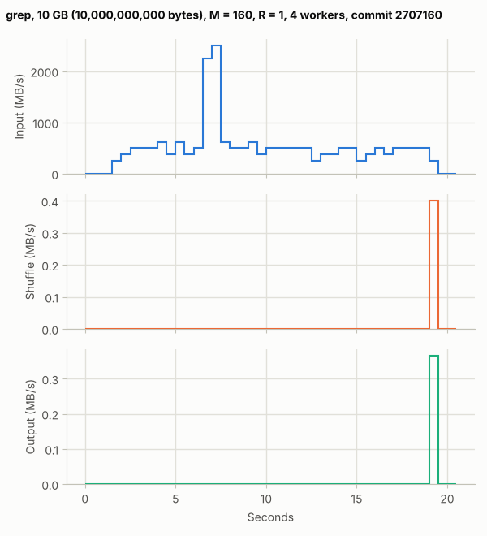
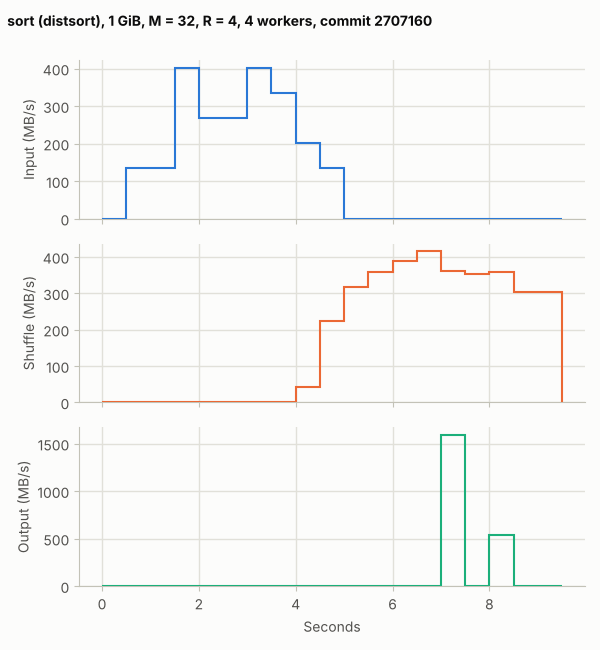
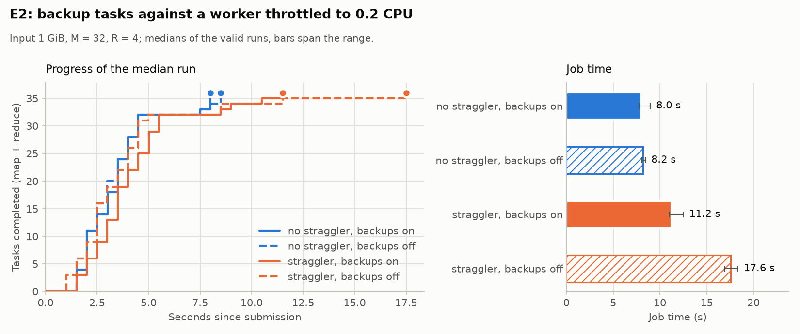

# Evaluation against the paper

Each of the paper's measurements in §5, run again on the course VM and
compared with the paper's figure (#58). The cluster has 4 workers to the
paper's 1,764, and the inputs are a hundred to a thousand times smaller, so
the comparison is of shapes, not numbers: what rises when, what a feature costs or saves, and
where scale changes the answer.

The machine for every run: the course VM, 4 vCPUs (Intel Xeon Silver
4516Y+), 8 GB of memory, one disk, Docker 29.8.1, with four workers of one
CPU each under Compose ([cluster VM](cluster-vm.md)). The paper's cluster
had about 1,800 machines, each with two 2 GHz Xeons, 4 GB of memory and two
160 GB IDE disks, on gigabit Ethernet (§5.1).

| §  | Paper | Here | Data |
|---|---|---|---|
| 5.2 Grep | 1 TB, M = 15,000, R = 1: 150 s | 10 GB, M = 160, R = 1: 18.3 s | [`paper/grep`](../bench/evaluation/paper/grep) |
| 5.3 Sort | 1 TB, M = 15,000, R = 4,000: 891 s | 1 GiB, M = 32, R = 4: 7.8 s | [`paper/sort`](../bench/evaluation/paper/sort), E0 |
| 5.4 No backup tasks | +44% (1,283 s) | +56% with a straggler (not drift-controlled); no statistically significant cost without one | E2 |
| 5.5 Machine failures | 200 of 1,746 killed: +5% (933 s) | 1 of 4 killed: +79% to +232% | E3 |

The grep and sort rows ran with `bench/run.sh` at commit `2707160`; their
directories hold the samples, the rates, the counters and the machine. E0,
E2 and E3 are the course evaluation in
[bench/README.md](../bench/README.md#evaluation-e0e6), each the median of
three runs.

## Grep (§5.2)



```sh
SIZE=10000000000 M=160 R=1 bench/run.sh grep
```

The job scans 10^8 records of 100 bytes for the pattern `XYZ`, which 923 of
them contain, in 160 map tasks of 62.5 MB and one reduce task. It took
18.3 s; three map tasks were backed up near the end, and all three backups
won.

- **The shape matches Figure 2.** The input rate rises as the workers are
  assigned tasks, holds a plateau, and drops as the last tasks finish. The
  shuffle and output are a few kilobytes at the very end, as in the paper,
  where grep's output is too small to plot.
- **Startup is 1.5 s, not a minute.** The paper's job spent about a minute
  starting: copying the program to every worker, and opening 1,000 input
  files on GFS and getting their locations for the locality optimization.
  Here the program is already in the worker image, the input is on a shared
  local disk, and four workers register in milliseconds. The first input is
  counted at 1.5 s because a map task's bytes are counted when it ends.
- **The rate is per worker, not per cluster.** The paper peaked above
  30 GB/s with 1,764 workers, about 17 MB/s each, which is what one 2004 IDE
  disk read. Here four workers share one disk at about 500 MB/s, 125 MB/s
  each. One disk shared by all the workers is the limit, as GFS's many
  disks were not.
- **One second runs five times faster.** Between 6.5 s and 7.5 s each worker
  finished about ten tasks, 2.4 GB in all. The likeliest cause is that those
  splits were still in the page cache from when the input was written: the
  file is 10 GB and the VM has 8 GB of memory. The plateau around it is the
  disk's rate.

## Sort (§5.3)



```sh
SIZE=1073741824 M=32 R=4 bench/run.sh sort
```

The job sorts 10.7 million 100-byte records (1 GiB) with distsort, which
partitions by key range so the four output files together are in order. It
took 7.8 s.

- **The phases overlap as in Figure 3(a).** The input rate peaks while the
  map tasks run, the shuffle starts as soon as the first map tasks finish,
  before the last input is read, and the output is written last. In the
  paper the shuffle has two humps, because 4,000 reduce tasks ran in two
  waves on 1,700 machines; here four reduce tasks run in one wave, so it
  has one.
- **The input rate is lower than the shuffle's.** The map tasks read and
  sort at about 300 MB/s, and the shuffle peaks at 415 MB/s. In the paper
  the input peaked at 13 GB/s, above the shuffle and output rates, because
  the locality optimization read most input from local disks while the
  shuffle crossed the network. Here both use the same disk, and the map
  tasks also sort and write their output.
- **The output comes in two bursts** of whole reduce tasks, because a
  reduce task's output is counted when it commits.
- **The shuffle outlives the job.** It adds up to 1.71 GB against 1.08 GB
  of map output, and runs about a second past the last output. The job
  started 6 backup attempts and none won. With as many reduce tasks as
  workers, the reduce phase is "close to completion" (§3.6) from the
  moment the first reduce task ends: that worker has nothing else to do,
  so it backs up another, and the backup fetches the whole partition
  again. The workers' logs show the losing backups stopped within 0.3 s of
  the job's end; one had finished, and its commit failed because the
  job's temporary directory was already gone. In the paper, with 4,000
  reduce tasks, backups were a few percent of the work; here they are most
  of a second copy of the reduce phase, though E2 finds no statistically
  significant slowdown (below).

The sort's scaling over 1, 2 and 4 workers is E0: 36.7 s, 20.4 s and
12.5 s, 2.9× on four workers, limited by the one shared disk.

## Backup tasks (§5.4)



The paper turned backup tasks off for the same sort and it took 1,283 s
instead of 891 s, 44% longer: the last 5 reduce tasks straggled and took
300 s to finish (Figure 3(b)). Nothing slowed them on purpose; at 1,800
machines some are always slow.

Four identical workers on one VM do not straggle on their own, so E2 makes
one worker slow, at 0.2 CPU, and measures the job with and without backups,
and with no straggler:

| Setting | Job time (s) |
|---|---|
| straggler, backups on | 11.24 |
| straggler, backups off | 17.58 (+56%) |
| no straggler, backups on | 8.03 |
| no straggler, backups off | 8.20 |

The straggler rows are medians of three runs; the others, of ten pairs of
runs taken in turn ([bench/README.md](../bench/README.md#e2-backup-tasks-and-a-straggler)).
The chart uses these same measurements: the no-straggler rows from
`bench/evaluation/E2-pairs/` and the straggler rows from `bench/evaluation/E2/`.
The saved `straggler-backups` trials ran as one block, followed by the
`straggler-no-backups` block, so the +56% estimate is not drift-controlled.
The current harness alternates settings, but that order does not apply to
these saved straggler rows.

- **The observed saving is similar.** Without backups the job waits for the
  slow worker's last tasks and takes 56% longer, close to the paper's 44%,
  subject to the run-order limitation above.
- **With no straggler, no statistically significant cost was found.** Backups still run,
  5 or 6 a job, and none win: with as many reduce tasks as workers, a
  worker that finishes its reduce task has nothing left to do, so it backs
  up another. Over ten pairs the mean difference is -0.11 s, with a 95%
  interval of -0.38 to +0.16 s, allowing a mean cost of up to 0.16 s.
  The backups use workers that would otherwise idle.
- **The cause differs.** The paper's straggling came from machine variation
  at scale (bad disks, contention, a bug that disabled processor caches;
  §3.6). Here it is injected, because a small cluster of identical
  containers has none to speak of.

## Machine failures (§5.5)


The paper killed 200 of 1,746 workers a few minutes into the sort. The
cluster restarted them, the lost map work ran again, and the job took
933 s, 5% longer (Figure 3(c)). E3 kills 1 of 4 workers, and does not
restart it:

| Worker killed at | Job time (s) | Cost |
|---|---|---:|
| no failure | 11.62 | |
| 2.9 s (25%) | 20.78 | +79% |
| 5.8 s (50%) | 23.50 | +102% |
| 8.7 s (75%) | 38.56 | +232% |

The baseline trials ran first, followed by the 25%, 50%, and 75% worker-kill
trials in that fixed order, with three runs per setting. These comparisons
are not drift-controlled.

- **Every job finished and its output checksum matched the first normal run.**
  This checks agreement with that run; it does not independently verify
  correctness, sorted order, or preservation of every input record. The
  coordinator notices the loss, runs the lost tasks again on the others,
  and the reduce tasks fetch the new map output (§3.3).
- **The cost is much larger, for two reasons of scale.** First, one of four
  workers is a quarter of the cluster, against 11% for the paper, and it is
  not restarted, so the rest of the job runs on three. Second, the
  coordinator declares a worker dead after 10 s of missed heartbeats, which
  is most of a 12 s job; the paper's timeout was small next to 891 s.
- **Killed late, it costs most.** At 75% the worker has finished most of its
  map tasks, and their output is on its disk, so they all run again before
  the reduce phase can finish.

## What scale changes

- **Fixed costs dominate a small job.** The paper's startup, about a
  minute, was large even in its 150 s grep, and the paper expected it to
  shrink in proportion on longer jobs; ours is 1.5 s of an 18 s grep, but
  the heartbeats and the worker timeout are seconds too. The
  worker timeout is the same story for failures.
- **Shared hardware replaces the network as the limit.** The paper's
  bottleneck was the network and many local disks; four containers on one
  VM share one disk, which limits grep and sort here.
- **Stragglers need scale, or a push.** Backups matter at 1,800 machines
  because some machine is always slow; four identical containers need a
  slow one made on purpose to show the same effect.
- **The mechanisms behave as the paper says.** Overlapping phases, backups
  that cut a straggler's tail, and lost tasks run again with output matching
  the first normal run all appear at this scale too.
