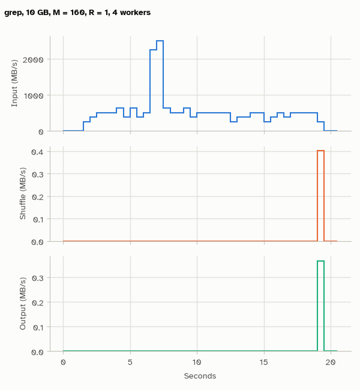
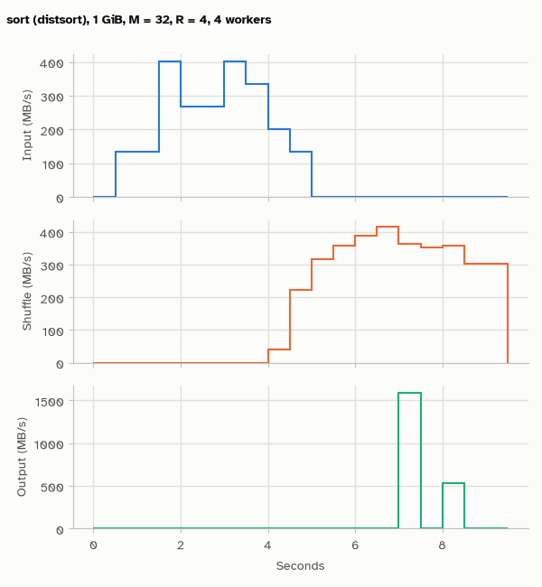
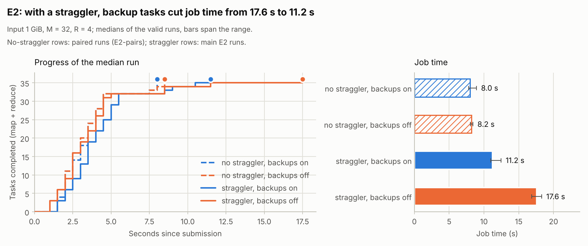
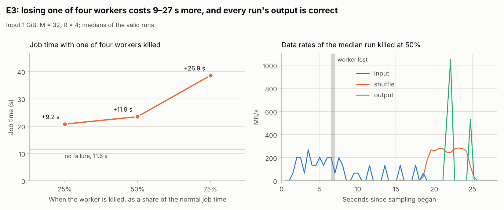
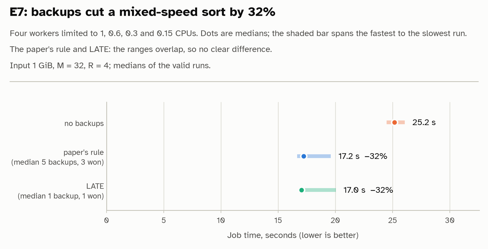

# Evaluation against the paper

Each of the paper's measurements in §5, run again on the course VM and
compared with the paper's figure (#58). The cluster has 4 workers to the
paper's 1,764, and the inputs are a hundred to a thousand times smaller, so
the comparison is of shapes, not numbers: what rises when, what a feature costs or saves, and
where scale changes the answer.

The machine for every run: the course VM, 4 vCPUs (Intel Xeon Silver
4516Y+), 8 GB of memory, one disk, Docker 29.8.1, with four workers of one
CPU each under Compose ([cluster VM](cluster-vm.md)). The paper's cluster
had about 1,800 machines, each with two 2 GHz Xeons, 4 GB of memory and two
160 GB IDE disks, on gigabit Ethernet (§5.1).

| §  | Paper | Here | Data |
|---|---|---|---|
| 5.2 Grep | 1 TB, M = 15,000, R = 1: 150 s | 10 GB, M = 160, R = 1: 18.3 s (one run, 28 Oct, archived) | [`archive/paper-2707160/grep`](../bench/evaluation/archive/paper-2707160/grep) |
| 5.3 Sort | 1 TB, M = 15,000, R = 4,000: 891 s | 1 GiB, M = 32, R = 4: 8.1 s (E0, four workers); 7.8 s in the archived run | E0, [`archive/paper-2707160/sort`](../bench/evaluation/archive/paper-2707160/sort) |
| 5.4 No backup tasks | +44% (1,283 s) | +58% with a straggler; no statistically significant cost without one | E2 |
| 5.5 Machine failures | 200 of 1,746 killed: +5% (933 s) | 1 of 4 killed: +101% to +333% | E3 |

The grep row, the sort row's 7.8 s and the two rates plots below are from
older single runs, on 28 October 2026 with `bench/run.sh` at commit
`2707160`, archived in
[`bench/evaluation/archive/paper-2707160/`](../bench/evaluation/archive/paper-2707160/); those directories hold
the samples, the rates, the counters and the machine. They were not rerun
at `8f0ddb9`; no newer run records rate samples for grep over 10 GB or for
a single sort. The sort row's 8.1 s is the rerun's E0. E0 to E7 are the course evaluation in
[bench/README.md](../bench/README.md#evaluation-e0e7), all with the system at
commit `8f0ddb9` except E0, rerun at `3a907de` (below), each the median of
five runs (E2-pairs is ten alternating pairs).

Provenance of the machine. The E-series directories each hold a
`machine.json`, written by `bench/experiments.sh`. The grep and sort
directories predate it. They record the machine inside `result.json`, which
`bench/run.sh` writes: CPU count and model, memory, kernel and Docker
version, which match the VM table in [cluster VM](cluster-vm.md#the-vm).
That block does not say which host it was. That these two runs were on the
course VM comes from the context of the runs, not from a record. No
`machine.json` was added for them afterwards.

E6 repeats §4.3's combiner measurement on real text at 1 GiB. On crawled
English the combiner cut the bytes shuffled 5.2× and the job time 11%; on
crawled pages in every language, 3.2× and 8%; on the book, 33× and 24%.
The book's fixed 41,631-word vocabulary is a best case, so the earlier
book-only result overstated what real text saves.

## Grep (§5.2)

This section's plot and numbers are from one archived run of 28 October
2026, at commit `2707160`, not the rerun at `8f0ddb9` (above).

<picture>
  <source media="(prefers-color-scheme: dark)" srcset="../bench/evaluation/archive/paper-2707160/grep/rates-dark.png">
  
</picture>

```sh
SIZE=10000000000 M=160 R=1 bench/run.sh grep
```

The job scans 10^8 records of 100 bytes for the pattern `XYZ`, which 923 of
them contain, in 160 map tasks of 62.5 MB and one reduce task. It took
18.3 s; three map tasks were backed up near the end, and all three backups
won.

- **The shape matches Figure 2.** The input rate rises as the workers are
  assigned tasks, holds a plateau, and drops as the last tasks finish. The
  shuffle and output are a few kilobytes at the very end, as in the paper,
  where grep's output is too small to plot.
- **Startup is 1.5 s, not a minute.** The paper's job spent about a minute
  starting: copying the program to every worker, and opening 1,000 input
  files on GFS and getting their locations for the locality optimization.
  Here the program is already in the worker image, the input is on a shared
  local disk, and four workers register in milliseconds. The first input is
  counted at 1.5 s because a map task's bytes are counted when it ends.
- **The rate is per worker, not per cluster.** The paper peaked above
  30 GB/s with 1,764 workers, about 17 MB/s each, which is what one 2004 IDE
  disk read. Here four workers share one disk at about 500 MB/s, 125 MB/s
  each. One disk shared by all the workers is the limit, as GFS's many
  disks were not.
- **One second runs five times faster.** Between 6.5 s and 7.5 s each worker
  finished about ten tasks, 2.4 GB in all. The likeliest cause is that those
  splits were still in the page cache from when the input was written: the
  file is 10 GB and the VM has 8 GB of memory. The plateau around it is the
  disk's rate.

## Sort (§5.3)

This section's plot and numbers are from one archived run of 28 October
2026, at commit `2707160`, not the rerun at `8f0ddb9` (above).

<picture>
  <source media="(prefers-color-scheme: dark)" srcset="../bench/evaluation/archive/paper-2707160/sort/rates-dark.png">
  
</picture>

```sh
SIZE=1073741824 M=32 R=4 bench/run.sh sort
```

The job sorts 10.7 million 100-byte records (1 GiB) with distsort, which
partitions by key range so the four output files together are in order. It
took 7.8 s.

- **The phases overlap as in Figure 3(a).** The input rate peaks while the
  map tasks run, the shuffle starts as soon as the first map tasks finish,
  before the last input is read, and the output is written last. In the
  paper the shuffle has two humps, because 4,000 reduce tasks ran in two
  waves on 1,700 machines; here four reduce tasks run in one wave, so it
  has one.
- **The input rate is lower than the shuffle's.** The map tasks read and
  sort at about 300 MB/s, and the shuffle peaks at 415 MB/s. In the paper
  the input peaked at 13 GB/s, above the shuffle and output rates, because
  the locality optimization read most input from local disks while the
  shuffle crossed the network. Here both use the same disk, and the map
  tasks also sort and write their output.
- **The output comes in two bursts** of whole reduce tasks, because a
  reduce task's output is counted when it commits.
- **The shuffle outlives the job.** It adds up to 1.71 GB against 1.08 GB
  of map output, and runs about a second past the last output. The job
  started 6 backup attempts and none won. With as many reduce tasks as
  workers, the reduce phase is "close to completion" (§3.6) from the
  moment the first reduce task ends: that worker has nothing else to do,
  so it backs up another, and the backup fetches the whole partition
  again. The workers' logs show the losing backups stopped within 0.3 s of
  the job's end; one had finished, and its commit failed because the
  job's temporary directory was already gone. In the paper, with 4,000
  reduce tasks, backups were a few percent of the work; here they are most
  of a second copy of the reduce phase, though E2 finds no statistically
  significant slowdown (below).

The sort's scaling over 1, 2 and 4 workers is E0: 25.0 s, 13.4 s and
8.1 s, 3.1× on four workers. Each worker's 768 MiB memory limit makes sort
on fewer workers re-read its intermediate files from disk, but that costs
about 3% of its 1-worker time at most (#347).

## Backup tasks (§5.4)

<picture>
  <source media="(prefers-color-scheme: dark)" srcset="../bench/evaluation/E2-comparison-dark.png">
  
</picture>

The paper turned backup tasks off for the same sort and it took 1,283 s
instead of 891 s, 44% longer: the last 5 reduce tasks straggled and took
300 s to finish (Figure 3(b)). Nothing slowed them on purpose; at 1,800
machines some are always slow.

Four identical workers on one VM do not straggle on their own, so E2 makes
one worker slow, at 0.2 CPU, and measures the job with and without backups,
and with no straggler:

| Setting | Job time (s) |
|---|---|
| straggler, backups on | 11.36 |
| straggler, backups off | 17.90 (+58%) |
| no straggler, backups on | 7.67 |
| no straggler, backups off | 7.90 |

The straggler rows are medians of five runs; the others, of ten pairs of
runs taken in turn ([bench/README.md](../bench/README.md#e2-backup-tasks-and-a-straggler)).
The chart uses these same measurements: the no-straggler rows from
`bench/evaluation/E2-pairs/` and the straggler rows from
`bench/evaluation/E2/`,
which is why it differs from `E2.png` (that one draws only the main E2 runs,
where no-straggler with backups on is 7.8 s). The image says so in its
subtitle, and `bench/plot-experiments.py` redraws it from both directories.
Both took their settings in turn within each repeat.

- **The observed saving is similar.** Without backups the job waits for the
  slow worker's last tasks and takes 58% longer, close to the paper's 44%.
- **With no straggler, no statistically significant cost was found.** Backups still run,
  4 to 6 a job, and none win: with as many reduce tasks as workers, a
  worker that finishes its reduce task has nothing left to do, so it backs
  up another. Over ten pairs the mean difference is −0.14 s, with a 95%
  interval of −0.36 to +0.08 s (paired t, p = 0.19; Wilcoxon signed-rank,
  p = 0.23), allowing a mean cost of up to 0.08 s.
  The backups use workers that would otherwise idle.
- **The cause differs.** The paper's straggling came from machine variation
  at scale (bad disks, contention, a bug that disabled processor caches;
  §3.6). Here it is injected, because a small cluster of identical
  containers has none to speak of.

## Machine failures (§5.5)

<picture>
  <source media="(prefers-color-scheme: dark)" srcset="../bench/evaluation/E3-dark.png">
  
</picture>

The rates panel's "worker lost" band is on the sampling clock and the kill
times are on the submission clock; the saved data does not record the offset
between them, so the band's position is approximate against the kill times.

The paper killed 200 of 1,746 workers a few minutes into the sort. The
cluster restarted them, the lost map work ran again, and the job took
933 s, 5% longer (Figure 3(c)). E3 kills 1 of 4 workers, and does not
restart it:

| Worker killed at | Job time (s) | Cost |
|---|---|---:|
| no failure | 7.86 | |
| 1.8 s (25%) | 15.78 | +101% |
| 3.6 s (50%) | 20.70 | +164% |
| 5.4 s (75%) | 34.05 | +333% |

Each is the median of five runs, timed from submission; the settings took
turns within each repeat, and the kill times are 25, 50 and 75% of three
calibration runs' median.

- **Every job finished and its output checksum matched the first normal run.**
  This checks agreement with that run; it does not independently verify
  correctness, sorted order, or preservation of every input record. The
  coordinator notices the loss, runs the lost tasks again on the others,
  and the reduce tasks fetch the new map output (§3.3).
- **The cost is much larger, for two reasons of scale.** First, one of four
  workers is a quarter of the cluster, against 11% for the paper, and it is
  not restarted, so the rest of the job runs on three. Second, the
  coordinator declares a worker dead after 10 s of missed heartbeats,
  longer than the whole 7.9 s job; the paper's timeout was small next to
  891 s.
- **Killed late, it costs most.** At 75% the worker has finished most of its
  map tasks, and their output is on its disk, so they all run again before
  the reduce phase can finish.

## Paper vs LATE on mixed-speed workers (#59)

<picture>
  <source media="(prefers-color-scheme: dark)" srcset="../bench/evaluation/E7-dark.png">
  
</picture>

E2 makes one worker slow. [ADR 0019](design/0019-late-speculation.md) adds
LATE, which picks the task to back up by its estimated time left and keeps
backups off slow workers, and it is meant for workers of different speeds.
E7 compares the paper's rule, LATE and no backups with all four workers
throttled to 1, 0.6, 0.3 and 0.15 CPUs, on the same 1 GiB sort:

| Setting | Job time (s) | Backups run | Backups won |
|---|---|---:|---:|
| no backups | 25.16 (24.48–26.07) | 0 | 0 |
| the paper's rule | 17.23 (16.65–19.60) | 4–5 | 1–3 |
| LATE | 17.04 (16.98–20.04) | 1–2 | 1 |

- **Backups cut the job by 32% with either rule.** On mixed speeds the
  slowest worker's tasks hold up the job, as the straggler does in E2, and
  a backup on a faster worker finishes them.
- **This does not show LATE faster.** The two rules' ranges overlap. LATE
  reaches the same time with fewer backups, a median of 1 against 5,
  because it backs up only the task with the most time left, where the
  paper's rule backs up the oldest attempts once nothing is idle.
- **A small cluster only.** With four workers LATE allows one backup at a
  time, so this says nothing about LATE on a large cluster.

[bench/README.md](../bench/README.md#e7-the-papers-backups-against-late-on-mixed-speed-workers-59)
has the settings, the output files and the knobs.

## The E0–E7 reruns (#344, #343)

The results above were run again at **one commit**, `8f0ddb9`, recorded in
every `machine.json`, with this protocol, fixed before any data was taken.
The one exception is the replacement E0 below, whose `machine.json`
records `3a907de`.

- **Repeats.** Five runs per setting (ten pairs for E2-pairs), on the
  course VM with the other course containers stopped.
- **Order.** Every experiment's settings take turns within each repeat,
  reversed on even repeats (#348), except E5's three, which rotate so each
  runs first in turn. E1 and E6 take turns within each input:
  combiner on and off alternate on one skew or corpus before the next
  begins, so only on-against-off comparisons are drift-controlled; their
  comparisons across inputs are of bytes, which drift does not change. E0 first runs each program once as
  `warmup`; E3 and E4 first run three `calibrate` runs, whose median sets
  the kill and restart times. The figures leave `warmup` and `calibrate`
  out.
- **E4's log.** Every E4 run starts on a fresh write-ahead log, so a
  restart replays its own job only. Its cost, 1.2 s, replaces the 1.6 s
  published before; it is not compared with it.
- **Chunks and gates.** Each experiment runs as a chunk. The next one
  starts only once every setting has its runs, every run `SUCCEEDED` with
  `valid=1`, `machine.json` names the commit with a clean tree, the workers
  are back at one CPU and 6 GB of disk is free; the chunk is then
  archived. Inputs are generated from fixed seeds, deleted after the last
  chunk that reads them, and their SHA-256 recorded after every chunk, so
  a regenerated input is shown to be the same.
- **Order of chunks.** E0, E1, E5, E2, E2-pairs, E3, E4, E7, E6.
- **Reporting.** Each figure and table is recomputed from the new
  `runs.csv`. A finding whose ranges now overlap is reworded as no clear
  difference. E7 was run for the first time.

The data, the archives and the harness logs are in
[`bench/evaluation/`](../bench/evaluation/), which holds only this rerun;
older runs are in its labeled `archive/`.
Two things were found after the data was taken, and are not part of the
protocol above:

- **E0 was run again with each input isolated.** In the first E0, all
  three programs' inputs, about 3 GiB, shared the VM's 8 GB of page cache,
  so sort often read its own 1 GiB input from disk: 1.2 GB per 4-worker
  run, against almost none in E2–E4, and 9.39 s against their 7.8–8.0 s.
  E0 now drops the other programs' inputs from the page cache and reads
  the running program's own before each run (`E0_ISOLATE=1`, the default,
  using `bench/drop-cache.py`). Rerun that way at `3a907de`, which adds
  only that to `8f0ddb9`, 4-worker sort took 8.06 s, in line with E2–E4.
  The first E0 is kept, marked superseded (#347).
- **Each worker's memory limit is a second cause of sort's reads.** The
  isolated E0's sort still reads from disk, more on fewer workers: a median
  of 142 MiB per run on 4 workers, 687 MiB on 2 and 952 MiB on 1. Each
  worker container has its own 768 MiB limit, so on fewer workers sort's
  intermediate files outgrow its page cache and are read back. Raising the
  1-worker limit to 2 GiB cut the reads to 81 MiB but the job only from
  25.5 s to 24.8 s, so memory accounts for about 3% of sort's 1-worker
  time at most, and its speed-up is mostly the CPUs. The isolated rerun's
  pass check was set before it ran but after this was found: every
  4-worker sort run under 300 MiB, which it met (at most 188 MiB). The
  check set before that, every sort run under 500 MiB, fails on the 1- and
  2-worker runs for this reason.
- **E1's word count also read from disk in some runs,** up to 1.4 GB
  machine-wide, with the combiner on and off, more often off. The time it saves is
  far larger than the spread this adds, so E1, unlike E0, was not rerun with
  its input isolated.

## What scale changes

- **Fixed costs dominate a small job.** The paper's startup, about a
  minute, was large even in its 150 s grep, and the paper expected it to
  shrink in proportion on longer jobs; ours is 1.5 s of an 18 s grep, but
  the heartbeats and the worker timeout are seconds too. The
  worker timeout is the same story for failures.
- **Shared hardware replaces the network as the limit.** The paper's
  bottleneck was the network and many local disks; four containers on one
  VM share one disk, which limits grep and sort here.
- **Stragglers need scale, or a push.** Backups matter at 1,800 machines
  because some machine is always slow; four identical containers need a
  slow one made on purpose to show the same effect.
- **The mechanisms behave as the paper says.** Overlapping phases, backups
  that cut a straggler's tail, and lost tasks run again with output matching
  the first normal run all appear at this scale too.
