# Final report

MapReduce-Reloaded, Honors Project 1, solo. This page is the end-to-end
summary; each section links to the page that has the detail.

## Abstract

This repository rebuilds the system in Dean and Ghemawat's *MapReduce:
Simplified Data Processing on Large Clusters* (OSDI 2004) [1] and runs it on
one VM with 4 vCPUs and 8 GB ([cluster VM](cluster-vm.md)): a coordinator and four worker containers,
each limited to one CPU, under Docker Compose. Go implements the
coordinator, the workers and the `mr` client; Python implements the same
API, file format, partition hash and local mode as a reference, and also
provides a coordinator server, and for
the same uncompressed job both produce the same bytes. All 24 of the
paper's features (F1–F24) are built and each is named with the test that
proves it. The paper's §5 experiments (grep, sort, backups, failures) were reproduced
on the VM, alongside further experiments E0, E1, and E4–E7.
The mechanisms behave as the paper says: phases overlap, backups cut a
straggler's tail (17.9 s without them, 11.4 s with), and a job survives a
lost worker or a restarted coordinator with the same output. What changes
at four workers is the size of fixed costs: startup, heartbeats and the
10 s failure timeout are a large share of an 8-second job.

## Architecture

A client on the host (`mr`) submits a job: the input paths, an output
path, M, R, and a Go source file with the map and reduce functions. The
coordinator splits the input into M map tasks and hands tasks to workers
that ask for them. A map task reads its split, runs the job's map
function (interpreted from the job file by Yaegi [3], or compiled in for the
built-in programs), combines, sorts, and writes one MRKV file per reduce
task to the worker's own disk. A reduce task fetches its partition from
every map worker over gRPC [4], merges, groups, reduces, and commits
`part-r-NNNNN` atomically to shared storage: a host directory mounted at
`/data`, or S3-compatible object storage. The coordinator logs each
decision before it replies, so a restarted coordinator replays the log
and the job continues.

- [Design](../design.md): the assignment's design questions, one job from
  submission to completion, and sequence diagrams for scheduling, the
  shuffle, failure recovery and the commit.
- [Design records](README.md#design-records): 24 ADRs, one per
  decision.
- [Explainers](README.md#explainers): one page per component.

## Feature parity

| Area | Paper features | State |
| --- | --- | --- |
| Programming model, combiner, ordering, formats, partitioning, local mode, side outputs, counters, example programs | F1, F14–F18, F20, F22, F23 | Go and Python |
| Splitting, master and tasks, shuffle, output files, atomic commit, task granularity | F2–F7, F10, F12 | Go; Python for splitting, partitioning and commit in local mode |
| Worker failure, master recovery, backup tasks, bad records | F8, F9, F13, F19 | Go |
| Locality, status pages | F11, F21 | Go |
| Performance experiments | F24 | [Evaluation](evaluation.md) |

[Paper mapping](paper-mapping.md) names the code and the tests for each
feature; `internal/papermap` fails the build if a named file or test does
not exist.

Beyond the paper: S3-compatible storage (#41), zstd [6] and Snappy [7]
compression of intermediate files (#42), job files interpreted by the
workers (ADR 0015), a write-ahead log in place of checkpoints (ADR 0007),
Prometheus [8] metrics, JSON logs and a Grafana dashboard (ADR 0012).

## Differences from 2004

The full table, with the reason and the record for each, is in
[design.md](../design.md#differences-from-the-2004-paper). The ones that
change behavior:

- **Go, with Python as a second implementation,** replace C++. The
  argument, the evidence and the costs are in [language
  choice](language-choice.md).
- **gRPC [4] and Protocol Buffers [5]** replace Google's RPC, so Go and Python share one
  contract.
- **A bind-mounted directory or S3** replaces GFS. An S3 commit is a copy
  and a delete, not a rename ([ADR 0013](design/0013-commit-on-object-storage.md)).
- **A write-ahead log** replaces periodic checkpoints, so a coordinator
  restart no longer aborts the job.
- **Workers send heartbeats**; the coordinator never connects to a worker.
- **Backups start when no task of the phase is idle**, because the paper
  gives no threshold.
- **A job is a source file**, interpreted by each worker, because the
  workers are static binaries and the assignment's client submits a file.
- **Four one-CPU containers** replace about 1,800 machines.

## Evaluation

| Experiment | Result |
| --- | --- |
| E0: scaling | 3.7× on four workers for word count, 3.1× for sort, 2.0× for grep |
| E1: combiner | 15× to 78× fewer bytes shuffled, 16–42% faster |
| §5.4 and E2: backup tasks | With one worker at 0.2 CPU, 11.4 s with backups and 17.9 s without (+58%; the paper saw +44%). With no straggler, no significant cost over ten interleaved pairs |
| §5.5 and E3: losing a worker | Every job finished, and its output checksum matched a normal run's; +101% to +333%, because one of four workers is a quarter of the cluster and the 10 s timeout is longer than the 7.9 s job |
| E4: coordinator restart | 1.2 s, every finished task kept |
| E5: interpreted job file | 2.3× slower than compiled with the compiled helpers, 10.2× without |
| E6: combiner on real text | 5.2× fewer bytes shuffled and 11% faster on crawled English [10], 3.2× and 8% in every language, 33× and 24% on the book [9] (a best case) |
| E7: paper's backups against LATE [2] | On four workers of mixed speeds, either rule cuts a sort by 32%; LATE uses fewer backups (1 against 5), and the two times overlap |
| §5.2 Grep, 10 GB (archived run) | 18.3 s, one run at commit `2707160` on 28 October; the input rate rises, plateaus near one disk's rate, and falls, as in the paper's Figure 2 [1] (Figure 10 here) |
| §5.3 Sort, 1 GiB (archived run) | 7.8 s, one run at commit `2707160` on 28 October (8.1 s in E0); map, shuffle and output overlap as in the paper's Figure 3(a) [1] (Figure 11 here) |

[Evaluation](evaluation.md) compares each run with the paper's figure;
[bench/README.md](../bench/README.md#evaluation-e0e7) has the plots, the
tables and the commands, and `bench/evaluation/` has the data. The two
archived rows are older single runs, kept in `bench/evaluation/archive/`;
every other row is the rerun at `8f0ddb9` (E0 at `3a907de`). Besides the
generated inputs, the experiments and examples use four real datasets
([data](data.md#sources-and-terms)): *War and Peace* [9], Common Crawl
WET files [10], NASA's July 1995 web log [11] and Google's web graph [12].

### Figures

Each figure is drawn from the data in `bench/evaluation/`, at the commits
above, and has a dark-theme version that GitHub shows in a dark color
scheme. Blue is the system as it ships or undisturbed, orange the changed
or disturbed setting. Each figure's table, raw CSVs and commands are in
[bench/README.md](../bench/README.md#evaluation-e0e7).

<picture>
  <source media="(prefers-color-scheme: dark)" srcset="../bench/evaluation/E0-dark.png">
  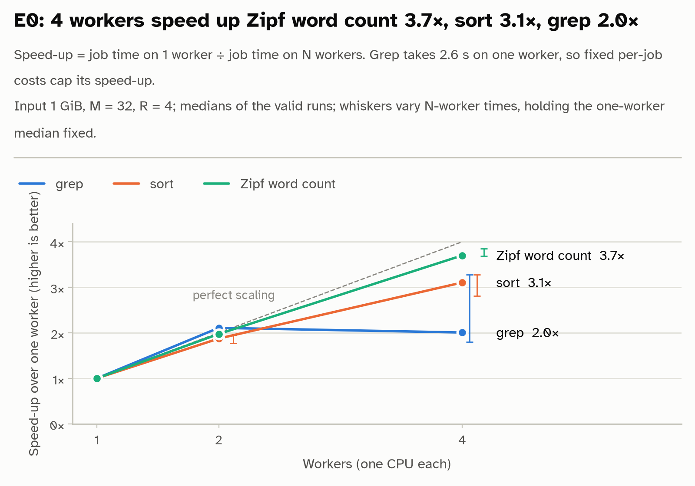
</picture>

*Figure 1. E0, scaling over workers. Word count runs 3.7× faster on four workers than on one, distributed sort 3.1×, grep 2.0×: a 2.6 s grep is mostly fixed costs.*

<picture>
  <source media="(prefers-color-scheme: dark)" srcset="../bench/evaluation/E1-dark.png">
  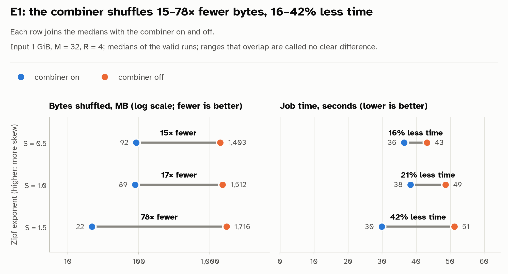
</picture>

*Figure 2. E1, the combiner on Zipf-distributed words. Each row joins the combiner-on and combiner-off medians; it shuffles 15× to 78× fewer bytes and takes 16–42% less time, more as the keys get more skewed.*

<picture>
  <source media="(prefers-color-scheme: dark)" srcset="../bench/evaluation/E2-dark.png">
  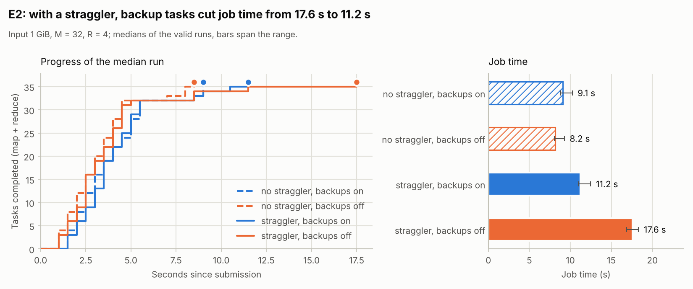
</picture>

*Figure 3. E2, backup tasks (the paper's §5.4). With one worker limited to 0.2 CPU, backups cut the job from 17.9 s to 11.4 s; with no straggler they cost nothing measurable.*

<picture>
  <source media="(prefers-color-scheme: dark)" srcset="../bench/evaluation/E3-dark.png">
  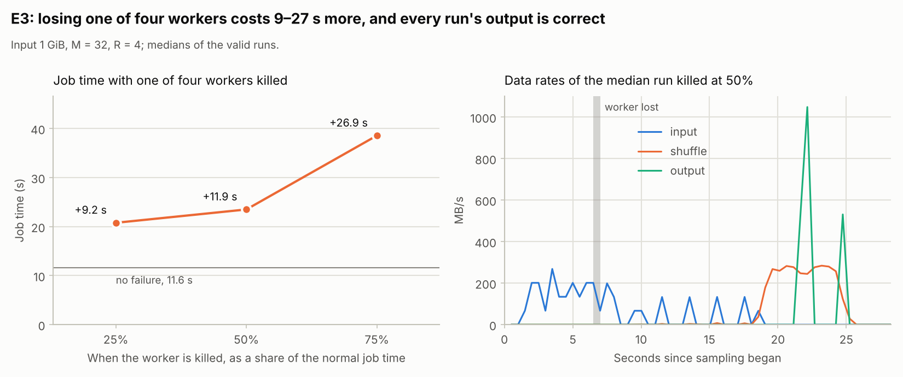
</picture>

*Figure 4. E3, losing a worker (the paper's §5.5). Every job finished with the undisturbed run's output, 8 s to 26 s later: one worker is a quarter of the cluster, and the 10 s failure timeout is longer than the 7.9 s job.*

<picture>
  <source media="(prefers-color-scheme: dark)" srcset="../bench/evaluation/E4-dark.png">
  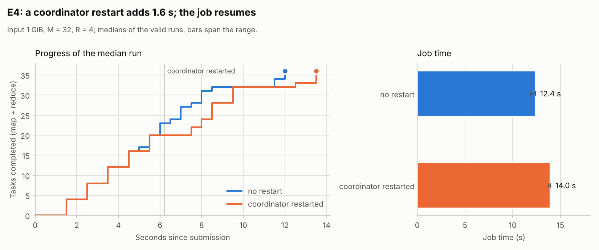
</picture>

*Figure 5. E4, a coordinator restart. Replaying the write-ahead log costs 1.2 s (15%), and every finished task is kept.*

<picture>
  <source media="(prefers-color-scheme: dark)" srcset="../bench/evaluation/faults-dark.png">
  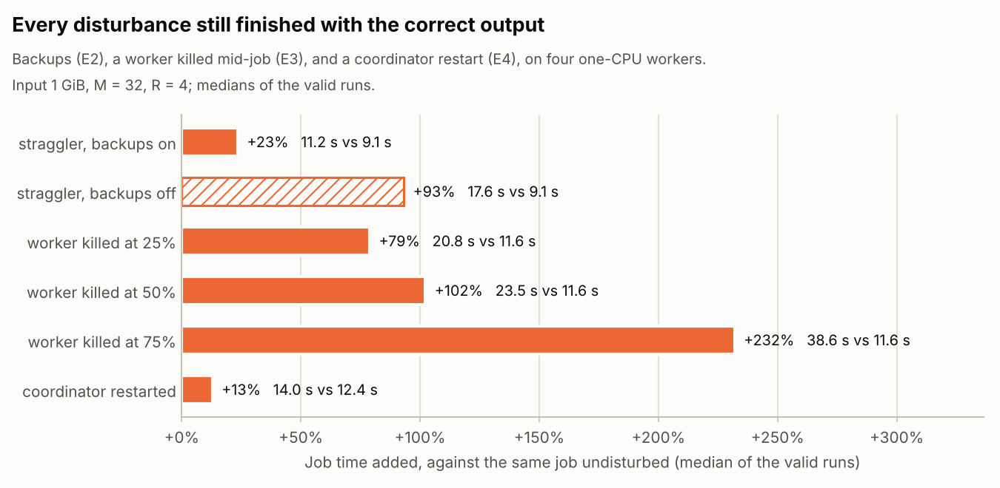
</picture>

*Figure 6. E2 to E4 together: the job time each fault adds. Every run's output matched an undisturbed run's.*

<picture>
  <source media="(prefers-color-scheme: dark)" srcset="../bench/evaluation/E5-dark.png">
  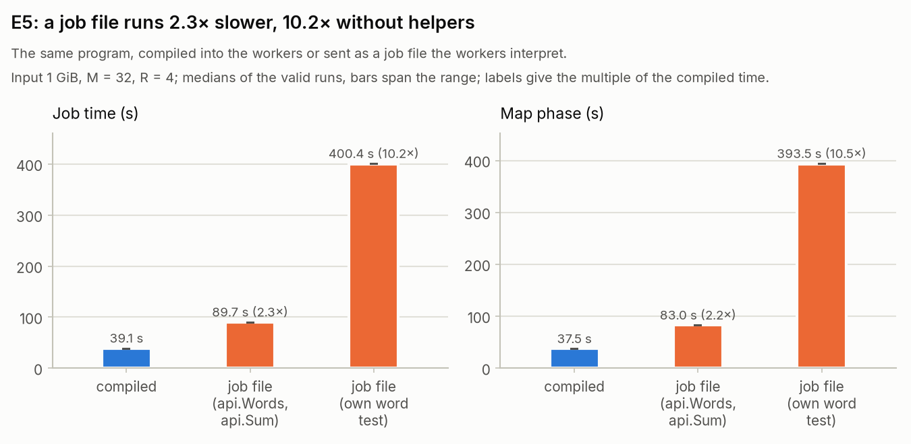
</picture>

*Figure 7. E5, an interpreted job file. Word count as a job file is 2.3× slower than compiled when it uses the helpers `api.Words` and `api.Sum`, and 10.2× without them.*

<picture>
  <source media="(prefers-color-scheme: dark)" srcset="../bench/evaluation/E6-dark.png">
  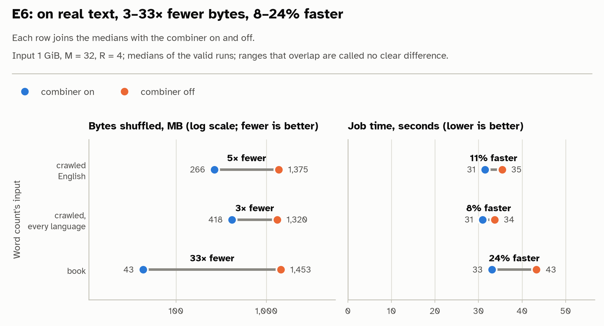
</picture>

*Figure 8. E6, the combiner on real text: 5.2× fewer bytes and 11% less time on crawled English [10], 3.2× and 8% in every language, 33× and 24% on *War and Peace* [9], a best case.*

<picture>
  <source media="(prefers-color-scheme: dark)" srcset="../bench/evaluation/E7-dark.png">
  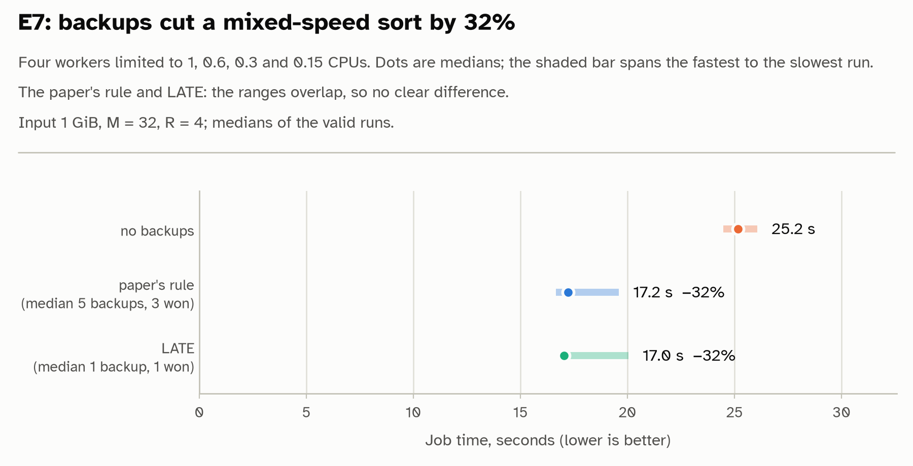
</picture>

*Figure 9. E7, the paper's backup rule against LATE [2] on four workers of mixed speeds. Either rule cuts the sort by 32% (25.2 s to about 17 s); LATE starts fewer backups (1 against 5), and the two times overlap.*

<picture>
  <source media="(prefers-color-scheme: dark)" srcset="../bench/evaluation/archive/paper-2707160/grep/rates-dark.png">
  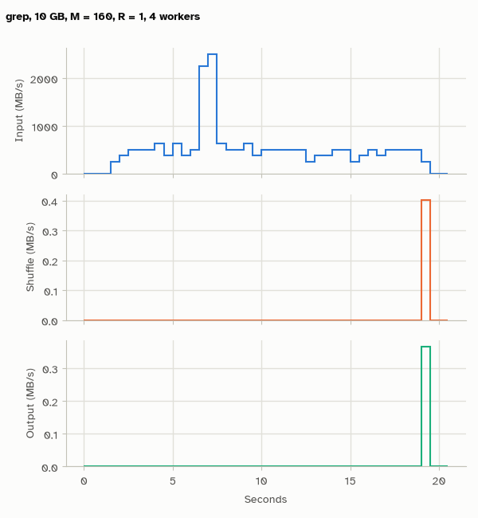
</picture>

*Figure 10. Grep over 10 GB (the paper's §5.2), one archived run: the input rate rises, plateaus near one disk's rate and falls, as in the paper's Figure 2 [1].*

<picture>
  <source media="(prefers-color-scheme: dark)" srcset="../bench/evaluation/archive/paper-2707160/sort/rates-dark.png">
  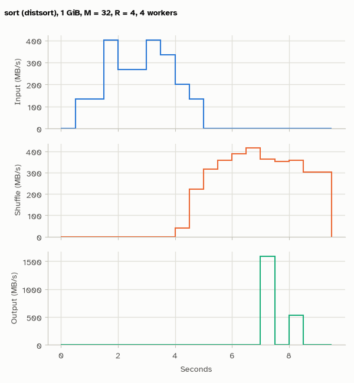
</picture>

*Figure 11. Sort of 1 GiB (the paper's §5.3), one archived run: map, shuffle and output overlap, as in the paper's Figure 3(a) [1].*

## How it is tested

[Testing](testing.md) lists every kind of test and how to run it. In
short: unit tests in both languages, golden vectors shared by Go and
Python for the file format, the hash and the messages, in-process cluster
tests, a seeded chaos test that kills workers and restarts the
coordinator, fuzzing of the decoders, a model-based test of the
coordinator's RPCs, coverage floors per package (Go 83–99% outside `tools/mutate`, Python 99%),
and mutation testing of the core packages. `make check` runs the fast set
locally, and CircleCI runs the six required checks on each pull request's
final commit before it merges.

## The demo

About six minutes, following the [demo script](demo.md). The
[notebook](../examples/demo.ipynb) runs the same steps in about two minutes,
with the story of each step written before its code. It checks each claim
with an `assert` and ends with a scorecard of the claims that held; a fault
step switched off is listed as not tested. It draws the word counts and the
combiner's saving as it runs, and shows the evaluation figures above as
earlier measurements. The steps:

1. Show the four workers limited to one CPU each and the status page.
2. Submit `examples/wordcount.go`, a job file the workers interpret, with
   `mr submit`, then again with `-combiner=false`: the same output, 2.6×
   more bytes shuffled.
3. Read the output and show it is byte for byte the local oracle's.
4. Sort 1 GiB and kill a worker in the middle: the job succeeds, and the
   coordinator's log says how many tasks ran again.
5. Sort again and restart the coordinator in the middle: the job resumes
   from the write-ahead log and writes the same output as step 4.
6. Show the fault-tolerance summary and the evaluation figures.

## Process and review

The assignment grades the engineering process as well as the code. Solo,
an AI agent plays the teammate, as the assignment allows
([design.md](../design.md#process)).

| Practice | How it is enforced | Evidence |
| --- | --- | --- |
| Never push to `main` | Branch protection on `main`: a pull request is required, the branch must be up to date, and the CircleCI checks must pass | Rule verified on 2026-10-29 (#267, #269) |
| CI runs tests on pull requests | Six CircleCI checks are required to merge: `proto`, `go`, `python-3.11`, `python-3.13`, `lint` and `mapping-coverage`. Each runs its tests when the pull request touches its inputs; otherwise it passes after a skip note (ADR 0020). Running CI once, on each PR's final head, is the project's policy (AGENTS.md), not something CircleCI enforces. `make check` runs the protobuf, lint, Go and Python checks locally and in the pre-push hook, on one Python version and without the mapping-selection check | [CI](ci.md), [ADR 0014](design/0014-ci-on-pull-requests.md), [ADR 0020](design/0020-implicated-only-ci.md) |
| Many small pull requests | One concern each, from the templates in `.github/`, each with its changelog entry | 223 merged pull requests by 16 November 2026; [changelog](../CHANGELOG.md) |
| Feedback sought | CodeRabbit and CodeAnt review every pull request I open, with inline comments; each thread gets a fix or a reason before merging | Resolved CodeRabbit thread on #264, CodeAnt thread on #263 |
| Feedback given | I review pull requests written by an AI agent and comment on them | Comments on the agent-written #185 and #219, each closed with the reason it was superseded (#213, #216, #217). A review with inline comments before an agent-written PR merges is still open in #269 |

Several real bugs were found in review rather than by the tests; the
"Coverage is not test strength" lesson below came from the same habit of
checking claims instead of trusting them.

## Lessons learned

- **Measure in pairs, in turn.** The first E2 comparison suggested
  backups cost 11% with no straggler. It was three runs per setting, with
  overlapping times. Ten interleaved pairs found no significant
  difference. Experiments that compare settings now alternate them within
  each repeat.
- **Scale changes which costs matter.** The paper's minute of startup and
  its failure timeout were small next to 891 s. Here they are most of the
  job, so a feature can work exactly as designed and still look costly.
- **With R equal to the workers, every job is "near completion".** The
  first reduce task to finish frees a worker with nothing else to do, so
  backups run in every job. They use idle workers and cost nothing
  measurable, but they shuffle the data again.
- **A shared contract needs shared vectors.** Go and Python agree byte for
  byte because both test against the same golden files, not because they
  were written to the same prose.
- **Coverage is not test strength.** Mutation testing found tests that
  ran code without checking its result, in packages at 90% coverage or
  more.
- **Small pull requests.** 223 merged pull requests by 16 November 2026,
  each reviewed by an AI agent and tested in CI before merging
  ([Process and review](#process-and-review)); several real bugs were found
  in review, not by tests.

## Future work

Kept open as `[stretch]` issues:

- **Python parity (#35, #37–#39):** a Python worker, Python
  map and reduce functions on Go workers, and a test matrix over every
  Go/Python combination.
- **Modern extensions (#43–#55):** an external shuffle service,
  coordinator high availability, LATE-style speculation (built as an
  opt-in coordinator mode [2], [ADR 0019](design/0019-late-speculation.md), and
  measured by E7 against the paper's rule: no clear difference in time,
  fewer backups), skew handling, memory-aware spilling, tracing, mTLS,
  Kubernetes, Parquet and JSON Lines, a job service, job DAGs, incremental execution and WebAssembly
  user functions.
- **Their evaluation (#59)** against this baseline.

## References

1. Jeffrey Dean and Sanjay Ghemawat. "MapReduce: Simplified Data
   Processing on Large Clusters." *6th Symposium on Operating Systems
   Design and Implementation (OSDI '04)*, USENIX, 2004, pp. 137–150.
   <https://research.google.com/archive/mapreduce-osdi04.pdf>
2. Matei Zaharia, Andy Konwinski, Anthony D. Joseph, Randy Katz and Ion
   Stoica. "Improving MapReduce Performance in Heterogeneous
   Environments." *8th USENIX Symposium on Operating Systems Design and
   Implementation (OSDI '08)*, 2008. The LATE scheduler that
   [ADR 0019](design/0019-late-speculation.md) builds and E7 measures.
3. Traefik Labs. *Yaegi: Yet Another Elegant Go Interpreter.*
   <https://github.com/traefik/yaegi>. Interprets job files in the workers
   ([ADR 0015](design/0015-user-job-files.md)).
4. *gRPC: A high performance, open source universal RPC framework.*
   <https://grpc.io/>
5. *Protocol Buffers.* Google. <https://protobuf.dev/>. The contract in
   `proto/` that Go and Python share.
6. Yann Collet and Murray Kucherawy. *Zstandard Compression and the
   'application/zstd' Media Type.* RFC 8878, IETF, February 2021.
   <https://www.rfc-editor.org/rfc/rfc8878>
7. *Snappy, a fast compressor/decompressor.* Google.
   <https://github.com/google/snappy>
8. *Prometheus: monitoring system and time series database.*
   <https://prometheus.io/>
9. Leo Tolstoy. *War and Peace.* Project Gutenberg eBook #2600.
   <https://www.gutenberg.org/ebooks/2600>. E6's best case, and the
   `make bench SCENARIO=book` input.
10. Common Crawl. Crawl CC-MAIN-2024-10, WET files, February 2024.
    <https://commoncrawl.org/>. E6's crawled pages (ten pinned files) and the
    `termvector` example's input (one), under the
    [Common Crawl terms of use](https://commoncrawl.org/terms-of-use).
11. *NASA-HTTP: two months of HTTP requests to the NASA Kennedy Space
    Center web server,* July and August 1995. The Internet Traffic Archive.
    <https://ita.ee.lbl.gov/html/contrib/NASA-HTTP.html>. The `urlfreq`
    example's real input.
12. Jure Leskovec and Andrej Krevl. *web-Google: Google web graph.*
    Stanford Large Network Dataset Collection (SNAP).
    <https://snap.stanford.edu/data/web-Google.html>. The `reverselinks`
    example's real input.
